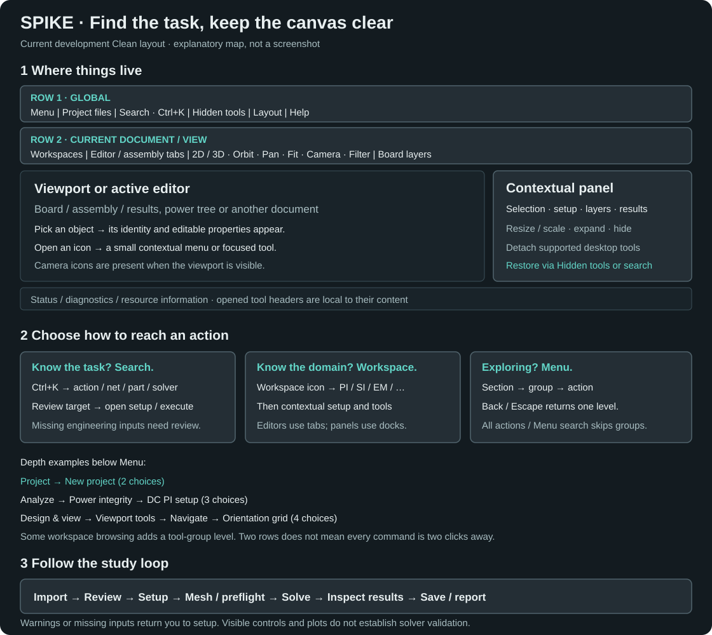
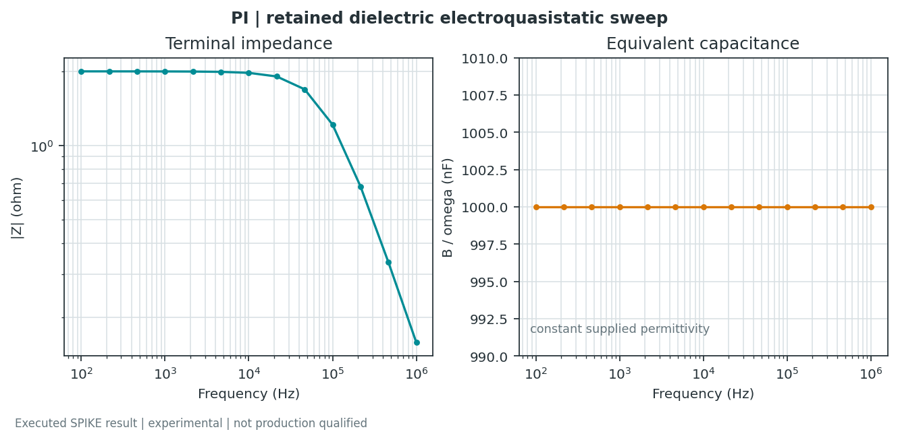
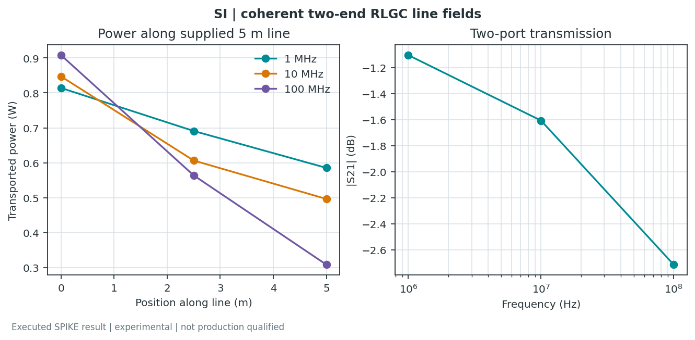
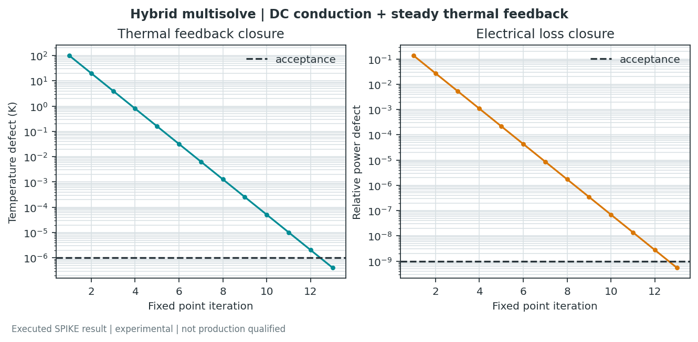
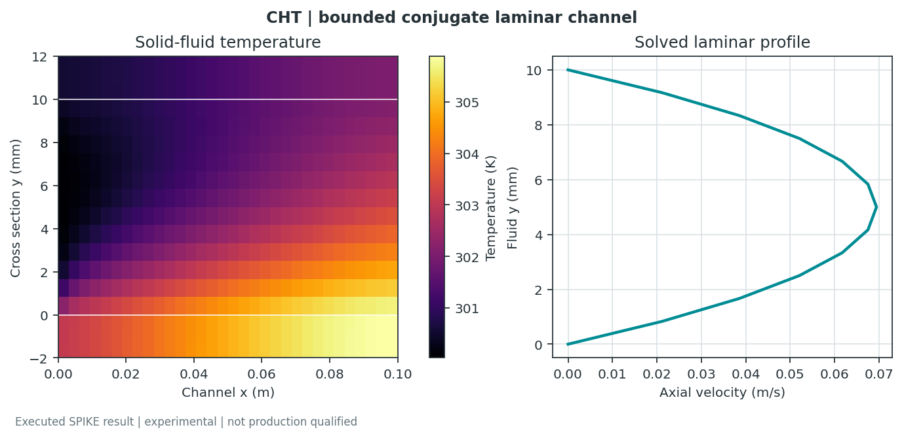

<p align="center">
  
</p>

# SPIKE - Multiphysics Simulation Workbench

<p align="center"><strong>PCB-focused multiphysics, from board to complete assembly.</strong></p>

<p align="center">
  <a href="https://github.com/wayri/SPIKE/releases/tag/v0.4.0-alpha.1"></a>
  <a href="https://github.com/wayri/SPIKE/actions/runs/39572252308"></a>
  <a href="https://discord.gg/UCmeR9ypzQ"></a>
  <a href="LICENSE"></a>
</p>

SPIKE is an open-source, local-first workbench for power integrity (PI), signal
integrity (SI), circuits, thermal and airflow, selected EM/RF, and bounded
mechanical workflows. It keeps PCB, assembly, material, study, and result
evidence together for supported 2D and 3D workflows.

> [!WARNING]
> **0.4.0-alpha.1 is an experimental development preview. Knowledgeable human
> numerical and firmware review remains pending.** It is not a stable,
> qualified, safety-assured, or production engineering release. Publication
> does not qualify any method, model, package, or result. Read the
> [release notes](docs/releases/v0.4.0-alpha.1.md) and
> [solver evidence](docs/SOLVER_STATUS.md) before relying on an analysis.

## Contents

| Start here | Explore | Reference | Participate |
| --- | --- | --- | --- |
| [Download 0.4.0-alpha.1](#download-040-alpha1) | [Interface](#current-ui-and-navigation) | [Capabilities](#pcb-analysis-capabilities) | [Report an issue](https://github.com/wayri/SPIKE/issues) |
| [First workflow](#start-a-study) | [Analysis gallery](#analysis-gallery) | [Solver modules](#solver-modules-and-the-solver-suite) | [Contribute](CONTRIBUTING.md) |
| [ESP32 walkthrough](docs/ESP32_QUICKSTART.md) | [Examples](examples/README.md) | [CLI and documentation](#cli-and-documentation) | [Discord](https://discord.gg/UCmeR9ypzQ) |
| [Release notes](docs/releases/v0.4.0-alpha.1.md) | [Headroom and limits](#part-limits-and-operating-headroom) | [Extensions](#extensions) | [License](#license) |

## Download 0.4.0-alpha.1

Release candidate `4f550c0f` passed the four-platform CI run
[`39572252308`](https://github.com/wayri/SPIKE/actions/runs/39572252308).
Choose the asset for your platform and verify its adjacent SHA-256 file. Asset
availability and CI success are packaging evidence; neither establishes
numerical qualification or supported-platform acceptance.

| Platform | Experimental package | SHA-256 |
| --- | --- | --- |
| Windows x64 | [**Download EXE**](https://github.com/wayri/SPIKE/releases/download/v0.4.0-alpha.1/SPIKE_0.4.0-alpha.1_x64-setup.exe) | [checksum](https://github.com/wayri/SPIKE/releases/download/v0.4.0-alpha.1/SPIKE_0.4.0-alpha.1_x64-setup.exe.sha256) |
| Linux x86_64 | [**Download Flatpak**](https://github.com/wayri/SPIKE/releases/download/v0.4.0-alpha.1/SPIKE_0.4.0-alpha.1_linux-x86_64_EXPERIMENTAL.flatpak) | [checksum](https://github.com/wayri/SPIKE/releases/download/v0.4.0-alpha.1/SPIKE_0.4.0-alpha.1_linux-x86_64_EXPERIMENTAL.flatpak.sha256) |
| macOS Apple silicon | [**Download DMG**](https://github.com/wayri/SPIKE/releases/download/v0.4.0-alpha.1/SPIKE_0.4.0-alpha.1_macos-arm64_EXPERIMENTAL.dmg) | [checksum](https://github.com/wayri/SPIKE/releases/download/v0.4.0-alpha.1/SPIKE_0.4.0-alpha.1_macos-arm64_EXPERIMENTAL.dmg.sha256) |
| macOS Intel | [**Download DMG**](https://github.com/wayri/SPIKE/releases/download/v0.4.0-alpha.1/SPIKE_0.4.0-alpha.1_macos-x86_64_EXPERIMENTAL.dmg) | [checksum](https://github.com/wayri/SPIKE/releases/download/v0.4.0-alpha.1/SPIKE_0.4.0-alpha.1_macos-x86_64_EXPERIMENTAL.dmg.sha256) |

See [platform installation and CLI commands](docs/PLATFORM_PACKAGES.md). Older
Windows Gamma and 0.3.5 Linux/macOS packages are historical artifacts and do
not contain this candidate source.

## Start a study

| Step | In SPIKE | Check before continuing |
| ---: | --- | --- |
| 1 | Import a board or open a `.spike` project. | Read the import diagnostics; omitted objects and substituted 3D models remain explicit. |
| 2 | Choose a workspace or press **Ctrl+K** for an action. | Select the intended physics and solver route. Similar plots may come from different models. |
| 3 | Define nets, ports, materials, sources, loads, boundaries, and returns. | A footprint, geometry import, or prepared case does not supply missing engineering assumptions. |
| 4 | Review model status, mesh, units, and prerequisites, then run. | External engines require separate compatible installations. A failed or incomplete result never becomes a pass. |
| 5 | Inspect residuals, conservation checks, warnings, probes, and limits. | Plot appearance alone is not validation. Compare against an independent reference for the intended use. |
| 6 | Save the project and export a report with provenance. | Keep inputs, engine/source versions, diagnostics, and limitations with shared results. |

Fast entry points: [five-minute ESP32 walkthrough](docs/ESP32_QUICKSTART.md) ·
[UI quick start](docs/UI_QUICKSTART.md) · [task sequences](docs/USER_TASK_SEQUENCES.md) ·
[runnable examples](examples/README.md)

## Current UI and navigation



Clean mode keeps a global header plus document and assembly tabs. Open a domain
from **Workspaces**, choose **Menu > All actions**, or press **Ctrl+K**. Selecting
an object opens its properties; **Show hidden tools** restores closed panels.
The six menu sections are **Project**, **Design & view**, **Analyze**, **Results
& reports**, **Tools**, and **Help**. The [visual navigation guide](docs/UI_NAVIGATION.md)
maps section ownership, menu depth, keyboard navigation, and the import -> setup
-> mesh -> solve -> results -> save loop.

| Actual development UI, 19 October 2026 | Actual command search, 19 October 2026 |
| --- | --- |
|  |  |
| Imported geometry and component stand-ins; no analysis was executed. | Search suggestions only; no command or analysis was executed. |

These are actual local **browser development UI captures**, not mockups, solver
results, native desktop acceptance captures, or packaged application evidence.
They use the public ESP32 board recorded in the
[capture manifest](app/public/help/ui-current/manifest.json). Graphite/Light
workspace appearance and Graphite/Light/AMOLED viewport appearance are separate
preferences.

The main field viewport can display supplied cells, points, velocity arrows,
temperature and other scalar fields, connected supplied curves, and saved frame
playback. Sparse samples are not joined across unknown gaps. CFD previews without
cell dimensions remain point samples. Renderer-generated frozen-field paths are
approximate presentation, not transient particle paths. See
[field visualization](docs/FIELD_VISUALIZATION.md); the planned Blender adapter
is not implemented.

## Analysis gallery

The eight images below are **computed documentation plots from executed named
examples and postprocessors**. They are not UI screenshots, measurements, or
evidence that every model runs in every workspace. Follow the
[gallery audit and reproduction guide](docs/ANALYSIS_GALLERY.md) for inputs,
units, hashes, model status, and limitations.

| Area | Computed plot | Demonstrated boundary |
| --- | --- | --- |
| PI |  | Retained dielectric electroquasistatic admittance and power accounting; not a full-board DC map or full-wave solve. |
| SI |  | Supplied RLGC line response and coherent longitudinal quantities; no new geometry extraction or measured channel claim. |
| EM |  | Huygens postprocessing of synthetic boundary samples; not a newly executed Maxwell solve or absolute gain. |
| Thermal |  | Steady two-solid conduction with a matched contact; not package-calibrated board prediction. |
| Hybrid |  | Iterated DC loss and temperature feedback with explicit material law; not general simultaneous multiphysics. |
| CFD |  | Two-dimensional laminar lid-driven cavity reference; not enclosure airflow, turbulence, or CHT. |
| CHT |  | Bounded conjugate solid/fluid laminar channel; not a general enclosure solve. |
| Multiboard |  | Explicit reduced harness and thermal networks; not full spatial fields across all boards. |

## PCB analysis capabilities

| Area | Available workflow | Current limit |
| --- | --- | --- |
| Board and project | Import KiCad PCB data into `SpiDeR`; inspect 2D layers and assembled 3D; save versioned projects with study cases. | Some KiCad features or 3D models may be omitted or substituted. Review each import report. |
| Power integrity and circuits | Supported DC voltage-drop, harness, PEEC, PDN, power-tree, and circuit workflows with explicit sources, loads, returns, mesh, and limits. | Simplified conductor/return models apply. Converter behavior and pin mapping must be supplied. |
| Signal integrity | Loaded RLGC or Touchstone channels with explicit ports and terminations; S-parameters, reflection, TDR/TDT, eyes, and NEXT/FEXT where returned. | Port networks contain no spatial E/H fields. Nonlinear IBIS-AMI and protocol checks are not implemented in this route. |
| Thermal | Object-node, 2D board-plate, and layered steady/transient models; explicit powers, heat paths, and boundaries. | Cooling presets prescribe heat-transfer coefficients rather than solving airflow; board grids omit detailed package geometry and CHT. |
| Electromagnetics | EMerge antenna adapter plus separate openEMS and internal screening routes; display returned S-parameters, cuts, and sampled relative patterns. | The EMerge board export is a simplified two-layer, one-dielectric model. Normalized display radius/color is not absolute gain. |
| CFD and CHT | Experimental bounded native laminar references, retained-solid thermal routes, and separately admitted external adapters. | Isothermal airflow is not CHT. Reference cases do not qualify arbitrary enclosures, turbulence, or fan assemblies. |
| Hybrid and multiboard | Supported reduced electrothermal/scalar coupling and explicit board, connector, interconnect, and contact models. | Coupling is workflow-specific, not a general all-domain simultaneous solve. |
| Visualization and reports | 2D/3D result layers, returned-value probes, study comparison, and reports with units, settings, warnings, and status. | Only quantities returned by the selected analysis can be plotted or probed. |
| Automation | Local worker and CLI, extension/solver managers, and optional MCP bridge for supported project and study tools. | Local models need a separate runtime and a tool-capable model; MCP is limited to exposed SPIKE tools. |

### Part limits and operating headroom

[Part limits and stress](docs/PART_LIMITS.md) compares captured observations
against occurrence-specific declared voltage, current, temperature, power,
mechanical stress, and frequency allowances. It reports stress/headroom,
coverage, provenance, and pass/fail/incomplete states in JSON/CSV. Missing
evidence never becomes a pass. Temperature percentages require an explicit
reference such as ambient. These checks are declared-limit comparisons, not
automatic datasheet qualification, reliability, lifetime, fatigue, or combined
stress predictions.

### Circuit simulation choices

The circuit workspace has a built-in linear solver and separate
[ngspice](docs/SOLVER_STATUS.md) and SPIKES backend routes. Select an engine for
the supplied circuit model and check runtime availability. **SPIKES Studio is a
separate program and is not included in the SPIKE desktop release.** SPIKE uses
only its backend for supported structured runs. See the
[circuit workflow](docs/USER_TASK_SEQUENCES.md).

## Solver modules and the solver suite

Open **Solver manager** from **Ctrl+K** to inspect named modules, scope,
dependencies, runtime readiness, and the appropriate setup workflow.

| Module family | Named workflows | Scope |
| --- | --- | --- |
| PI | DC PI, 2.5D PI, PI Transient, 3D DC conduction, PDN and filters | Reduced networks, quasi-static PEEC, supported transients, bounded solid DC, and explicit circuits. |
| SI | Networks, channels, eye and protocol screens | Sampled networks, supported line/channel models, and deterministic screens. |
| Thermal and coupling | Board/solid thermal, assembly electrothermal, PWM electrothermal | Explicit heat models and mapped loss/temperature feedback. |
| CFD and CHT | 2D CFD, channel airflow, admitted external cooling/CHT adapters | Bounded native references and separately installed engines; isothermal CFD and CHT remain distinct. |
| EM and RF | 2D magnetic FEM, lumped EM machines, openEMS and EMerge adapters | Bounded magnetic models and supported external field workflows. |
| Circuits | Circuit MNA, adaptive transient, I/Q device models, SMPS stability | Supported structured routes; some authoring/execution lives in separate Studio or CLI tools. |
| Mechanics and MCAD | 3D structural, thermoelastic, geometry/FreeCAD adapters | Bounded static mechanics, same-mesh coupling, and geometry exchange. |
| Assemblies and execution | Harness/board adapters, scalar co-simulation, parallel workers | Explicit interconnect and coupling contracts; parallel jobs do not automatically couple physics. |

Implemented first-party code and adapters are bundled by default. Solver blocks
are logical dependency groups, not separately installable packages. Bulk
selection previews dependencies; it does not install, remove, or execute them.
Optional engines need their own compatible installation and admission. Bundled
code, runtime readiness, and numerical qualification remain separate states.

| Module guide | Purpose |
| --- | --- |
| [Solver suite](docs/SOLVER_SUITE.md) | Module families and workflow entry points |
| [Solver blocks](docs/SOLVER_BLOCKS.md) | Dependency groups and unresolved external engines |
| [Solver manager](docs/SOLVER_MANAGER.md) | Engine selection, registration, and readiness |
| [Solver status](docs/SOLVER_STATUS.md) | Authoritative implementation and validation status |
| [Extension SDK](extension_sdk/README.md) | Process isolation, permissions, result contracts, and examples |

## Extensions

<details>
<summary><strong>Extension catalog and boundaries</strong></summary>

| Extension | Capability | Dependency and limitation |
| --- | --- | --- |
| [openEMS Suite](extensions/openems_suite/README.md) | Explicit-port HF PI/SI preparation and execution; supported result import. | Separate openEMS/CSXCAD installation; one excited port per run; no DC PI or thermal coupling. |
| [EMerge Suite](extensions/emerge_suite/README.md) | Simplified selected-net S-parameters and relative radiation patterns. | Separate compatible runtime; selected copper, aligned ports, rectangular bounds, one dielectric, and surface PEC. |
| [ODB++ Import](docs/ODB_AND_HARNESS_EXTENSIONS.md) | Experimental board-job import with quality diagnostics. | Unsupported symbols, compositing, and panel repeats are reported; retain the source archive. |
| [Harness Engineering](docs/ODB_AND_HARNESS_EXTENSIONS.md) | JSON/CSV/TSV connection editing and assembly binding. | Does not import other harness database formats. |
| [MCAD Collaboration](docs/MCAD_EXPORT.md) | Preview and named STEP, FreeCAD, BREP, and metadata export. | Requires FreeCAD; geometry exchange only. |
| [PWM Converter Analysis](extensions/converter-analysis/spike-extension.json) | Readiness checks and versioned setup envelope. | No converter solve or efficiency/loss calculation. |
| [Net Inventory](extensions/net-inventory/spike-extension.json) | Example SDK net/conductor inventory. | No numerical analysis. |

External result format, source, unit, and bounds checks do not repeat an external
engine calculation. See the [extension analysis contract](docs/EXTENSION_ANALYSIS_API.md).

</details>

## CLI and documentation

```powershell
.\spike.cmd --help
.\spike.cmd --output-format text inspect board.kicad_pcb
.\spike.cmd --output result.json analyze-dc board.kicad_pcb `
  --net VCC `
  --source 10,10,F.Cu,5 `
  --load 50,20,F.Cu,1
```

| Need | Guide |
| --- | --- |
| Commands, saved requests, batches, and reports | [CLI reference](docs/CLI.md) |
| User workflows and tutorials | [Documentation index](docs/README.md) |
| Numerical implementation status and limits | [Solver status](docs/SOLVER_STATUS.md) |
| Mathematics, methods, and references | [Mathematics](docs/SOLVER_MATHEMATICS.md) · [handbook](docs/SOLVER_HANDBOOK.md) · [references](docs/SOLVER_REFERENCES.md) |
| LM Studio, Ollama, and MCP | [Local LLM and MCP](docs/LOCAL_LLM_MCP.md) |
| Build, architecture, and contribution | [Developer guide](docs/DEVELOPER_GUIDE.md) · [architecture](ARCHITECTURE.md) · [contributing](CONTRIBUTING.md) |

The product direction includes larger assemblies and coordinated cross-domain
studies. Coverage and execution scale depend on the selected workflow;
large-scale arbitrary-assembly simulation remains a development target, not a
blanket validated capability. See [product scope](docs/PRODUCT_SCOPE.md).

## Help improve SPIKE

Share reproducible comparisons, especially where SPIKE falls short. Include a
small publishable example, tool versions, settings, geometry, materials, ports,
boundary conditions, and the observed difference. Review reports before sharing
board data. [Open an issue](https://github.com/wayri/SPIKE/issues) or join the
[Discord community](https://discord.gg/UCmeR9ypzQ); the invite opens in the
read-only welcome channel.

<details>
<summary><strong>Disclaimer and development disclosure</strong></summary>

SPIKE is a work in progress and is provided **AS IS**, without warranty or
guarantee of any kind, including accuracy, reliability, or fitness for a
particular purpose. Use it at your own risk. To the extent permitted by
applicable law, and unless otherwise agreed in writing, Yawar B (wayri) and the
contributors are not liable for any damage, loss, or other consequences arising
from using or being unable to use SPIKE, including incorrect results, design
errors, equipment damage, data loss, or financial loss. You are responsible for
checking inputs, assumptions, and results before relying on them. This summarizes
the warranty and liability provisions in the [Apache License 2.0](LICENSE); the
license terms govern.

SPIKE's development effort is largely LLM-driven under human review. Human
direction and responsibility remain distinct from LLM-generated proposals,
code, tests, and documentation. Passing tests and generated reports are
engineering evidence, not independent physical validation. Read the
[LLM-driven development disclosure](docs/LLM_DEVELOPMENT.md). This early
community preview may contain instabilities, bugs, and incomplete behavior.

</details>

## License

Copyright 2026 Yawar B (wayri) and SPIKE contributors. SPIKE-owned code and
documentation are licensed under [Apache 2.0](LICENSE), except where a file or
directory specifies different terms. Dependencies, external engines, and
example boards retain their own licenses; see
[third-party notices](THIRD_PARTY_NOTICES.md).

<details>
<summary><strong>Acknowledgements</strong></summary>

- Large language models have produced substantial proposals, code, tests, and
  documentation under human direction and review. The
  [development disclosure](docs/LLM_DEVELOPMENT.md) records this contribution
  and its limits.
- The KiCad project and its contributors for the PCB ecosystem SPIKE works with.
- The Tauri, React, Three.js, Plotly.js, and Lucide projects behind the desktop
  interface and plots.
- NumPy, SciPy, Shapely/GEOS, PyVista, wxPython, nanobind, Matplotlib,
  mplcursors, ReportLab, Apache Arrow, jsonschema, and Eigen contributors.
- [ngspice](https://ngspice.sourceforge.io/) contributors for the optional
  circuit engine.
- [openEMS](https://openems.de/) and
  [CSXCAD](https://github.com/thliebig/CSXCAD) contributors for the optional EM
  solver and geometry tools.
- Robert Fennis and [EMerge](https://github.com/FennisRobert/EMerge)
  contributors for the optional EM solver used in the ESP32 antenna example.
- The [OpenFOAM](https://www.openfoam.com/) community for the optional airflow
  solver, and the [FreeCAD](https://www.freecad.org/) community for the optional
  mechanical CAD integration.
- Berkeley Lab and the Regents of the University of California for the Marble
  reference board, and uysan for the open `iot-esp-eth` ESP32 example board.
- Contributors, testers, issue reporters, and documentation authors.

If a credit is missing, open an issue or pull request. Source and license details
for included examples and integrations are in
[third-party notices](THIRD_PARTY_NOTICES.md).

</details>
