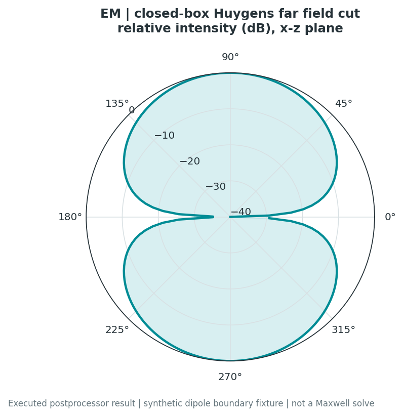
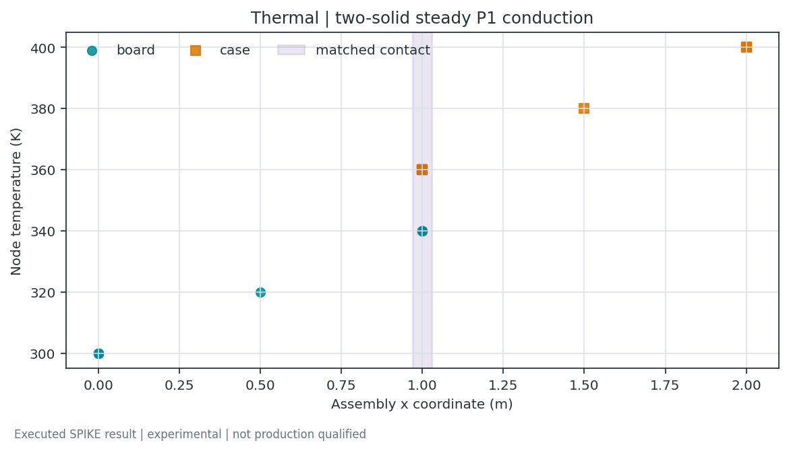
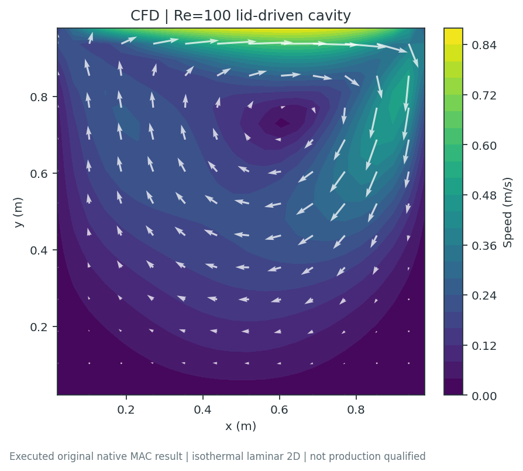
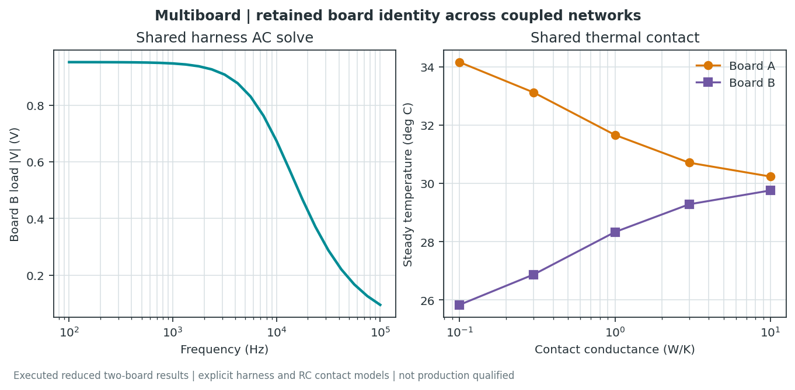

<!-- SPDX-License-Identifier: Apache-2.0 -->

# Analysis gallery: PI, SI, EM, Thermal and coupled assemblies

These eight figures are generated from executed SPIKE example models and named
postprocessors. They are **computed documentation plots**, not screenshots of
result editors, measurements, or evidence that every model can run in every
workspace. The [current UI guide](UI_QUICKSTART.md) contains actual browser UI
captures. Historical screenshots keep their original scope.

## Reproduce and audit

Follow the [gallery example README](../examples/analysis_gallery/README.md) to
install the development prerequisites and build the native airflow runtime if
needed. From the repository root:

```powershell
.\.venv\Scripts\python.exe scripts\generate_analysis_gallery.py
```

The generator writes eight figures, compact data records and a
[manifest](../examples/analysis_gallery/manifest.json). Each data record retains
requests or their digests, executed model/source hashes, runtime versions,
plotted series, units, diagnostics, model status and limitations. PNG copies
ship in offline Help. Read the script for exact sampling and transforms.
The [examples index](../examples/README.md) links the underlying workflows.
In offline Help, unbundled source scripts and raw data appear as repository paths;
use a source checkout for those artifacts and to regenerate the examples.

| Area | What the figure demonstrates | What to check before using a result |
| --- | --- | --- |
| PI | Retained dielectric complex admittance and power accounting | Port definition, dielectric law, reference identity, frequency range and power closure. |
| SI | Supplied RLGC line response and coherent longitudinal fields | Terminations, excitation phase, units, loss assumptions and power residual. |
| EM | Huygens transformation of supplied synthetic boundary samples | Closed surface, sample conventions and normalization; this is postprocessing. |
| Thermal | Two-solid steady conduction with an explicit matched contact | Heat sources, contact area, boundary temperatures, conductivity and heat balance. |
| Hybrid multi-solve | Iterated DC loss and steady temperature feedback | Material law, exchanged quantities, relaxation, stopping criteria and energy accounting. |
| CFD | Native two-dimensional laminar lid-driven cavity | Boundary conditions, Reynolds number, pressure/divergence residuals and mesh/time-step sensitivity. |
| CHT | Bounded conjugate solid/fluid laminar channel | Velocity-profile assumptions, inlet/boundaries, interface heat transfer and energy closure. |
| Multiboard | Explicit circuit/harness and thermal network studies | Board instance/connector identity, returns, interconnect R/L and thermal contact assumptions. |

## PI: dielectric and PDN analysis


A retained dielectric P1 electroquasistatic sweep evaluates complex admittance
and associated power. Inspect axes and units before comparing frequency points.
This is a dielectric/PDN example, not a full-board DC-drop map or a full-wave
solve. Conductive DC source/load analysis is a separate model; the multiboard
example below includes a reduced DC network.

In the UI, find **PI** or **Run PI** through Workspaces or Ctrl+K, select the
actual net and source/load pads, supply voltage/current and the return, then
review the solver and mesh before running. For ICs with multiple pins, review
the explicit pad loading allocation; a component reference does not determine
current sharing. Read [PI path analysis](PI_PATH_ANALYSIS.md),
[dielectric examples](../examples/pdn_dielectric_thermal/) and the
[PI data record](../examples/analysis_gallery/data/pi.json).

## SI: network response and distributed line fields


The uniform RLGC example uses supplied per-length parameters and coherent
excitations at its ends. Returned longitudinal quantities and power accounting
belong to this line model. It does not extract a new board geometry or establish
measured channel performance. A Touchstone port response alone contains no
spatial E/H field.

Find **HF / SI** or the SI workflow through search, choose the intended network
or field route and explicitly map ports, reference impedances and terminations.
Inspect transmission/reflection, TDR/TDT, waveform/eye or crosstalk only when
returned by that route. See the [SI user guide](SI_USER_GUIDE.md),
[RLGC example](../examples/rlgc_line_fields/) and
[SI data record](../examples/analysis_gallery/data/si.json).

## EM: far-field transformation and field workflows



This figure executes the Huygens far-field postprocessor on a synthetic dipole
boundary fixture. **It is not a newly executed Maxwell field solve.** Its
normalized angular pattern demonstrates the transform and comparison for that
fixture; it must not be interpreted as absolute antenna gain or EMC compliance.

The **EM** workspace also exposes screening and separately admitted field-engine
routes. Screening is prioritization, not solved fields. openEMS/EMerge require
compatible external runtimes and supported geometry/ports. Inspect actual
returned field samples, power balance, mesh sensitivity and limitations. The
[ESP32 example](../examples/esp32/README.md) retains a separately executed,
simplified EMerge antenna result and historical viewport captures. See
[EM workflow](EMI_WORKFLOW.md), [Huygens input](../examples/em/huygens_dipole_request.json)
and [EM data record](../examples/analysis_gallery/data/em.json).

## Thermal: retained solid conduction



A steady P1 conduction solve uses two explicit solids and a matched contact.
Temperature and boundary heat accounting are computed for those geometry,
material and boundary assumptions. This is neither an object-marker overlay nor
a package-calibrated board temperature prediction.

Find **Thermal setup**, choose object nodes, board grid or retained solids
according to the desired model, and assign power/material/boundary ownership.
Inspect energy closure and spatial or transient refinement separately. Board
cooling coefficients prescribe heat transfer; they do not solve airflow. See
[thermal guide](THERMAL_USER_GUIDE.md), [assembly field examples](../examples/assembly_field/README.md)
and [thermal data record](../examples/analysis_gallery/data/thermal.json).

## Hybrid multi-solve: electrothermal feedback


The example iterates a DC conduction solve and steady thermal feedback using an
explicit temperature-dependent material law. Inspect coupling convergence along
with each domain's residual and conservation ledger. A small coupling update
alone does not certify the underlying physical model.

Independent job scheduling through **Parallel workers** is a separate facility:
running several analyses concurrently does not couple them. Supported
co-simulation requires declared handoff ownership, compatible units, time or
iteration schedules and stopping criteria. This figure does not demonstrate a
general simultaneous PI/SI/EM/thermal/flow solve. See
[co-simulation](COSIMULATION_DIGITAL_TWIN.md),
[electrothermal runner](../examples/assembly_field/run_electrothermal.py) and
[hybrid data record](../examples/analysis_gallery/data/hybrid-multisolve.json).

## CFD: native laminar cavity



The native MAC projection runtime executes an isothermal, two-dimensional
Reynolds-100 lid-driven cavity. The image shows returned velocity quantities for a bounded reference case;
convergence diagnostics are in the data record. It is not a board/enclosure airflow
field, a turbulence model or conjugate heat transfer. Compare residuals and
mass/divergence behavior as well as velocity appearance.

Search **CFD** or **Solver manager** to inspect the admitted route and runtime
requirements. General assembly preparation and external solver adapters have
separate execution gates; a prepared case is not a completed solve. See
[solver status](SOLVER_STATUS.md), [internal airflow example](../examples/assembly_field/run_internal_airflow.py)
and [CFD data record](../examples/analysis_gallery/data/cfd.json).

## CHT: bounded laminar channel


The solid/fluid finite-volume channel example solves fully developed plane-channel momentum and conjugate
solid/fluid energy from a supplied pressure gradient. This bounded CHT reference
retains its model status and interface/energy limitations; it is not a general
Navier–Stokes enclosure solve. Heat-transfer coefficient presets in ordinary
board thermal setup are another, simpler model.

The separate **SU2 conjugate heat transfer** adapter uses its own experimental
reference setup, external engine and gates. Do not transfer the channel result's
status to SU2 or arbitrary assemblies. See [SU2 CHT](SU2_CHT.md),
[channel request](../examples/thermal/laminar_channel_cht_request.json) and
[CHT data record](../examples/analysis_gallery/data/cht.json).

## Multiboard: connectivity before coupled results



A two-board explicit R/L harness and thermal RC contact illustrate connectivity,
DC/AC electrical response and temperatures in reduced networks. The curves come from supplied models, not automatic routing or imported geometry.
These are not full spatial SI/EM/thermal fields across all boards.

Import each board as a distinct instance, review placement, then map connector
pins and explicit returns. Assign interconnect electrical parameters and thermal
contacts before selecting analysis. Review each domain's outputs separately.
The [curated multiboard examples](../examples/multiboard/README.md) include larger
board-pair workflows; [harness SI](../examples/high_speed_si/harness/README.md)
is a separate model route. See the
[multiboard data record](../examples/analysis_gallery/data/multiboard.json).

## Save and share evidence

Keep inputs, result data, diagnostics, source/engine versions and material
provenance together. Save a `.spike` project with the desired results; an exported
image is not a restorable study. Use [result screenshots](RESULT_SCREENSHOTS.md)
and reports for visual communication, and preserve units and model status.
Knowledgeable human review and physical correlation remain separate from these
computed examples. [Solver status](SOLVER_STATUS.md),
[mathematics](SOLVER_MATHEMATICS.md) and [references](SOLVER_REFERENCES.md) govern
claims beyond the pictured fixtures.
