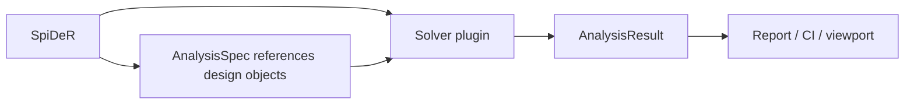

# Versioned Data Contracts

`spike/capacitive-network-transient-request/v1` and
`spike/capacitive-network-transient-result/v1` support mixed resistor/shunt-C
Thevenin boundaries around an executed rational fit. Require at least one C>0,
and R>0 on those ports. Source current and network current are separate outputs;
capacitor voltage/derivative, KCL residual, resistor loss and capacitor energy
preserve units/port identity. Registered schemas and runtime closure/stability/
resource admission have [explicit semantics and limits](CAPACITIVE_NETWORK_TRANSIENT.md).

`spike/inductive-network-transient-request/v1` and
`spike/inductive-network-transient-result/v1` add supplied nonnegative series R/L
boundaries around an executed rational fit, requiring at least one positive L.
Registered schemas preserve fit/source/boundaries and typed V/I/derivative/loss/
energy histories. Runtime additionally admits the complete port partition,
regular stable closure, state/resource/precision limits and waveform horizon.
See [semantics and reference derivation](INDUCTIVE_NETWORK_TRANSIENT.md).

Experimental structural request/result contracts use
`spike/assembly-tetra-structural-request/v1` and
`spike/assembly-tetra-structural-result/v1`; coupled thermal-to-elastic execution
uses `spike/assembly-thermomechanical-request/v1` and
`spike/assembly-thermomechanical-result/v1`. Schemas are registered in the catalog;
runtime admission additionally checks geometry, ownership, exact mesh identity,
material coverage, constraints, conditioning and limits. See
[semantics and unsupported effects](COUPLED_MECHANICS_MAGNETICS_DEVICES_PLAN.md).

Standalone Studio's `spikes/manufacturer-parts/v1` retains sourced identity and
model-readiness metadata. `spikes/wire-rlc/v1` binds explicit lumped extraction
values to a project/source hash and stable wire IDs; admission is atomic and
unsupported topologies fail closed. See [contracts and limits](SPIKES_SOURCED_PARTS_WORKBENCH.md)
and [ADR 0069](adr/0069-studio-sourced-parts-and-wire-models.md).

SPIKES ABI v1 adds the optional `spikes_transient_result_recovery_diagnostics`
getter without changing existing layouts. Adaptive project results distinguish
reporting samples from accepted integration samples and record controls in
provenance; nonfinite LTE ratios become null plus a finite flag. See
[adaptive API semantics](SPIKES_ADAPTIVE_SWITCHING_FOUNDATION.md) and
[ADR 0065](adr/0065-adaptive-native-transient-recovery.md).

Experimental scalar co-simulation and recorded twin comparison use
`spike/cosimulation-request/v1`, `spike/cosimulation-result/v1`,
`spike/digital-twin-request/v1` and `spike/digital-twin-result/v1`.
Their schemas are registered in `schemas/manifest.json`. Cross-field identity,
port/unit, time and resource admission stays in Python services. See
[API, semantics and limits](COSIMULATION_DIGITAL_TWIN.md).

The parallel pool accepts registered `spike/parallel-batch/v1` inline jobs and
returns ordered `spike/parallel-batch-result/v1` outcomes with SHA256 provenance.
`spike/cluster-wire/v1` wraps bounded strict mutual-TLS messages. Administrator
enrollment and private keys stay outside project packages. See
[worker manager limits and trust](PARALLEL_WORKER_MANAGER.md).

The additive `spike/parallel-workspace/v1` project field retains reviewed drafts,
original batch requests and complete hash-bound execution results. It contains
no enrollment or active process state. See [portable workspace contract](PARALLEL_WORKSPACE_CONTRACT.md)
and [schema](../schemas/parallel-workspace-v1.schema.json).

SPIKE transports plain JSON-compatible records between importers, projects,
the desktop, CLI, workers, solvers, reports, and future remote services. Python
dataclasses in `python/spike_core/contracts.py` are the active implementation;
JSON schemas in `schemas/` document the compatible wire envelope.

## Contract family

Headless orchestration uses `spike/headless-workflow/v1` and
`spike/headless-workflow-result/v1`. The [input schema](../schemas/headless-workflow-v1.schema.json)
describes 1..64 uniquely named sequential worker calls. A parameter object whose
only key is `$ref` resolves a prior complete worker response using
`stepName#/JSON/pointer`. Semantic admission rejects duplicate names, missing or
forward references, non-finite JSON and oversized documents. Results retain
individual worker envelopes; `ok: false` stops the sequence at `failed_step`.
Execution provides no rollback or engineering qualification. See
[headless automation](HEADLESS_AUTOMATION.md).

Local developer checks use `spikes/sourced-qualification-request/v1` and
`spikes/sourced-qualification-result/v1` with strict Python semantic admission.
The separate `spike/transient-resistive-electrothermal-request/v1` and result
bind resistor loss/temperature maps, complete loss ledgers and thermal RC state.
These do not authorize hardware PASS or replace production worker supervision;
see [scope](SOURCED_POWER_QUALIFICATION.md).

`spike/assembly-electrothermal-request/v1` binds retained volumes, thermal setup,
scalar DC laws, terminals, every retained bond and explicit averaged loss data.
`spike/assembly-electrothermal-result/v1` carries experimental coupled outputs,
conservation and fixed-point defects. `spike/electrical-heat-source/v1` and
`spike/electrical-heat-evaluation/v1` admit waveform, RMS spectral and bounded
semiconductor-table losses, including rectangular temperature/voltage/current
tables and stored-energy-aware multi-terminal heating. These produce averaged
losses, not arbitrary device dynamics. See [scope and worker methods](ASSEMBLY_ELECTROTHERMAL.md).

`spike/emerge-gerber-source/v1` retains original UTF-8 copper artwork,
dielectric gaps, declared bounds and explicit manual port planes. The native
EMerge importer returns `spike/design-snapshot/v1`; source content and digests
remain in design metadata while the current stackup controls executed material
values. See [native Gerber admission and workflow](EMERGE_GERBER.md) and
[ADR 0035](adr/0035-native-emerge-gerber-source.md).

Retained volume field studies add `spike/assembly-field-handoff-request/v1`,
`spike/assembly-field-handoff/v1`, `spike/assembly-field-thermal-problem/v1`,
`spike/assembly-field-thermal-result/v1`, and
`spike/assembly-field-study-file/v1`. A private bounded P1 kernel uses
`spike/assembly-tetra-thermal-request/v1` and corresponding result; geometric
view factors use `spike/assembly-view-factor-request/v1` and corresponding
result. See [field workflow](ASSEMBLY_FIELD_HANDOFF.md) and ADR 0035. The
public solver-mesh object map remains unchanged. Handoff and view factors
do not assert CAD extraction, Maxwell execution or coupled radiation solving.

`spike/emerge-runtime-update/v1` describes local EMerge 3+ update checks,
background operations, bounded status logs, and independent install,
dependency and adapter API outcomes. See
[EMerge runtime updates](EMERGE_RUNTIME_UPDATES.md) for the three worker
methods, version/channel rules and interruption recovery.

Coupled assembly studies add `spike/multiboard-circuit-request/v1`,
`spike/multiboard-thermal-request/v1`, and `spike/multiboard-em-request/v1`
with corresponding result contracts. These use explicit reduced properties and
retained occurrence identities. `spike/multiboard-study-file/v1` stores a domain,
physical assembly digest, setup and nullable results for direct loading.
See [coupled assembly contracts](MULTIBOARD_COUPLED_ANALYSIS.md) and ADR 0027.

All three currently use `contract: spike/v1`.

`DesignIR` naming remains a compatibility surface at the KiCad-Prism boundary;
SPIKE internals consume `SpiDeR` (SPIKE Design Reference).

Workflow-specific envelopes use separate contracts where their lifecycle is not
a normal solver request/result. The EMI family uses `spike/emi-setup/v1`,
`spike/emi-preflight/v1`, and `spike/emi-workflow/v1`; see
`docs/EMI_WORKFLOW.md` and `schemas/emi-setup-v1.schema.json`.

## SpiDeR

`SpiDeR` describes normalized source geometry and metadata. Coordinates and
linear dimensions use millimetres unless an entity contract explicitly states
otherwise. Electrical values use SI units. It includes:

- ordered layer table and physical stackup;
- nets and stable object identities;
- tracks, vias, pads, copper zones, components, and connectors;
- reviewed component-to-pad/copper contact records; see
  `docs/COMPONENT_BONDS.md`;
- rigid, flex, or rigid-flex regions and bend metadata;
- import issues and source/importer provenance.

Entity dictionaries are currently extensible and not yet fully discriminated.
New code should document required fields and avoid consuming source-only fields.
Future entity schemas will tighten this without changing units or identity
semantics inside `spike/v1`.

## AnalysisSpec

`AnalysisSpec` is the complete reproducible request. It identifies solver mode
and capability, nets, sources, loads, return paths, probes, frequency/transient
settings, mesh settings, limits, and explicit options. Coordinates in terminals
must be anchored to normalized geometry where possible; a bare coordinate is a
request to snap, not proof of electrical connection.

## AnalysisResult

`AnalysisResult` preserves result and validity separately:

- `status`: execution outcome;
- `model_status`: validated/approximate/unsupported/convergence status;
- `summary`: scalar engineering outcomes and resource/timing data;
- `fields`: scalar fields, vector fields, mesh, animation frames, and units;
- `networks`: RLCG, impedance, S-parameter, or circuit outputs;
- `probes`: sampled values with object/coordinate provenance;
- `issues`: numerical, geometry, limit, and validity diagnostics;
- `provenance`: solver, version, assumptions, mesh, and dependency record.

Clients may hide a dataset, but they may not create a dataset the solver did
not return. Reports and visualizations preserve the exact model status.

## Compatibility

The internal meshing worker uses `spike/internal-mesh-request/v1` and returns
`spike/internal-mesh-result/v1`. Generation/adaptation/optimization candidates
contain solver-neutral tetra meshes, complete labeled boundary triangles,
quality and provenance digests; `production_qualified` remains false. Unknown
controls are rejected. See [the request schema](../schemas/internal-mesh-request-v1.schema.json)
and [the engine integration guide](INTERNAL_MESH_ENGINE.md) for limits and field
transfer semantics. This is additive and does not change `spike/mesh/v3` preview
or `spike/solver-mesh/v1` interchange semantics.

Compatible `spike/v1` changes may add optional fields or new issue codes.
Breaking changes include unit changes, renamed required fields, changed identity
semantics, or altered interpretation of existing values. They require:

1. a new contract version;
2. project/result migration code;
3. compatibility tests and fixtures;
4. an ADR and release note;
5. updated solver/importer SDKs.

Unknown optional fields must survive load/save where practical. Unknown enum
values must produce an explicit unsupported diagnostic rather than silently
mapping to a different mode.

## Validation ownership

### Python IDE files and recovery

`python_workspace_files` returns `spike/python-workspace-files/v1`. List, read,
and write remain confined to the selected root, reject symlink traversal, and
limit files to 512 KB. Writes require the opened file's SHA-256 before replacing
an existing path. The additive `worktrees` action inventories existing Git
checkouts with argument-array invocation, a five-second timeout, and bounded
porcelain parsing. It returns `root`, `available`, `worktrees`, and an optional
diagnostic `message`; navigation never changes Git state.

The IDE's v2 session record is validated before restoration. Durable local
recovery retains at most five snapshots in a 2 MB record. Recovery opens a new
unsaved identity without path, root, or overwrite hash. Failed storage writes
retain the last valid backup and remain visible. Recovery does not establish a
file save or a solver-result validation.

### Analysis validation

- Importer registry validates that adapters return the expected contract.
- Design validation checks completeness and source quality.
- Preflight validates analysis terminals, geometry, mesh, and solver capability.
- Solver plugins validate formulation-specific requirements.
- Reports present recorded validation; they do not approve it.
- EMI preflight owns setup, geometry-coverage, and execution-readiness gates;
  EMI screening ranks only supplied pre-pass metrics and never creates fields.

## Harness conductor and signal contracts

`spike/harness/v1` adds optional wire roles and explicit return-wire references,
plus ordered differential/twisted pair metadata. Assembly records bind this
metadata to exact saved pin maps through `spike/assembly-harness-conductors/v1`
in their `spike.harness-conductors` extension. Legacy documents remain valid.
`spike/harness-si-request/v1` supplies a complete uniform two-conductor RLGC
model and provenance; `spike/harness-si-result/v1` retains the complete request
snapshot for stale-result admission. `spike/harness-em-handoff/v1` is always an
unsupported requirements handoff, not a field solution. See
[harness engineering](HARNESS_ENGINEERING.md) for transport, units and limits.

## Study resources and captured history

The optional additions to the version-one frontend study projection are `tags`, `archived`, `datasets`, case `datasetIds`, and case `runs`. A run is a workspace capture with `capturedAt`, frozen settings/scenario, reported result facts, and the original payload or reference. Capture time is not execution time. Legacy current-result fields retain their invalidation behavior. Limits are 128 datasets per study, 2 MiB per dataset, 100 captures per case, 96 MiB of retained dataset/capture data per study, and 256 MiB per full study document including frozen setups. Exceeding a bound is an explicit error. Result-free copies remove result-derived payloads and references while preserving definitions. See [study model](SIMULATION_STUDIES.md) and ADR 0033.

## Integrated assistant boundary

The [integrated assistant](INTEGRATED_ASSISTANT.md) uses an inert normalized provider message contract, typed frontend tools and explicit consent/revision review. API keys and transcripts are not `.spike` fields. Installed schema discovery/validation is offline and shared with MCP through `contract_catalog.py`; it cannot read arbitrary files. See [ADR 0048](adr/0048-consent-bound-integrated-assistant.md).

## Studio board simulation

The inert `spikes/studio-board-circuit-handoff/v1` graph retains source revision,
board occurrence, part placement and explicit connectivity. The
`spike/studio-board-cosimulation-request/v1` contract supplies circuit, thermal
and optional conductor geometry bindings; accepted frames belong to
`spike/studio-board-cosimulation-result/v1`. See [board Studio](SPIKES_BOARD_STUDIO.md).

## Dielectric conductivity feedback

`spike/pdn-dielectric-feedback-request/v1` wraps an existing one-way study with
explicit conductivity-temperature laws and bounded iteration controls. Results
retain the operating electrical-temperature state, final thermal state, raw
residual history and generated material/source identities. See
[feedback contract](PDN_DIELECTRIC_FEEDBACK.md).

## Dielectric-to-thermal coupling

The separate `spike/pdn-dielectric-thermal-request/v1` couples one coherent RMS
electrical drive to a steady thermal request on an identical retained mesh.
`spike/pdn-dielectric-thermal-result/v1` preserves cell heat/power, port-to-volume
energy evidence and the returned thermal result with experimental one-way
status. See [coupling contract](PDN_DIELECTRIC_THERMAL.md).

## Passive sampled PDN reduction

`spike/pdn-admittance-reduction-request/v1` supplies ordered admittance samples,
an exact retained/eliminated partition and passive termination matrices on the
same grid/reference. Its result retains reduced samples, auxiliary voltage
bases, power evidence and source/model identity. See
[sampled reduction contract](PDN_ADMITTANCE_REDUCTION.md).

## Finite dielectric AC admittance

The separate `spike/pdn-dielectric-ac-request/v1` supplies retained finite
dielectric geometry, explicit scalar/tensor permittivity, conductivity and loss
tangent at ordered positive frequencies. `spike/pdn-dielectric-ac-result/v1`
retains complex electrode admittance, field/current/power evidence and source
lineage with experimental status. See [contract and derivation](PDN_DIELECTRIC_AC.md).

## Simultaneous PDN loads

The additive `spike/pdn-network-request/v1` transient form admits explicit
ordered `loads` with independent PWL points and a common horizon. The existing
scalar form remains compatible. Multi-load results retain `load_port_ids` and
per-point `load_current_a_by_port`; scalar aliases are reserved for legacy
requests. See [contract and numerical acceptance](PDN_SIMULTANEOUS_LOADS.md).

## SpiDeR interoperability API

The additive `spider/api-result/v1` envelope carries validation, normalization,
paged entity/reference queries and revision differences over existing v1/v2
designs. It does not replace either design contract or establish solver
qualification. See [interfaces](MCP_SPIDER_INTERFACES.md) and ADR 0076.

## Supplied PDN decap corners

`run_pdn_decap_corners` accepts `spike/pdn-decap-corners-request/v1` and returns
`spike/pdn-decap-corners-result/v1` through the owned worker. Exact corner and
port coverage, finite supplied series-RLC values and aggregate resources are
admitted before execution. Failed impedance targets remain explicit results;
invalid/numerically failed studies return structured errors without success.
See [operating-corner workflow](PDN_DECAP_CORNERS.md) and its versioned schemas.

## Supplied decap BOM selection

`run_pdn_decap_selection` accepts `spike/pdn-decap-selection-request/v1` and
returns `spike/pdn-decap-selection-result/v1` through the owned worker.
Explicit sites, complete supplied part-corner tables, integer costs and
inventory define the bounded exhaustive domain. Constraint-rejected and
electrically failing populations remain visible; only the selected population
retains the full corner result. See [selection workflow](PDN_DECAP_SELECTION.md).

## Explicit two-port fixture removal

`deembed_two_port` accepts `spike/two-port-deembedding-request/v1` and returns
`spike/two-port-deembedding-result/v1` through the owned worker. All measured
and fixture networks use ordered receiver/source S matrices, matched exact
grids and one common positive real reference. Orientation, conditioning,
source snapshots and reconstruction diagnostics are explicit. See
[fixture-removal workflow](TWO_PORT_DEEMBEDDING.md).

## Explicit sampled network grids and DC

`resample_sparameter_network` accepts `spike/sparameter-resampling-request/v1`
and returns `spike/sparameter-resampling-result/v1` through the owned worker.
Source and target grids, real reference, named ports and an explicit DC policy
define a bounded Cartesian-linear transformation. Source snapshots and target
support/weight diagnostics remain separate from derived samples. See
[resampling workflow](SPARAMETER_RESAMPLING.md).

## Supplied stable-pole rational network fit

`fit_sparameter_rational` accepts `spike/sparameter-rational-fit-request/v1`
and returns `spike/sparameter-rational-fit-result/v1` through the owned worker.
Explicit stable real pole rates and a maximum sample error bound define a
full-rank real least-squares model. Original source, coefficients, realization,
sample reconstruction and conditioning/error diagnostics remain inspectable.
See [rational fit workflow](SPARAMETER_RATIONAL_FIT.md).

## Prescribed-wave rational network transients

`run_rational_network_transient` accepts
`spike/rational-network-transient-request/v1` and returns
`spike/rational-network-transient-result/v1` through the owned worker.
The actual rational fit composes with exact PWL state propagation of explicit
incident waves at every port, retaining fit evidence and final memory states.
Voltages/currents use the original common real reference and current into the
network. See [transient workflow](RATIONAL_NETWORK_TRANSIENT.md).

## Resistively terminated rational network transients

`run_terminated_network_transient` accepts
`spike/terminated-network-transient-request/v1` and returns
`spike/terminated-network-transient-result/v1` through the owned worker.
Every port has an explicit finite nonnegative Thevenin resistance and PWL
source voltage. Connected loop/stability admission precedes exact PWL
state propagation; full fit, termination and boundary evidence is retained.
See [terminated workflow](TERMINATED_NETWORK_TRANSIENT.md).
