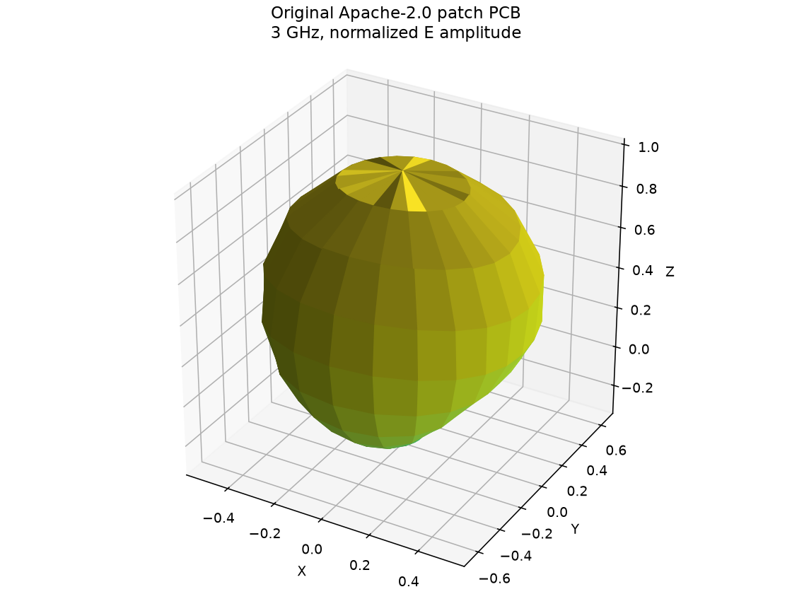
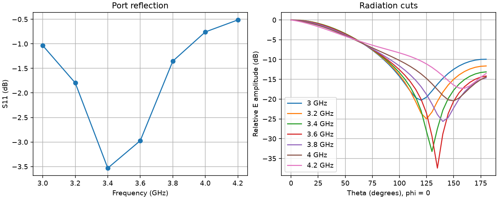
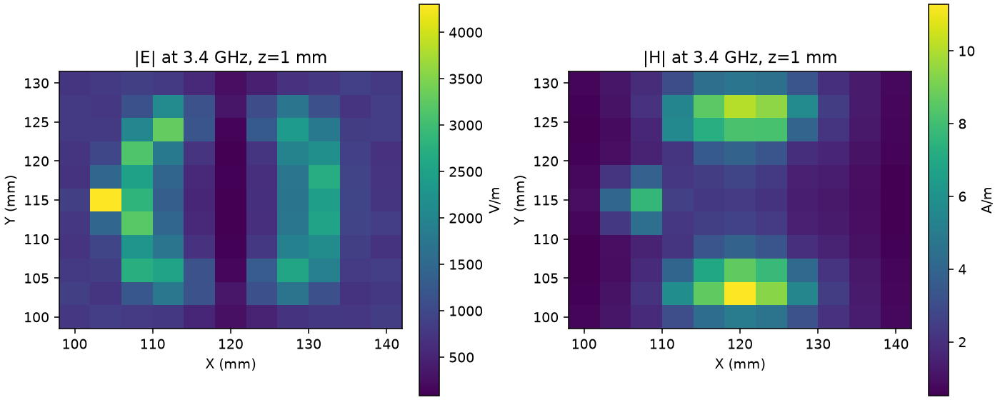
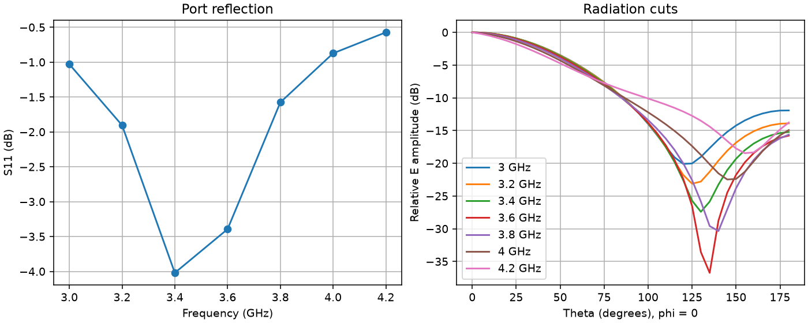

<!-- SPDX-License-Identifier: Apache-2.0 -->
# EMerge examples: projects, fields and probes

## Start here

Use **Ctrl+K**, search **EMerge example projects**, and open the example browser.
Select **Board projects** for ready-to-open desktop projects, or **Advanced studies**
for all 23 RF wrappers and five visibly suspended thermal entries. **Save study
wrapper** retains the existing file unchanged; open it in the separate SPIKE-Em
gateway with its pinned source resources and compatible runtime. The browser
does not install those resources or execute the script.

The same browser is available from **Example projects, fields and probes** in
EMerge setup. Search supports words, `*` and `?`; category buttons narrow the
projects. Opening uses the normal unsaved-work review. It does not run EMerge.

The [project library](../examples/emerge/gallery/README.md) includes canonical
`.spike` files for normal **Open**, alongside inline snapshots bundled for the
in-app browser. The builder preserves original numerical results and source
provenance. No new FEM solve or hardware validation is asserted by packaging.
Saved historical results retain their original design binding; where today's
importer produces a different digest, the manifest explicitly records that
mismatch. They are historical review data, not results for a newly imported
or edited board. Re-run after reviewing the current geometry and ports.

| Start with | Learn | Expected output |
| --- | --- | --- |
| Patch antenna | Ports, sweep, resonance and radiation | Saved S11, angular cuts and relative 3D pattern |
| Patch with dielectric cover | Explicit surroundings and comparison | Saved S11 and relative radiation with a dielectric slab |
| Complex E/H plane | Loss settings and spatial probing | Saved complex E/H vectors on an 11 by 11 XY grid |
| ESP32 RF surrogate | Source licensing and geometry reduction | Saved RF-surrogate reflection and radiation; not a complete ESP32 assembly |
| Multilayer two-port setup | Adjacent-layer ports, two-port mapping and EMCAD | Setup for a new solve; no newly bound numerical result |

## 1. Open and orient

Open a project, choose **EM**, and keep the board in the main viewport. Use
**Fields** / the EM result manager to select a saved result, its frequency and
quantity. Toggle the selected dataset and adjust its display controls. The
board and radiation display share the main viewport. Optional result plots
provide exact sampled network, angular and near-field values.

Check source, engine version, model status, warnings and the result identity
before interpretation. All supplied solved physical models are **unvalidated**.
The saved gallery needs no EMerge runtime for inspection. A fresh solve needs a
separately installed compatible runtime and explicit extension trust.



This is a plot of retained solver arrays, not a screenshot of the current UI.
Sphere radius encodes relative E amplitude; color encodes peak-normalized dB.
Its drawn radius is not a physical distance or calibrated gain.

## 2. Probe and export

| What to inspect | Controls and action | What the sample means |
| --- | --- | --- |
| Reflection / transmission | In EMerge results choose **Receive port**, **Excited port** and **Network sample** | Complex S[receive][excited] at the solved frequency; S21 needs two ports |
| Network plot | Hover a curve; click or press Enter to pin the nearest solved sample | Magnitude/phase of returned complex data, not an added frequency solve |
| Radiation | Select **Radiation frequency**, then **Solved angular grid** | Theta/phi and relative dB from the returned angular samples; interpolated surface is display only |
| E/H plane | Choose **Near-field frequency**, **Near-field quantity**, then **Probe grid sample** | Coordinate in mm plus three complex E or H components; invalid samples stay blank |
| Files | Export network CSV / RI Touchstone or **Export complex field CSV** | Original solved frequency/grid samples with their reference and units |

Each gallery project has a neighboring `probes/<id>.json` recipe with exact
sample indices and returned values. Use it to reproduce a probe selection.
These records do not install invented voltage, temperature or current probes
on the board. Spatial measurements require matching returned spatial fields.





The E/H example uses a 1 mm-high XY plane, 11 points per axis, two solved
frequencies (3.4 and 3.6 GHz) and constant imported dielectric loss. E is in
V/m and H in A/m under the saved modal excitation convention. Unit port
coefficient is not established as one volt or one watt. Calibrated input power
is required for an absolute field claim. The largest valid grid sample is a
sampled maximum, not proof of the continuous-domain peak.

## 3. Review setup and run deliberately

1. Open **Settings -> Extension manager -> EMerge Suite**, trust the extension,
   choose a compatible Python interpreter and **Check EMerge runtime**. A
   missing runtime does not prevent reviewing saved data.
2. Review selected copper/return nets, ordered aligned pad pairs, dielectric
   stackup, frequencies, requested mesh, air region and excitation. A two-port
   study needs the receive pair. General vias/contacts and arbitrary CAD are
   not supplied by selecting more examples.
3. For fields, enable **Capture complex E/H on XY field plane**, set its height
   and grid. For a cover, enable **Model dielectric cover in front of antenna**
   and review its dimensions, gap and permittivity. Use a local interpreter;
   bundled examples do not embed another machine's executable path.
4. The ESP32 surrogate also retains explicit return-net shorting via IDs and
   its disabled-fragmentation setting. Inspect **Explicit PCB geometry exceptions**;
   these remain solid PEC approximations, checked by the worker.
5. **Preview generated Python**, inspect its case/source digests, then explicitly
   **Run** the SI or radiation contribution. A changed setup requires a new
   preview. Retain the current result and its warnings separately from the
   historical example. Save a new project copy.



Compare the bare patch with the cover case; do not treat the separate lossy
field-plane case as an otherwise identical comparison. Every change in material,
excitation, mesh, air boundary or port definition changes the study.

## Advanced study map

The library covers the integrated board adapter and maps the broader existing
study set. Upstream EMerge feature availability does not make every feature a
SPIKE desktop extension workflow. Its [official feature inventory](https://www.emerge-software.com/features)
is a scope reference, not execution or validation evidence for these projects.

| EM family | Existing study / example entry | SPIKE route and status |
| --- | --- | --- |
| Planar patch, cover and E/H fields | Gallery projects; [retained GUI executions](../examples/emerge/gui_workflow/README.md) | Integrated EMerge Suite board setup; saved executed samples, unvalidated |
| Multilayer and two-port networks | [Four-layer fixture](../examples/emerge/multilayer/README.md) | Integrated explicit adjacent-layer port setup; gallery is setup only because old raw result lacks full source binding |
| Coupled lines, differential/common mode, NEXT/FEXT and eye scenarios | [Marble / White Rabbit experiments](../examples/emerge/board_si/README.md); existing demo16 wrapper | Explicit multiport API / local licensed sources; route sections only, DC-assumed eyes remain separate scenarios |
| Native Gerber copper | [Gerber source manager](EMERGE_GERBER.md) | Separate integrated artwork path; explicit materials/ports; Excellon execution blocks |
| RF filter families | Existing demo1 stepped impedance, demo2 combline, demo3 coupled-line, demo8 waveguide BPF and demo11 lumped-element study wrappers | Separate SPIKE-Em upstream-study gateway; general CAD, wave ports and lumped-element adapters are not inferred for desktop board setup |
| Antenna families | Existing demo4 patch, demo10 horn, demo13 helix, demo19 Vivaldi and demo21 inverted-F wrappers | Separate SPIKE-Em gateway; gallery patch is the integrated desktop board case |
| Resonators, transitions and modal views | Existing demo0 parallel plate, demo5 revolve, demo9 dielectric resonator, demo12 mode alignment and demo15 strip/slotline wrappers | Separate gateway and exact runtime/source requirements; not newly executed here |
| Periodic cells and boundaries | Existing demo7 periodic, demo14 boundary selection | Pending desktop periodic/Floquet and general face-boundary contracts |
| CAD and routed structures | Existing demo6 stripline/vias and demo17 STEP wrappers | Broader upstream geometry differs from the restricted desktop board adapter |
| Visualization and parameter studies | Existing demo18 plotting and demo20 optimization | Separate gateway; optimization is not a desktop automatic-validation action |
| Scattering / RCS | Existing demo22 wrapper | General incident-wave/scattering adapter remains pending in desktop |
| EM/circuit and thermal handoff | [Sampled AC/circuit bridge](EMERGE_COSIMULATION.md) and [replay example](../examples/emerge/replay_cosimulation.py) | Explicit sampled AC handoff; not a live arbitrary circuit/EM/CHT simulation |
| Thermal upstream defaults | Five existing heat-conduction wrappers | Suspended in the pinned upstream catalog; not enabled as working EM examples |

The [pinned study manifest](../examples/upstream-emerge/manifest.json) lists
23 RF wrappers and five suspended thermal entries. Existing wrappers retain
their own license boundary and resource requirements. This increment copies
no upstream implementation, example source, CAD, mesh or dataset. Do not infer
that a wrapper has run simply because it can be opened. See the
[extension capability inventory](../extensions/emerge_suite/capability_inventory.py)
for precise integrated/pending boundaries.

## Reproduce and audit the gallery

```powershell
.venv/Scripts/python.exe -B examples/emerge/gallery/build.py
.venv/Scripts/python.exe -B -m unittest tests.python.test_emerge_gallery -v
```

The builder reads retained source/config/result evidence, creates project copies,
reopens native packages, checks exact retained data and writes SHA-256 records.
It does not invoke EMerge. The manifest identifies omitted datasets and binding
gaps instead of relabeling them. To perform actual FEM runs use the existing
[GUI example runner](../scripts/run_emerge_gui_examples.py) with its documented
runtime; those are separate, potentially long operations. Keep current and
historical result hashes distinct.

## Recovery and limits

- **No result or missing quantity:** open a solved project and select its stored
  dataset. A setup-only project must run before result controls become available.
- **Runtime unavailable:** choose the interpreter in EMerge setup and check it.
  Do not change saved result data to make a runtime probe pass.
- **Unsupported geometry:** inspect import/port diagnostics. Simplify explicitly
  or use a supported external/CAD workflow; do not silently discard geometry.
- **Invalid field sample:** choose a valid returned point. No zero fill or spatial
  extrapolation is supplied.
- **Old result/source mismatch:** preserve the historical record, regenerate the
  model preview and run against the current source before a current-source claim.
- **No S21:** a one-port patch result contains only S11. Add and verify a second
  terminal pair, then run a new two-port sweep.

PEC surfaces, material simplifications, finite absorbing air, incomplete real
assembly geometry and missing mesh/measurement correlation limit these models.
Relative patterns are not efficiency, absolute gain, radiated susceptibility,
RCS or regulatory pass/fail evidence. Harmonic frequency sweeps do not supply
time-resolved transient histories or a physical transient movie.

## Verification of this packaging increment

The gallery has five canonical native write/read checks, including deterministic
rebuilds, exact probe pointers and source/result/script tamper rejection. The
focused gallery/control suite runs 13 tests. Frontend checks exercise every
snapshot through real project parsing, setup restoration and request construction,
all 28 lazy study resources, wildcard/category selection and suspended actions.
A regression saves/reopens a newly identified result without inheriting the
previous run's raw arrays. Native installed UI visual acceptance remains pending;
no new FEM solve is claimed by these application and packaging checks.
