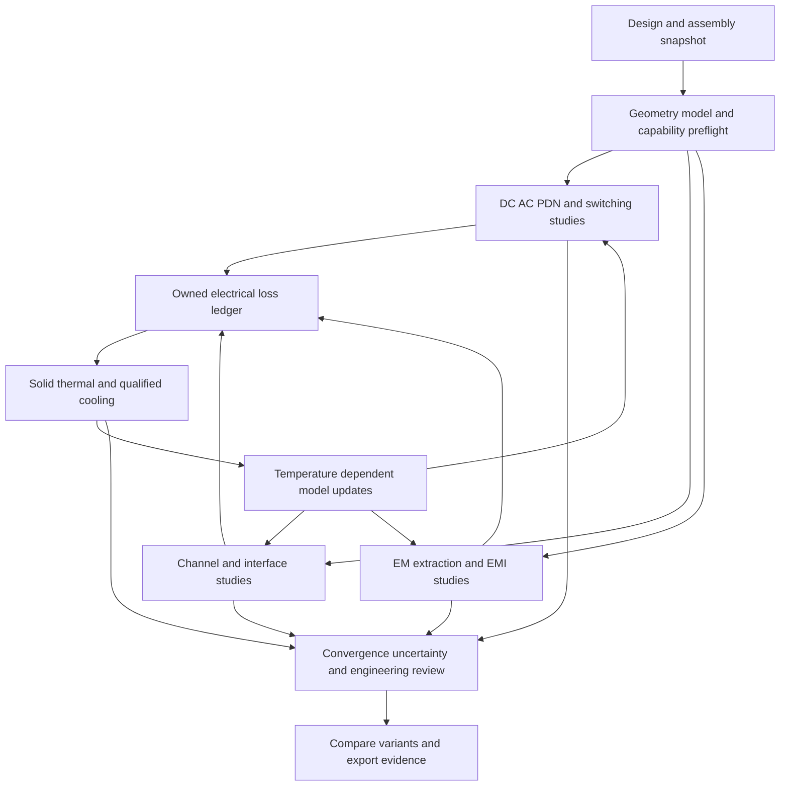

<!-- SPDX-License-Identifier: Apache-2.0 -->
# SPIKE electronics parity, general physics and wave optics plan

Electronics planning baseline: 12 October 2026. General physics, visualization,
materials, acceleration and wave-optics scope expansion: 14 October 2026.

The [18 October platform strategy](MULTIPHYSICS_PLATFORM_STRATEGY.md) establishes
general multiphysics simulation as the product direction, with simulation
geometry preparation and external ECAD/MCAD inputs. It adds an industry/research
comparison and recommended gaps beyond existing stages; chemistry remains
outside active scope. Future numerical work follows the
[referenced method evidence policy](NUMERICAL_METHOD_EVIDENCE.md). Recommendations
do not open deferred gates or promote capabilities.

SPIKE should provide a general multiphysics platform with a complete
electronics-analysis workflow: import a design,
verify signal and power delivery, predict cooling and electromagnetic behavior,
couple those domains, and retain reproducible engineering evidence. The immediate
priority is to qualify shared geometry, material and field foundations, improve
SI/field/cooling coverage and establish the original parity program first.
On 18 October 2026 the user explicitly activated a parallel coupled mechanics,
magnetics, failure and semiconductor-device track. Its bounded scope and stages
are defined in [the coupled suite plan](COUPLED_MECHANICS_MAGNETICS_DEVICES_PLAN.md).
PI/SI remains the primary parity program. The 21 October owner request separately
authorizes [optics/materials development](OPTICS_PHOTONICS_MATERIALS_PLAN.md)
in parallel. Legacy OP01–OP05 backlog stages remain planned pending their own
prerequisites/evidence; this scheduling exception does not open production or
parity-completion gates. Unrelated expansion retains its existing policy.
Adding solver names or controls alone
does not achieve parity.

HyperLynx parity covers its SI, PI, schematic analysis, analog mixed-signal,
electrical DRC and Advanced Solvers modules.
Electronics cooling, general RF/antenna EM, magnetics and structural reliability
are additional goals, benchmarked against complementary products. They are not
all capabilities of HyperLynx itself. Siemens describes the module boundaries
in its [six-solution suite description](https://blogs.sw.siemens.com/electronic-systems-design/2026/03/12/hyperlynx-a-parallel-reality/).

This is a proposed development plan. Current executable and validation claims
remain governed by [Solver status](SOLVER_STATUS.md), its linked records and the
machine-readable capability ledger. The tables summarize the inspected working
tree; they do not assert that an installed release has every source capability.

## What parity means

Track three independent outcomes for every requirement:

| Outcome | Required evidence |
| --- | --- |
| Functional parity | Same declared task and input class; complete workflow, diagnostics, import/export and failure recovery. |
| Predictive parity | Same physical problem and observables; mesh/time/frequency convergence, independent comparison and measurement correlation within agreed uncertainty. |
| Workflow parity | Reproducible setup, batch execution, cross-probing, design-change comparison and usable reports within a measured resource and interaction budget. |

Before making an exhaustive parity claim, pin the comparator version, modules,
protocol editions, permitted model libraries, geometry classes and operating
envelope. Public product pages establish feature families; they do not establish
every licensed feature, numerical accuracy or complete rule inventory. Obtain
the detailed inventory through permitted customer documentation and turn every
item into a traceable requirement. Until then, this is a feature-family gap
assessment rather than an exhaustive HyperLynx release checklist.

Source access at this baseline: several Siemens product links returned an
unsupported-content response on direct retrieval; their official indexed text
supports the feature-family comparison. The Siemens six-solution article and
the Ansys, CST and COMSOL reference
pages were directly retrievable. Exact Siemens release entitlements and full
feature inventories require a further documentation check before M0 closes.

In the following tables, **partial** means executable bounded behavior exists
but the full target is unmet; **experimental** preserves the current model
status; **pending** means the inspected evidence does not establish that target.
Priority P0 removes foundational blockers, P1 closes core board-analysis gaps,
P2 extends system multiphysics and P3 adds broader specialist applications.
Milestones M0-M9 are defined below. Their order expresses dependencies, not
promised dates. Multiple increments within one row will be needed.

## Signal integrity and interface verification

The comparator is [HyperLynx SI](https://www.siemens.com/en-gb/products/pcb/hyperlynx/signal-integrity/):
pre/post-layout analysis, DDR interfaces and SerDes workflows, including
IBIS-AMI. Broader EM extraction is covered separately below.

| ID | Target capability | SPIKE baseline and evidence | Required improvement | Priority and milestone |
| --- | --- | --- | --- | --- |
| SI01 | Pre-layout topology exploration and constraints | Partial: configurable RLGC/Touchstone endpoints and passives in [SI workflow](SI_WORKFLOW.md). | Reusable topology editor, corners, termination sweeps and export of reviewed layout constraints. | P1 M2 |
| SI02 | General post-layout channel extraction | Experimental straight/pair planar paths and a separately supplied [uniform lossless TEM transient](LOSSLESS_LINE_TRANSIENT.md); bends omit discontinuity physics and general geometry extraction remains open. | Branches, layer changes, return planes, explicit single-ended/differential/multiconductor PCB/coax/cable classes; frequency-dependent RLGC, distributed delay and reflections, geometry coverage and converged extraction. | P0 M1, P1 M2 |
| SI03 | Vias, launches, connectors and package discontinuities | Bounded optional EM workflows; general board extraction is unqualified. [Solver status](SOLVER_STATUS.md). | Calibrated multiport submodels, explicit reference planes, de-embedding, package/board composition and stitched return paths. | P1 M4 |
| SI04 | Nonlinear IBIS driver and receiver behavior | Inventory and explicit DC-slope/ramp reduction; nonlinear switching and AMI absent. [SI guide](SI_USER_GUIDE.md). | Qualified IBIS parser/model execution, clamps, V/T behavior, package parasitics, corners and model diagnostics. | P1 M2 |
| SI05 | SerDes statistical analysis and IBIS-AMI | Deterministic loaded NRZ/PAM4 records and bounded clock recovery; no established AMI or rare-event BER capability. [Solver status](SOLVER_STATUS.md). | Bounded AMI execution, statistical/time-domain modes, CTLE/FFE/DFE, jitter/noise/CDR models and protocol-specific acceptance. | P1 M4 |
| SI06 | DDR full-interface SI and timing verification | No qualified DDR interface workflow established by the inspected ledger. | Controller/DRAM model binding, read/write timing, strobes, byte lanes, ODT, topology and corners; versioned JEDEC requirements. | P1 M4 |
| SI07 | Crosstalk, waveform, eye and TDR diagnostics | Partial experimental NEXT/FEXT, deterministic eyes, loaded transfer and TDR. [SI guide](SI_USER_GUIDE.md). | Multi-aggressor switching, timing/noise budgets, spatial cross-probing and independent two/four-port VNA/TDR correlation. | P1 M2 |
| SI08 | Network quality and interoperability | Operational Touchstone S/Z/Y, renormalization, bounded mixed mode, passivity/reciprocity; arbitrary causality checks unavailable. [Solver status](SOLVER_STATUS.md#network-data-workbench). | Reviewed causality/resampling/DC policy, calibrated fixture removal, general port pairing and passive causal broadband model fitting. | P0 M1, P1 M2 |

## Power integrity and electrical rule checking

[HyperLynx PI](https://www.siemens.com/en-us/products/pcb/hyperlynx/power-integrity/)
covers DC delivery, AC decoupling and PDN optimization.
[HyperLynx electrical DRC](https://www.siemens.com/en-us/products/pcb/hyperlynx/electrical-design-rule-check/)
provides configurable structural/electrical checks. Rule coverage and physical
simulation accuracy are separate acceptance questions.

| ID | Target capability | SPIKE baseline and evidence | Required improvement | Priority and milestone |
| --- | --- | --- | --- | --- |
| PI01 | Board DC drop, current density and via loading | Executable routed/hybrid DC with bounded analytical benchmarks. [Solver status](SOLVER_STATUS.md#copper-geometry-dc-spikerouted_dc). | Representative geometry qualification, full rail coverage, contacts, source/load regimes and measured-board correlation. | P0 M1, P1 M2 |
| PI02 | Broadband AC PDN extraction | Approximate PEEC driving-point networks and candidate review; C/G estimates and scaling limits remain. [AC PI](AC_POWER_INTEGRITY_EFFECTS.md). | Converged capacitance/dielectric loss, proximity redistribution, plane/via/package multiports and passivity-preserving reduction. | P1 M2 |
| PI03 | Physical decap selection and placement optimization | Supplied-network candidate/single-cap comparison exists. [PI tools](PI_ENGINEERING_TOOLS.md). | Location-dependent extraction, bias/temperature/tolerance models, BOM constraints and validated optimizer; retain rejected candidates. | P1 M2, P2 M5 |
| PI04 | Switching loads, SSN and circuit/field interaction | Native transient, staged ngspice and bounded field/circuit paths exist. [Solver status](SOLVER_STATUS.md). | Qualified switching/model subsets, package PDN, simultaneous-switching return currents, stable broadband N-port coupling and reference comparisons. | P1 M2, P2 M5 |
| PI05 | SI/PI/EMI/safety electrical DRC | Contextual checks, return-path tools and evidence export; no HyperLynx-class ruleset established. [Engineering review](ENGINEERING_REVIEW.md). | Versioned geometric rule engine, explicit coverage, waivers, cross-probing and original fixture library; separate native EDA DRC/ERC evidence. | P1 M2 |
| PI06 | Power-circuit and converter model completeness | Behavioral PWM electrothermal and sourced model checks are bounded. [Power qualification](SOURCED_POWER_QUALIFICATION.md). | Real controller/device models, deadtime, startup/protection, semiconductor temperature feedback and measured loss/thermal correlation. | P2 M5 |

## Schematic analysis and analog mixed signal

Siemens also includes schematic inspection and AMS circuit simulation in its
[HyperLynx suite description](https://blogs.sw.siemens.com/electronic-systems-design/2026/03/12/hyperlynx-a-parallel-reality/).
These need explicit requirements alongside board field analysis. The public
description does not settle complete simulator dialect or device coverage.

| ID | Target capability | SPIKE baseline and evidence | Required improvement | Priority and milestone |
| --- | --- | --- | --- | --- |
| SA01 | Schematic net and component electrical analysis | Connectivity/BoM/contextual checks exist; no qualified complete schematic-analysis workflow established. [Engineering review](ENGINEERING_REVIEW.md). | Reviewed schematic import and hierarchy, model/pin assignment, operating-condition compatibility and net-wide checks; actionable cross-probed findings and explicit coverage. | P1 M2 |
| AMS01 | Analog and mixed-signal circuit verification | Native circuit/transient kernels and optional circuit adapters execute bounded subsets. [Solver status](SOLVER_STATUS.md). | Pin comparator device/model/dialect coverage; OP/DC/AC/transient/noise and analog/digital event interaction as required by that inventory; schematic-to-netlist traceability and independent numerical verification. | P1 M2, P2 M5 |

## Electromagnetic extraction and system EM

[HyperLynx Advanced Solvers](https://eda.sw.siemens.com/en-US/pcb/hyperlynx/3d-em/)
is the PCB/package extraction comparator. General RF, antennas and EMC broaden
the target to [Ansys HFSS](https://www.ansys.com/de-DE/products/electronics/ansys-hfss)
and [CST Studio Suite](https://www.3ds.com/products/simulia/cst-studio-suite).
These suite-level scopes do not mean every application uses the same formulation.

| ID | Target capability | SPIKE baseline and evidence | Required improvement | Priority and milestone |
| --- | --- | --- | --- | --- |
| EM01 | Quasi-static R/L/C/G extraction | PEEC and bounded quasi-TEM cross sections; general convergent capacitance and proximity physics remain open. [Solver status](SOLVER_STATUS.md). | Independent electrostatic/magnetoquasistatic oracles, explicit material ranges, frequency validity and full conductor matrices. | P1 M2 |
| EM02 | Hybrid planar full-board/package extraction | No qualified general hybrid extraction path established. | Segment planar regions and 3D discontinuities without losing return currents; validate interface continuity and multiport composition. | P1 M4 |
| EM03 | Full-wave 3D multiport SI/PI/RF | Optional EMerge/openEMS execute bounded cases; native `spike.fullwave_3d` remains unavailable. [Solver status](SOLVER_STATUS.md). | Complete geometry/RF ports and antenna feeds, dielectric dispersion and conductor loss, boundary convergence, multi-excitation calibration and qualified PCB/package/local RF fixtures; radio-system metrics require their separate RF01/RF02 evidence. | P1 M4 |
| EM04 | Antennas, near/far fields and scattering | Experimental fields/NF2FF and one-way physical optics; public MoM unavailable. [Retained EM](RETAINED_ASSEMBLY_EM.md), [mesh roadmap](ANALYSIS_AND_MESH_ROADMAP.md). | Power calibration, fed antenna matching, antenna/enclosure/cable interaction; boundary-element/integral-equation radiation and scattering with surface discretization and no volumetric exterior air mesh, qualified near/far fields and accelerated solves. | P2 M4, P3 M6 |
| EM05 | Conducted/radiated EMC and immunity | EMI screening and reference-profile metadata; regulatory pass/fail and signoff absent. [EMI workflow](EMI_WORKFLOW.md). | Cable/common-mode sources, LISN/receiver/fixture models, shielding/transfer paths, immunity excitation and licensed edition-specific limits with chamber correlation. | P2 M6 |
| EM06 | Nonlinear magnetics, machines and actuators | Experimental planar FEM, stationary eddy currents and reduced motion/thermal models. [Machine studies](MAGNETIC_MACHINE_STUDIES.md). | 3D material-qualified magnetics, moving interfaces, hysteresis/core loss, drive-circuit feedback and force/torque/loss measurement. | P3 M6 |

## Thermal and cooling

These targets extend beyond HyperLynx. Dedicated comparators are
[Simcenter Flotherm](https://www.siemens.com/en-gb/products/simcenter/fluids-thermal-simulation/flotherm/),
[Ansys Icepak](https://ansys.synopsys.com/products/electronics/ansys-icepak)
and the [COMSOL Heat Transfer Module](https://www.comsol.com/heat-transfer-module).
Module dependencies and permitted automation differ between products.

| ID | Target capability | SPIKE baseline and evidence | Required improvement | Priority and milestone |
| --- | --- | --- | --- | --- |
| TH01 | PCB/package/assembly solid heat transfer | Experimental layered and retained tetrahedral steady/transient conduction, contacts and ambient radiation; CalculiX comparisons exist. [Thermal roadmap](THERMAL_RESEARCH_ROADMAP.md). | Resolve existing refinement failures; qualify copper/package detail, thin layers, temperature-dependent materials and nonmatching contacts. | P0 M1, P1 M3 |
| TH02 | Junction and compact package models | Reviewed solids and explicit losses/resistances; decorative STEP does not reveal internal package physics. [Component solids](THERMAL_COMPONENT_SOLIDS.md). | Conditioned die/TIM/lead models, multi-node dynamic compact models, Zth import/fit and independent package measurements. | P1 M3 |
| TH03 | General enclosure airflow and CHT | Native/SU2 2D cavity, SU2 three-zone CHT and synthetic OpenFOAM fan/duct cases are experimental; arbitrary retained-assembly execution has blockers. [Solver status](SOLVER_STATUS.md), [fan evidence](FAN_CHT_QUALIFICATION.md). | Robust imported fluid domains, natural/forced convection, boundary layers, fan curves and pressure losses; independently refined CFD and measured cooling. | P1 M3 |
| TH04 | Enclosure radiation, vacuum and potting | Ambient radiation, geometric view-factor work and bounded coating/potting paths; coupled enclosure radiosity remains open. [Thermal roadmap](THERMAL_RESEARCH_ROADMAP.md). | Conservative surface-to-surface radiation, occlusion/closure, reviewed optical properties, vacuum boundaries and qualified thin/effective layers. | P2 M3 |
| TH05 | Bidirectional transient electrothermal | Steady DC/AC multiboard and bounded PWM retained-volume coupling exist. [Volume PWM](PWM_VOLUME_ELECTROTHERMAL.md), [multiboard](MULTIBOARD_VOLUME_ELECTROTHERMAL.md). | Device/PCB loss mapping, temperature-dependent semiconductor behavior, multiple time scales, rollback and coupled mesh/time/energy convergence. | P2 M5 |
| TH06 | Thermal stress and reliability | No qualified general thermomechanical/reliability route established by this baseline. | Conservative temperature-to-structure transfer, CTE/material/contact models, deformation/stress; fatigue/lifetime only with calibrated material and mission data. | P3 M6 |

## Shared data and engineering workflow

Automation and job distribution are part of the HyperLynx Advanced Solvers
comparison above. General multiphysics coupling also takes guidance from the
[COMSOL RF Module](https://www.comsol.com/rf-module), which supports RF and
thermal interaction with the appropriate additional modules. SPIKE should
extend its current neutral contracts rather than duplicate each domain's setup.

| ID | Target capability | SPIKE baseline and evidence | Required improvement | Priority and milestone |
| --- | --- | --- | --- | --- |
| WF01 | CAD-neutral board/package/assembly ingestion | SpiDeR/AssemblyIR and importer boundaries exist; schema coverage exceeds executable support. [Foundation](CAD_NEUTRAL_NATIVE_MULTIPHYSICS_FOUNDATION.md). | Tested format/version coverage, unit/object/topology audits, source-ID mapping and explicit omissions across licensed ECAD/MCAD inputs. | P0 M0–M1 |
| WF02 | Shared materials, models and operating conditions | Environment profiles and domain-specific models exist; readiness does not validate physics. [Solver status](SOLVER_STATUS.md). | One conditioned model catalog with property functions, frequency/temperature ranges, uncertainty, provenance and redistribution rights. | P0 M1 |
| WF03 | Adaptive meshing and error control | Manual/local refinement and bounded adaptive reference tools exist. [Mesh roadmap](ANALYSIS_AND_MESH_ROADMAP.md). | Quantity-of-interest error control, interfaces/ports/loss-preserving transfer, mesh/time studies and explicit uncertainty; physics-specific meshes. | P0 M1, P1 M3–M4 |
| WF04 | Unified study orchestration and cross-probing | Worker/CLI, saved studies, provenance and several domain viewers exist; unified ordered evidence pipeline pending. [Review](ENGINEERING_REVIEW.md). | Dependency graph, stale-result propagation, synchronized occurrence/time/frequency probes, replay and consolidated review report. | P0 M1, P2 M5 |
| WF05 | Batch, optimization and scalable execution | Bounded independent local/remote worker jobs exist; no general single-solve MPI or AMD/Intel GPU claim. [Worker manager](PARALLEL_WORKER_MANAGER.md). | Workload-specific scheduling, checkpoint/recovery, reuse caches; profile before adding distributed kernels/GPU; validate each backend. | P1 M2, P2 M5 |
| WF06 | Measurement correlation and release qualification | Analytical/reference records and recorded telemetry comparison exist; general physical parity is unqualified. [Co-simulation](COSIMULATION_DIGITAL_TWIN.md), [contributing](../CONTRIBUTING.md). | Version-bound qualification packs, calibrated measurements, separate calibration/validation sets, supported-envelope reports and human numerical release review. | P0 M0, all milestones |

## General physics, optics and scale expansion

The 34 requirements below retain expansion scope; the explicitly requested coupled subset may proceed in parallel. Complete the
original 34-family parity program before refining and implementing these additions. Reuse
existing EM/TH/WF owners and contracts; overlapping foundations are shared work,
not duplicate solver stacks. Full requirements, screenshot mappings, benchmark
sequence and limits are in [the general physics and wave-optics plan](GENERAL_PHYSICS_AND_WAVE_OPTICS_PLAN.md).

| ID | Target capability | SPIKE baseline and evidence | Required improvement | Priority and milestone |
| --- | --- | --- | --- | --- |
| GP01 | General geometry and physical-domain studies | CAD-neutral AssemblyIR and explicit STEP handoffs are bounded foundations. [Evidence](CAD_NEUTRAL_NATIVE_MULTIPHYSICS_FOUNDATION.md). | Admit non-PCB solids/surfaces/air/fluid/optical regions, scale and frames, sources/boundaries and constitutive requirements without interpreting CAD as solvable physics. | Authorized parallel track; P0 M1, M7 |
| GP02 | General discretization and mesh qualification | Existing mesh and field handoff paths cover bounded domain cases. [Evidence](ANALYSIS_AND_MESH_ROADMAP.md). | Physics-specific FEM/FVM/FDTD/BEM and high-order/matrix-free feasibility; adaptive interfaces, skin depth, wavelength and boundary-layer resolution with quality/convergence evidence. | Authorized parallel track; P0 M1, M7 |
| GP03 | General 3D electrostatics and magnetostatics | Bounded field/extraction methods exist; arbitrary 3D geometry/material qualification remains open. [Evidence](SOLVER_STATUS.md). | Stationary 3D coil/electrode/core/air studies, nonlinear law admission, flux/charge/energy and force consistency; reuse EM01/EM06 foundations. | Authorized parallel track; P1 M7 |
| GP04 | 3D machines, transformers and induction systems | Experimental planar machines and stationary eddy currents do not establish converged 3D moving machines. [Evidence](MAGNETIC_MACHINE_STUDIES.md). | Real winding/core/air geometry, circuit excitation, nonlinear/hysteretic/laminated laws, moving interfaces, losses, torque and electrothermal feedback with measurement. | Authorized parallel track; P1 M7 |
| GP05 | General interior and exterior fluid domains | Native/SU2/OpenFOAM paths have bounded experimental cases, not arbitrary building/assembly CFD. [Evidence](SOLVER_STATUS.md). | General fluid-domain generation, laminar/turbulent flow, natural/forced convection, exterior boundaries and CHT; conservative interfaces and independently refined/measurement-correlated cases. | Vehicle aerodynamics authorized now; other CFD post-parity; P1 M7 |
| GP06 | General solid heat and radiative transport | Retained-volume conduction/radiation foundations have declared scope and remaining convergence gaps. [Evidence](THERMAL_RESEARCH_ROADMAP.md). | Non-PCB solids, temperature laws, contacts, enclosure/view-factor radiation and heat-source transfer; preserve TH01-TH05 gates for shared work. | Authorized parallel track; P1 M7 |
| GP07 | Structural dynamics and thermomechanics | Experimental static isotropic P1 tetra elasticity and executed same-mesh thermal-to-stress coupling; broader assembly qualification remains open. [Evidence](SOLVER_STATUS.md). | Elasticity, contact, modes/vibration and deformation, temperature/force transfer and stress; fatigue/lifetime only with applicable calibrated laws. | Authorized parallel track; P2 M7 |
| GP10 | Hall sensors and semiconductor magnetotransport | Existing 1D equilibrium TCAD has no biased transport or Hall response. [Scope](COUPLED_MECHANICS_MAGNETICS_DEVICES_PLAN.md). | Compact field-driven Hall models, classical magnetic transport and later biased Poisson/carrier continuity, with contact, thermal and current/voltage validation. | Authorized parallel track; P1 M7 |
| GP11 | Coupled failure and degradation scenarios | General mechanical failure/lifetime qualification is not established. [Scope](COUPLED_MECHANICS_MAGNETICS_DEVICES_PLAN.md). | Conditioned screening limits, propagated fault events, later calibrated fatigue/fracture/degradation and mission-history models with uncertainty. | Authorized parallel track; P1 M7 |
| GP12 | Vibration, random environments and shock response | Requested target; current bounded mechanics does not establish this workflow. [Plan](VIBRATION_VEHICLES_AND_MECHANISMS_PLAN.md). | Modal/base/harmonic/transient dynamics, PSD and correlated multi-axis/support excitation, shock/SRS with spectral, damping, convergence and measured-fixture evidence. | Authorized parallel track; P1 M7 |
| GP13 | PCB package and solder-joint mechanical reliability | Requested target; current bounded mechanics does not establish this workflow. [Plan](VIBRATION_VEHICLES_AND_MECHANISMS_PLAN.md). | Revision-bound global/local board-package-joint stress, thermal mismatch and conditioned creep/plasticity/fatigue with calibrated life uncertainty and electrical failure-event transfer. | Authorized parallel track; P1 M7 |
| GP14 | Multibody gears actuators and precision watch movements | Requested target; current bounded mechanics does not establish this workflow. [Plan](VIBRATION_VEHICLES_AND_MECHANISMS_PLAN.md). | Constrained rigid/flexible assemblies, shafts/joints/gears, backlash/friction/contact, motors, springs and watch escapement/balance timing with work, contact and event convergence. | Authorized parallel track; P1 M7 |
| GP15 | Complete drone code electrical propulsion and flight studies | Requested target; current bounded mechanics does not establish this workflow. [Plan](VIBRATION_VEHICLES_AND_MECHANISMS_PLAN.md). | Actual executable-controller SITL, sensors/clocks, battery/ESC/motor back-EMF and propeller loads, 6-DOF aerodynamics, structural/thermal/fault feedback and measured mission/performance evidence. | Authorized parallel track; P1 M7 |
| GP16 | Satellite and launch-vehicle coupled dynamics | Requested target; current bounded mechanics does not establish this workflow. [Plan](VIBRATION_VEHICLES_AND_MECHANISMS_PLAN.md). | Mission-bound environmental/coupled loads, spacecraft thermal-vacuum/attitude/jitter/deployment and launcher ascent/staging/GNC/flexible dynamics with independent and measured evidence. | Authorized parallel track; P1 M7 |
| GP08 | Acoustic wave and vibroacoustic studies | General acoustic/building/vibroacoustic qualification is not established. [Evidence](SOLVER_STATUS.md). | Pressure waves, sources/impedance/absorbing boundaries, structural coupling, modal/transient/harmonic observables and domain/mesh/time references. | Post-parity; P2 M7 |
| GP09 | Conservative general multiphysics coupling | Bounded reduced/retained coupling and co-simulation exist; general PDE coupling remains open. [Evidence](COSIMULATION_DIGITAL_TWIN.md). | Shared dependency graph, conservative nonmatching transfers, nonlinear/time-scale coupling, rollback, conservation and coupled convergence; reuse WF04/TH05. | Authorized parallel track; P0 M1, P2 M7 |
| OP01 | Geometrical optics and lens/mirror assemblies | General mirror/lens ray tracing is not established; far-zone scattering is a different scope. [Evidence](SOLVER_STATUS.md). | Parametric/aspheric surfaces, normals/frames, stops/detectors, reflection/refraction, sequential/nonsequential rays, optical path and controlled multiple reflections. | Post-parity; P1 M9 |
| OP02 | Coherent scalar wave propagation and diffraction | General coherent mirror/lens diffraction workflow is not established. [Evidence](SOLVER_STATUS.md). | Bounded Gaussian/Fresnel/angular-spectrum propagation, apertures and amplitude/phase surfaces; explicit scalar/paraxial limits, sampling/window refinement and power/phase checks. | Post-parity; P1 M9 |
| OP03 | Vector wave optics, modes and resonators | Existing RF/PEC scattering adapters do not qualify dielectric vector optical assemblies. [Evidence](SOLVER_STATUS.md). | Polarized vector Maxwell/beam-envelope problems, high-NA/wavelength-scale structures, waveguides/resonators, PML/interfaces and modal/scattering power convergence. | Post-parity; P2 M9 |
| OP04 | Optical materials and coatings | No qualified general spectral coating/index catalog established. [Evidence](SOLVER_STATUS.md). | Conditioned complex index/absorption/dispersion and anisotropy; passive multilayer amplitude/phase response, Fresnel/TIR and coating reference checks. | Post-parity; P0 M1, P1 M9 |
| OP05 | Structural-thermal-optical performance | General STOP and optical assembly correlation are not established. [Evidence](SOLVER_STATUS.md). | Absorption-to-heat, dn/dT, stress/deformed surfaces and alignment/tolerance; PSF/MTF/wavefront/error and coupled conservation with independent correlation. | Post-parity; P2 M9 |
| VF01 | General scientific field visualization | Existing contours, field samples and domain viewers cover bounded result types. [Evidence](VISUALIZATION_ARCHITECTURE.md). | Typed scalar/vector/tensor node/cell/face/sample fields; slices, isosurfaces, volumes, glyphs and streamlines with units, masks, interpolation and raw-result binding. | Authorized parallel track; P0 M1, M7 |
| VF02 | Time, phase, motion and linked scientific probes | Some time/phase/field viewers exist; a general synchronized scientific scene is not established. [Evidence](VISUALIZATION_ARCHITECTURE.md). | Declared complex/real/modal semantics, transient/rotor/deformation/ray/particle animation, linked probes/integrals, reproducible exports and rendering budgets. | Authorized parallel track; P1 M7, M9 |
| AX01 | Scalable physics execution and algebra | Hybrid DC acceleration includes single-process PETSc/MUMPS and optional CUDA; general single-solve MPI is absent. [Evidence](ACCELERATION_ARCHITECTURE.md). | Workload-specific matrix-free/sparse/FFT kernels, compatible Krylov/block/AMG methods, CPU/GPU/MPI qualification, precision/error controls and measured RAM/VRAM/time budgets. | Authorized parallel track; P1 M8 |
| AX02 | Large field storage, meshing and rendering | Independent worker jobs and scene resource management exist; general large-field streaming is not established. [Evidence](ACCELERATION_ARCHITECTURE.md). | Partitioned/chunked meshes and fields, checkpoints, out-of-core limits, cancellation/recovery and rendering/downsampling without changing authoritative results. | Post-parity; P1 M8 |
| LB01 | Conditioned multiphysics material library | Domain-specific supplied laws exist; the WF02 shared conditioned catalog remains a target. [Evidence](SOLVER_STATUS.md). | One versioned scalar/tensor/surface law catalog with units, frames, ranges, uncertainty, interpolation, provenance/rights and compatibility checks across physics. | Authorized parallel track; P0 M1, M7, M9 |
| LB02 | Reusable physical assembly and model library | Visual model discovery and explicit component-solid handoff do not establish physical model libraries. [Evidence](MCAD_EXPORT.md). | Typed parametric parts/assemblies, constitutive and compact models, ports/interfaces and detector/source assets; distinguish visuals/solids/laws/measurement and bind revisions/dependencies/rights. | Authorized parallel track; P0 M1, P1 M7, M9 |

## Transmission lines, radio and HVDC scope

Transmission-line and local RF extraction requirements stay active within the
existing SI/EM parity rows. Radio-system simulation and utility-scale HVDC are
additional post-parity targets. Their models, observables and acceptance levels
are specified in [the transmission/RF/HVDC scope](TRANSMISSION_RF_HVDC_SCOPE.md).
They do not change the original 34-family parity completion gate.

| ID | Target capability | SPIKE baseline and evidence | Required improvement | Priority and milestone |
| --- | --- | --- | --- | --- |
| RF01 | Wideband and nonlinear radio-system simulation | RLGC/Touchstone and bounded circuit/EM paths do not establish a complete radio chain. [Evidence](SOLVER_STATUS.md). | Qualified RF device/noise models, carrier/envelope/passband applicability, harmonic/intermodulation and compression effects, modulation, phase/IQ errors, EVM/BER and receiver metrics. | Post-parity; M7-M8 domain stages |
| RF02 | Antenna, array and radio-link system studies | Experimental antenna/field outputs do not establish calibrated radio-link or MIMO performance. [Evidence](SOLVER_STATUS.md). | Calibrated feeds/patterns, polarization/efficiency, arrays/MIMO, declared channel/propagation/interference models and link budgets with independent measurement and power accounting. | Post-parity; M7-M8 domain stages |
| PW01 | Utility transmission-line and cable models | Bounded supplied/harness networks do not qualify overhead/underground/submarine power lines. [Evidence](HARNESS_ENGINEERING.md). | Frequency-dependent multiconductor phase-domain traveling waves, explicit DC behavior, conductor/earth returns, skin/proximity/dielectric losses, fitting/causality and delay/reflection references. | Post-parity; M7-M8 domain stages |
| PW02 | HVDC converter stations and controls | Existing converter/PWM evidence does not establish LCC/VSC/MMC utility converters. [Evidence](SOURCED_POWER_QUALIFICATION.md). | Declared averaged/equivalent/switching LCC/VSC/MMC models, transformers/filters/reactors, submodule energy/balancing and compatible controls; independently verified power, stability and resolution-specific outputs. | Post-parity; M7-M8 domain stages |
| PW03 | HVDC faults, switching and protection transients | Qualified utility faults, breaker/arrester/protection workflows are not established. [Evidence](SOLVER_STATUS.md). | DC/AC faults, surges, energization/restart, converter interaction and explicit protection models; traveling-wave/timestep refinement, interruption energy and measured/independent fault references. | Post-parity; M7-M8 domain stages |
| PW04 | Large multi-terminal AC/DC networks | Bounded circuit/co-simulation foundations do not qualify network-scale HVDC studies. [Evidence](COSIMULATION_DIGITAL_TWIN.md). | AC/DC load flow, initialization, multi-terminal controls/stability/contingencies, EMT-phasor or reduced coupling with conservative synchronization, recovery and resource/scale evidence. | Post-parity; M7-M8 domain stages |
| PW05 | Infrastructure thermal, grounding and insulation fields | General utility ampacity/grounding/insulation qualification is not established. [Evidence](SOLVER_STATUS.md). | Conditioned cable/conductor ampacity and heat, insulation electric fields, return/electrode potentials and local station coupling; applicable boundary/material/standard scope and independent evidence. | Post-parity; M7-M8 domain stages |

## Active parity and deferred expansion

The active execution phase is **parity**. Continue WF01-S04C and the original
SI/PI/SA/AMS/EM/TH/WF roadmap. Shared geometry, materials, meshing and acceleration
needed for those original requirements remain in scope. The user's 18 October
request authorizes GP01/02/03/04/06/07/09/10/11, VF01/02, AX01 and LB01/02
as a parallel coupled-physics track. The follow-up adds GP12-GP16 vibration,
electronics reliability, mechanisms, drones and aerospace systems, plus GP05
restricted to vehicle aerodynamics. See [the delivery matrix](VIBRATION_VEHICLES_AND_MECHANISMS_PLAN.md).
This permission does not mark these
families complete or open the full post-parity gate. Remaining OP, general GP05 outside vehicle aerodynamics, GP08,
AX02, RF and PW expansion stays deferred. The backlog checker enforces the
precise exception and retains the full original-family completion gate.

## Development milestones and dependencies

### Boundary-element radiation without an air-volume mesh

EM04 explicitly includes a surface boundary-element / method-of-moments (BEM/MoM)
solver for radiated fields and scattering in an admitted homogeneous exterior.
The intended workflow discretizes conducting surfaces and material interfaces,
solves their unknowns, and evaluates fields at requested observation points.
It requires no volumetric exterior air mesh, enclosing air box or exterior PML
for this formulation. "Meshless" means air-volume-mesh-free here: surface/wire
discretization and convergence checks are still required. Observation grids used
for slices and visualization are field-sampling grids, not solver air meshes.

The official [COMSOL BEM interface description](https://doc.comsol.com/6.4/doc/com.comsol.help.rf/rf_ug_radio_frequency.07.091.html)
documents boundary-only discretization for harmonic radiation/scattering and
the dense-system cost. Its [RF interface overview](https://doc.comsol.com/6.4/doc/com.comsol.help.rf/rf_introduction.02.02.html)
also describes a FEM interior with a BEM exterior. These establish comparator
scope only; no vendor implementation or fixtures are adopted.

| Increment | Planned output | Acceptance before Done |
| --- | --- | --- |
| EM04-S01: original PEC exterior reference | Frequency-domain surface-current solve for bounded conducting radiation/scattering, explicit incident fields or supported feeds, open-space Green function and observation probes. | Independently authored PEC sphere scattering and radiating-current references; surface/quadrature/solver refinement; complex field amplitude/phase, polarization, power balance and scattering observables; prove zero exterior volume cells and reject unsupported inputs. |
| Feed and material expansion | Antenna ports, matching, radiated power, directivity/gain with declared loss model; impedance surfaces, thin-wire models and piecewise homogeneous dielectric interfaces as separately admitted cases. | Reference-port and power normalization, charge/current continuity, surface orientation, dielectric transmission and applicable loss/material ranges; actual independent full-wave and measured comparisons when available. |
| Scalable and hybrid execution | Profile dense costs; evaluate fast multipole, hierarchical compression, iterative preconditioning and CPU/GPU execution. Couple local FEM volumes to an exterior BEM where needed. | Retained residual and observable error, measured RAM/VRAM/time, cancellation and identical-reference comparison; FEM/BEM interface continuity and power balance. No general speed or GPU claim from eliminating an air mesh. |

Near-field E/H probes (including declared near-surface trace limits), far-field
patterns, polarization, radiated power and RCS must retain frequency, units,
phasor convention, incident/source normalization and surface-current ownership.
EM04-S01 must set explicit reference tolerances and supported electrical sizes
before implementation. Tests must discriminate formulation/internal-resonance
failures, low-frequency conditioning, near-singular quadrature and underresolved
edges/gaps; a small linear residual alone is insufficient evidence.

Arbitrary inhomogeneous or nonlinear volumes are outside the initial pure-surface
model. Use a separately qualified hybrid or volume formulation when required;
its interior may need volume cells, while the homogeneous exterior remains
air-volume-mesh-free. Transient BEM, general dielectric/optical scattering and
infrastructure-scale scenes are separate later gates. Radiation fields derived
from prescribed currents do not by themselves qualify a self-consistent fed
antenna solve. Existing physical-optics/NF2FF results do not establish BEM parity.

The bounded EM04 radiation work belongs to the original M4/M6 parity scope.
General geometry/material, optical and large-scene expansion still follows the
post-parity gate; the active WF01 stage is unchanged. No BEM runtime capability
is enabled by this plan.

Scope effort only after M0 establishes the detailed inventory and available
engineering capacity. Full feature, accuracy and workflow parity is a sustained
multi-release program. External adapters can accelerate usable coverage while
native methods mature; adapter completion and native solver parity must be
reported separately.

| Milestone | Deliverable and recommended owner | Dependencies | Exit evidence |
| --- | --- | --- | --- |
| M0 Baseline and acceptance | Product/validation owners: requirement inventory for the original 34 active parity rows; deferred scope notes retained for the other 34. Pin comparator versions/modules, model rights, supported envelopes and benchmark plans. Reconcile stale summaries with scoped validation records. | None; respect the existing [active queue](ACTIVE_ENGINEERING_QUEUE.md). | Every active parity row has an accountable owner role, input/output contract, exact benchmark, proposed tolerance, reference availability and failure policy. Detailed post-parity planning waits for parity establishment; unknown comparator details remain open. |
| M1 Shared foundation and existing failures | Geometry, contracts and validation owners: canonical geometry/model coverage, job dependencies, loss ledger, conservative transfer contracts and reproducible convergence runner. | M0, existing SpiDeR/AssemblyIR/AnalysisSpec/AnalysisResult. | Geometry/unit/ownership checks and stale-result rejection pass; known thermal refinement and SI passivity failures are resolved or remain blocked with a bounded supported scope. |
| M2 Core board SI and PI | SI/PI and UI owners: nonlinear IBIS increment, stronger channel/PDN extraction, network quality, DRC/schematic-analysis subsets, bounded AMS verification and topology/corner/batch flows and first correlated board pack. | M1; qualified extractors required for physical decap placement. | R/L/C/G and loaded electrical observables pass declared analytical, independent and measurement gates; DRC coverage explicit. No DDR/AMI claim yet. |
| M3 Solid thermal and assembly cooling | Thermal/CFD and geometry owners: solid/package qualification, reliable fluid-domain compiler, contacts/radiosity, cooling workflow and measured assembly pack. | M1; explicit electrical loss inputs from M2 where needed. | Heat and mass balances, mesh/time refinement, independent solid/flow references and calibrated temperature/flow comparisons pass within the declared envelope. |
| M4 High-speed interfaces and 3D EM | EM/SI owners: qualified discontinuity extraction, multiport composition, AMI and DDR interface workflows. Develop these as separate bounded increments. | M1/M2; EM03 qualification precedes geometry-derived full-wave link claims. | Two/four/N-port calibration, passivity/reciprocity/causality as applicable, port/PML convergence, interface timing and permitted protocol-model benchmarks pass. |
| M5 Integrated cross-domain studies | Coupling/application owners: one study graph for electrical, EM, thermal and circuit feedback; sensitivity and constrained optimization. | Qualified subsets of M2/M3/M4, versioned transfer contracts. | Coupled fixed-point/time refinement, conservative transfers, event/rollback behavior, no duplicated losses, reproducible restart and end-to-end measured pack. |
| M6 Broader system capability and release | EMC/magnetics/structures/release owners: cables/shielding/immunity, selected machine/structural routes and scalable distribution. | Relevant qualified M3–M5 paths; reference hardware and model rights. | Domain-specific qualification; numerical human review, offline/upgrade/uninstall and clean-machine release gates. Each added application gets its own envelope. |
| M7 General 3D physics and scientific scenes | Geometry, field, material and domain owners: non-PCB admission, original dipole/coil visualization, stationary 3D fields and incremental machine/fluid/thermal/structural/acoustic cases. | The scoped coupled track is authorized now; remaining expansion requires established original M0-M6 parity. Reuse M1 contracts and domain foundations. | Domain-specific mesh/boundary/time references, correct field association/units and conservation; advanced moving/nonlinear cases remain separate gates. |
| M8 Scalable compute and large datasets | Numerics/performance owners: profiled CPU/GPU/MPI kernels, matrix-free/preconditioned methods, field streaming and recovery. | Established original parity, then exact reference workloads from M7/M9. | Identical-model CPU equivalence, error/residual limits, RAM/VRAM/wall-time measurements and explicit backend failure/fallback; no universal speed claim. |
| M9 Wave optics and optical assemblies | Optics/material owners: bounded coherent scalar propagation, ray/lens/mirror assemblies, vector optics and later STOP coupling. | Established original M0-M6 parity, completed shared contracts and optics references; subsequent work can progress alongside M7. | Gaussian/diffraction/Fresnel/power/phase oracles and sampling/mesh/PML convergence; coatings, high-NA and multiphysics have separate qualified envelopes. |

Parallel work is economical after M1: thermal M3 and board SI/PI M2 can use the
same geometry/provenance foundation with distinct physics owners. AMI and DDR
can develop against qualified supplied networks while EM extraction matures,
but full-board predictive claims must wait for the extraction gates. Do not
make M2 wait for an entire native Maxwell solver or restart existing work merely
to fit this milestone numbering.

## Cross domain workflow

Use one immutable design snapshot, explicit operating scenarios and a dependency
graph of studies. Reuse entity identity and materials across domains; use
separate qualified meshes and conservative transfer operators where needed.

| Workflow | Transfer and feedback | Acceptance and practical value |
| --- | --- | --- |
| PDN to thermal to PDN | Current/conductor/contact/device losses → owning volumes; temperature → R, ESR and qualified device properties. | No double-counted Joule/device loss; convergence of rail drop, hotspot and energy. Finds rails or capacitors that degrade when warm. |
| SI and EM to thermal to SI | Qualified conductor/dielectric losses → thermal; temperature-dependent materials/models → extracted channel and endpoints. | Passive network/field consistency and coupled eye/timing convergence. Enables temperature-aware link margins. Small-signal SI amplitude alone does not establish dissipated operating power. |
| Switching PI to EMI | Time-domain return currents and switching spectra → explicitly defined EM ports/cables; qualified impedances → circuit response. | Preserve reference planes, phase, RMS/peak and source loading. Locates common-mode paths and compares filters/shield changes. |
| Fan and enclosure to electrical limits | Solved flow → thermal interface; temperature → electrical derating and losses. | Verify actual interface flux and global heat/mass balance. Prescribed convection remains a separate reduced model. |
| Board package harness and enclosure | Occurrence-scoped ports/bonds/contact/source IDs connect domain submodels. | Continuous return paths and ownership; distinguish supplied lumped harness networks from geometry-resolved field coupling. |
| Thermal to structure and reliability | Temperature history → structural expansion/stress; reviewed deformation may update geometry/contact conductance. | Preserve transferred loads/work and material range; calibrated fatigue models before lifetime claims. Later M6 extension. |

The coupling contract must record source/target mesh and model digests, entity
and occurrence IDs, units, timestamps/frequencies, sign conventions, transferred
integrals, interpolation method and error. Distinguish stored electromagnetic
energy from dissipative heating. A changed model, port, boundary or mesh
invalidates dependent results. Interpolation cannot quietly erase events,
conservation defects or unsupported source ownership.

Use explicit one-way coupling first. Add steady bidirectional iteration with
both state-change and residual/energy gates. Add transient window coupling only
with event alignment, rollback, resource limits and independent communication-
step refinement. Reuse current specialized electrothermal paths; generalize
them only when their contracts and evidence support it. FMI integration is a
separate planned adapter, not a prerequisite for the existing couplings.

## Implementation strategy

Keep domain contracts/orchestration in Python, profiled numerical kernels in
C++, presentation in TypeScript and the Rust host thin, following the
[language policy](LANGUAGE_POLICY.md). Extend registries and the existing
AnalysisSpec/AnalysisResult boundaries. A study graph extension or new public
transfer boundary needs an accepted ADR before implementation.

| Approach | Use it for | Conditions |
| --- | --- | --- |
| Extend SPIKE native code | Shared identity, study orchestration, provenance, reviewed loss/model catalogs, bounded electrical/thermal kernels and UI integration. | Preserve existing evidence and architecture; do not duplicate domain logic across UI/host/services. |
| Qualify existing optional engines | openEMS/EMerge for overlapping EM, CalculiX for solids, OpenFOAM/SU2 for overlapping CFD, ngspice/Xyce for supported circuits. | Pin versions, admit actual translated geometry/models, verify results and platform packaging; discovery or native output inspection is insufficient. |
| Add commercial exchange where useful | Licensed HyperLynx/HFSS/SIwave/Icepak/Flotherm reference comparison and customer workflows. | Verify public/licensed APIs, supported exchange formats and automation rights. No adapter is assumed present; no implicit purchase or engine redistribution. |
| Develop new native formulations | General electrostatics, scalable PEEC, hybrid/full-wave/MoM, advanced CFD only where needed. | Independent derivation, bounded reference implementation, convergence and comparison before performance work; maintain fail-closed public capability flags. |

Native ownership can remain the long-term goal without blocking useful
cross-domain operation on validated external subsets. Reassess engine choices
against accuracy, memory, execution time, maintainability, installation and
license obligations for the exact task. Do not assume a second solver's output
is ground truth merely because it is commercial.

## Validation and parity reporting

Build an original, legally reproducible benchmark pack for each family:

| Family | Required cases and observables |
| --- | --- |
| DC and PDN | Trace/sheet/via/contact references, multi-source rails, plane/package resonances and switched loads; R, voltage, current density, complex Z and energy. |
| SI and interfaces | Uniform/coupled lines, via/connector discontinuities, nonlinear IBIS, AMI reference channels and complete DDR lanes; complex S, delay, TDR, loaded waveform, eye/BER and timing. |
| EM | Resonator/antenna references, calibrated multiports, PCB/enclosure/cable cases; complex S, field norms, power balance, gain/pattern and shielding response. |
| Thermal and CFD | Anisotropic slabs/contacts, transient sources, cavity/channel flow, heated solid-fluid interfaces, package and assembly tests; temperature rise, heat rate, pressure drop and mass/energy histories. |
| Coupling | Resistor R(T), mapped multi-device losses, switched power into solids, temperature-aware channel and restart/event cases; transferred energy, residuals and iteration/time-step error. |
| Workflow | Project reopen, changed inputs, unavailable runtime, cancellation, malformed/partial results and bounded batch recovery; correct evidence retention and measured interaction/resource costs. |

Approve observable-specific tolerances **before** runs. Preserve existing
stricter gates. Complex S near a zero needs an absolute error metric; phase
needs meaningful amplitude and declared reference planes; temperature metrics
use temperature rise and measurement uncertainty; BER needs statistical
confidence. Use separate mesh, timestep and sweep refinement, normally at least
three consistent mesh levels where feasible. Algebraic residual, conservation,
cross-engine agreement and hardware accuracy are different metrics.

Keep failed White Rabbit eye passivity, the real-board thermal refinement
failure, timed-out CFD cases and geometry exclusions visible until new evidence
resolves them. Compare the same geometry, materials, loads, boundaries and
model subset; keep calibration and validation hardware separate. Numerical
implementation still requires knowledgeable human review before release.

Report supported requirement counts separately for functional, predictive and
workflow parity, with denominators and exclusions. Do not invent a single
percentage from these 68 broad rows. A benchmark dashboard should link exact
engine/build/model/mesh identities, inputs, logs, results, uncertainty, reviewer
and known failures. New evidence updates Solver status and capability flags only
through the project's acceptance process.

## First implementation batch

Implementation tracking is now in [the versioned development backlog](parity-capability-backlog-v1.json).
It covers all 68 rows without changing runtime capability flags. WF01 has its
first bounded import-assurance increment: [an original KiCad coupon](../benchmarks/parity-import/README.md)
passed real CLI execution and 24 geometry/reference assertions. The other
benchmark definitions remain pending, so Start01 is not yet an acceptance-complete
benchmark inventory. Check backlog coverage with `python scripts/check_parity_backlog.py`.

Bounded implementation stages are tracked separately from the M0-M9 program
milestones and the 68 overall capability families. A stage is marked **Done** only
after its declared checks pass; neither M0 nor WF01 as a whole is complete.

| Stage | Status | Acceptance evidence |
| --- | --- | --- |
| WF01-S01 | Done | Straight tracks/via: real CLI execution and [24 source-bound assertions](validation/parity/WF01-S01.json). |
| WF01-S02 | Done | Rotated pad/native origin, materials and bindings: real CLI execution and [12 assertions plus KiCad 10.0.6 checks](validation/parity/WF01-S02.json). Native DRC findings remain explicit. |
| WF01-S03 | Done | Bounded exact copper arcs and straight-outline cutouts: [18 import assertions and recomputed consumer observables](validation/parity/WF01-S03.json). Historical failure evidence remains retained. |
| WF01-S04 | In progress | Additional formats, source geometry and package-model coverage; split into bounded substages below. |
| WF01-S04A | Done | All KiCad model occurrences and declared placement vectors retained: [30 CLI assertions and independent native pcbnew facts](validation/parity/WF01-S04A.json). JSON/legacy round-trip and malformed-vector diagnostics verified. |
| WF01-S04B | Done | [Actual native ODB export](validation/parity/WF01-S04B.json): 14 CLI assertions, member/native geometry/topology/reference gates and 56 pad pose/shape cases. Initial failures and the original candidate remain historical evidence. |
| WF01-S04C | In progress | Explicit package-model placement, solid geometry and material qualification; native composed KiCad placement and material evidence remain open. |
| WF01-S04C1 | Done | [Explicit neutral STEP handoff](validation/parity/WF01-S04C1.json): three source-bound package occurrences, actual native solid counts/volumes/bounds and STEP round trips. Source KiCad transforms remain unapplied. |
| WF01-S04C2 | Done | [Retained component admission gate](validation/parity/WF01-S04C2.json): actual native meshing, repeated occurrence identity, supplied conductivity/provenance transfer and saved-package/stale-source checks; synthetic material evidence only. |
| WF01-S04C3 | Done | [Native STEP placement reference](validation/parity/WF01-S04C3.md): twelve front/back instances at 37/90 degrees, exact solid corners/bounds/volumes, copper datum and preserved exporter clearance; automatic placement/material qualification remain open. |
| WF01-S04C4 | Done | [Placement review drafts](COMPONENT_PLACEMENT_REVIEW.md): eight native-reference-backed rigid proposals, exact baseline/source consistency and frame/stack guards; explicit review and handoff required, nonuniform scale rejected. |
| WF01-S04C5 | Done | [Derived STEP scale assets](COMPONENT_STEP_SCALE.md): positive scale baked into geometry with source/derived digests, actual native/reimport witnesses, resource bounds and curved-conversion rejection; placement stays rigid. |
| WF01-S04C6 | Done | [Scaled component review](SCALED_COMPONENT_REVIEW.md): four actual bake-then-rigid proposals match native STEP corners; snapshots, control budgets, cancellation and derived-registration requirements preserve source/project ownership. |
| SI08-S01 | Done | [Explicit mixed-mode pairing](PI_SI_PARITY_EXECUTION.md): seven independent polarity, impedance, power and rejection checks; [source-bound execution](validation/parity/SI08-S01.json). |
| PI04-S01 | Done | [Inductive-cutset transient consistency](PI_SI_PARITY_EXECUTION.md#pi04-s01-transient-consistency): eight independent waveform/energy/refinement checks; [source-bound execution](validation/parity/PI04-S01.json). |
| PI04-S02 | Done | [Simultaneous supplied loads](PDN_SIMULTANEOUS_LOADS.md): eight asynchronous shared-return, energy, superposition and failure/worker checks; [source-bound execution](validation/parity/PI04-S02.json). Legacy single-load shapes preserved. |
| PI02-S01 | Done | [Finite dielectric AC admittance](PDN_DIELECTRIC_AC.md): twelve actual complex-field, layered/multielectrode power, units and schema/worker checks; [source-bound execution](validation/parity/PI02-S01.json). Experimental finite-domain scope remains explicit. |
| PI02-S02 | Done | [Passive sampled reduction](PDN_ADMITTANCE_REDUCTION.md): nine circuit, coupled/nonreciprocal power, ordering, rejection and actual extraction-to-worker checks; [source-bound execution](validation/parity/PI02-S02.json). No causal fitting or geometry qualification implied. |
| PI02-S03 | Done | [Dielectric AC loss to temperature](PDN_DIELECTRIC_THERMAL.md): ten conservative heat, coherent-drive, temperature-refinement and actual worker checks; [source-bound execution](validation/parity/PI02-S03.json). One-way same-mesh multiphysics with no temperature feedback. |
| PI02-S04 | Done | [Conductivity-temperature feedback](PDN_DIELECTRIC_FEEDBACK.md): nine independent coupled-reference, raw convergence, failure and worker/schema checks; [source-bound execution](validation/parity/PI02-S04.json). Other constitutive properties and transient stability remain separate. |
| PI03-S01 | Done | [Supplied decap operating corners](PDN_DECAP_CORNERS.md): ten independent circuit, multiport, failure and worker/schema/example checks; [source-bound execution](validation/parity/PI03-S01.json). Automatic component laws, location extraction and BOM optimization remain open. |
| PI03-S02 | Done | [BOM-constrained supplied decap selection](PDN_DECAP_SELECTION.md): ten independent circuit, site-effect, ranking, failure and worker/schema checks; [source-bound execution](validation/parity/PI03-S02.json). General placement extraction, catalog models and measured qualification remain open. |
| SI08-S02 | Done | [Explicit two-port fixture removal](TWO_PORT_DEEMBEDDING.md): ten independent matched/reflective/directional, failure and worker/schema checks; [source-bound execution](validation/parity/SI08-S02.json). Calibration, uncertainty, arbitrary multiport removal and causality remain open. |
| SI08-S03 | Done | [Explicit resampling and DC](SPARAMETER_RESAMPLING.md): nine independent affine/refinement/passivity, failure and worker/schema checks; [source-bound execution](validation/parity/SI08-S03.json). Causality, broader interpolation accuracy and passive causal fitting remain open. |
| SI08-S04 | Done | [Supplied stable-pole rational models](SPARAMETER_RATIONAL_FIT.md): eleven independent coefficient/state, failure and worker/schema checks; [source-bound execution](validation/parity/SI08-S04.json). Automatic pole selection, general passive fitting and physical broadband validation remain open. |
| SI07-S01 | Done | [Rational network transient execution](RATIONAL_NETWORK_TRANSIENT.md): eleven independent PWL/state, simultaneous-port, precision/failure and worker/schema checks; [source-bound execution](validation/parity/SI07-S01.json). General terminations, physical broadband accuracy and measured waveform validation remain open. |
| SI07-S02 | Done | [Resistively terminated network transients](TERMINATED_NETWORK_TRANSIENT.md): eleven independent RC/divider, feedback/stability, failure and worker/schema checks; [source-bound execution](validation/parity/SI07-S02.json). Reactive/nonlinear boundaries and physical/measured waveform qualification remain open. |
| SI07-S03 | Done | [Mixed resistive/series-inductive transients](INDUCTIVE_NETWORK_TRANSIENT.md): eleven independent RLC/coupled-port, energy, unit/reference, failure and worker/schema/example checks; [source-bound execution](validation/parity/SI07-S03.json). General capacitive/nonlinear/descriptor boundaries, thermal integration and measured qualification remain open. |
| SI07-S04 | Done | [Mixed resistive/shunt-capacitive transients](CAPACITIVE_NETWORK_TRANSIENT.md): eleven independent RC/parallel-RLC, coupled two-capacitor, current-split, energy, failure and worker/schema/example checks; [source-bound execution](validation/parity/SI07-S04.json). Combined arbitrary RLC/descriptor/nonlinear boundaries, thermal execution and measured qualification remain open. |
| SI07-S05 | Done | [Combined series-R/L and shunt-C transients](RLC_NETWORK_TRANSIENT.md): ten analytic loaded-RLC, nonzero fitted-memory, coupled multiport, energy, failure and worker/schema/example checks; [source-bound execution](validation/parity/SI07-S05.json). General topology/DAE, nonlinear models, thermal execution and measured qualification remain open. |
| SI07-S06 | Done | [Supplied RLC initial states and stateless continuation](RLC_INITIAL_STATES.md): eleven analytic initialized/free-decay, physical fitted-memory/energy, genuine ramp/knot restart, admission and worker/schema/example checks; [source-bound execution](validation/parity/SI07-S06.json). Managed sessions, general DAE, thermal transfer and measured qualification remain open. |
| SI07-S07 | Done | [Continuous RLC energy ledger](RLC_ENERGY_LEDGER.md): eleven analytic/physical work-heat-storage, mixed-port/unit/reference, stiff doubling, split/refinement, admission and worker/schema/example checks; [source-bound execution](validation/parity/SI07-S07.json). Generic fitted-network heat/storage, thermal transfer and measured qualification remain open. |
| SI07-S08 | Done | [Sampled multi-aggressor crosstalk](MULTI_AGGRESSOR_CROSSTALK.md): nine independent physical/analytic attribution, common-state/fixed-driver, sign-envelope/witness, unit/reference, admission and worker/schema/example checks; [source-bound execution](validation/parity/SI07-S08.json). Intersample/timing/BER, nonlinear drivers, energy attribution and measured qualification remain open. |
| SI07-S09 | Done | [Supplied crosstalk timing corners](CROSSTALK_TIMING_CORNERS.md): nine shifted-PWL/physical finite-corner, common-state/fixed-driver, refinement/unit/reference, admission and worker/schema/example checks; [source-bound execution](validation/parity/SI07-S09.json). Continuous skew, intersample peaks, probabilistic jitter/BER, energy/thermal mapping and measured qualification remain open. |
| SI07-S10 | Done | [Initialized network-port reflectometry](NETWORK_REFLECTOMETRY.md): nine analytic/physical V/I/wave/power, actual network-current, memory/multiport/state, floor/open/active, unit/refinement, admission and worker/schema/example checks; [source-bound execution](validation/parity/SI07-S10.json). Spatial/calibrated/measured TDR, isolated S11, physical uncertainty and thermal deposition remain open. |
| SI02-S01 | Done | [Distributed lossless TEM line transient](LOSSLESS_LINE_TRANSIENT.md): ten matched-delay/geometric echo, two-sided/zero-R, power/local-energy/injected-work, units/refinement, admission and worker/schema/example checks; [source-bound execution](validation/parity/SI02-S01.json). Lossy/dispersive/coupled/branched geometry extraction, arbitrary initial line state and measured qualification remain open. |
| SI02-S02 | Done | [Distortionless lossy line transient](DISTORTIONLESS_LINE_TRANSIENT.md): nine attenuation/echo, zero-loss equivalence, telegrapher/local-loss, finite-pulse energy, units/refinement, admission and worker/schema/example checks; [source-bound execution](validation/parity/SI02-S02.json). Constant Heaviside condition only; general RLGC, geometry extraction and thermal deposition remain open. |
| SI02-S03 | Done | [Supplied uniform sampled RLGC networks](RLGC_LINE_NETWORK.md): eighteen spatial-oracle/ladder-refinement, DC/lossless/Heaviside, weak-loss/long-line, invariants/scaling/admission and worker/schema/handoff checks; [source-bound execution](validation/parity/SI02-S03.json). Broadband causal material/geometry extraction, coupled topology and thermal transfer remain open. |
| SI02-S04 | Done | [Driven sampled RLGC fields/loss ledger](RLGC_LINE_FIELDS.md): fifteen RMS spatial-field/quadrature, matched heat/interference/short-line, invariants/scaling/refinement/admission and worker/schema/example checks; [source-bound execution](validation/parity/SI02-S04.json). Positive-frequency supplied scalar line only; thermal ownership/transfer, coupled extraction and physical qualification remain open. |
| SI02-S05 | Done | [Supplied piecewise RLGC cascades](RLGC_LINE_CASCADE.md): fourteen spatial-chain/section-quadrature, segmentation, impedance-step, coherent/junction/heat, invariants/admission and actual worker/CLI/schema/example checks; [source-bound execution](validation/parity/SI02-S05.json). Ideal series junctions only; physical branches/launches/returns, thermal transfer and measured qualification remain open. |

Current execution priority is the complete PI/SI stack (SI01–SI08, PI01–PI06).
See the [ordered stack plan and numerical acceptance](PI_SI_PARITY_EXECUTION.md).
Further placement work waits behind that priority; unfinished placement parents
remain open. The explicitly scoped coupled-physics track remains authorized;
other expansion retains its existing parity gate.

The checker rejects a Done stage with stale fixture/manifest/runner bytes,
failed or incomplete import evidence, or unfinished dependencies. These are
development acceptance records, not solver-release or hardware qualification.

S04A preserves model source declarations, including repeated paths and every
offset/scale/rotation triple, and binds each occurrence to its component.
Native KiCad 10.0.6 agrees with the retained facts. Model paths in this original
fixture deliberately have no solid files: rendering validates board parsing,
not package shape accuracy. Placement composition, model-file loading, solid
geometry, thermal properties and EM qualification remain outside this substage.
The canonical transform stays empty and the retained source envelope explicitly
forbids projection. Malformed declarations remain diagnostic source evidence;
they do not erase the footprint or pad. S04 stays in progress until its remaining
format and model-geometry coverage is independently qualified.

S04A verification: 39 focused tests and all 30 CLI assertions pass; native
KiCad confirms three model occurrences and their source vectors. Architecture,
backlog and documentation checks pass. The full host suite ran 3706 tests with
69 skips and one debug-session start timeout. The unchanged eight-test debug
module passed on rerun; the timeout cause is not established and the original
failure remains in the receipt. No zero-failure full-suite or release claim is
made.

S04B admits explicitly declared, digest-pinned ODB archives through the existing
registered importer/package policy. The original candidate remains a runner
regression fixture. The completed stage uses an actual KiCad 10.0.6 native export
with an absolute output path and typed `str_utf8_Map`. Fourteen assertions and
independent member, geometry, cutout and connectivity gates pass. Generated
font data is excluded from the redistributed geometry-only archive. Missing
stackup/models stay diagnostic; all solver-readiness flags stay false.

Native comparison exposed an incorrect earlier pad-angle oracle: the pad angle
is zero, not its footprint's 90 degrees. Import now normalizes angle to neutral
mathematical XY once, without a second back-side reflection; normalized UI
projection converts back to display convention. Native gates strengthen
S02/S03/S04A, with failure history retained. See [the frame decision](adr/0077-native-pad-angle-and-reflection-boundary.md).
This is bounded source/display geometry, not full format, model or physics parity.

S04B verification: 58 focused tests, 81 downstream geometry/import regressions,
three frontend scripts and TypeScript compilation pass. The full host suite
ran 3761 tests with 69 skips, two failures and one error. Native KiCad independently
confirmed that the Marble pad previously expected to be isolated is connected
through its saved back-copper zone; the corrected eight-test PEEC module passes,
including no-zone separation controls. The original full-run failure is retained.
Debugger publication and native Gerber subprocess deadlines remain unresolved;
this is not a zero-failure full-suite or release claim. See the stage receipt
for source-bound native connectivity evidence and all verification logs.

S04C1 adds complete embedded STEP bodies with explicit board-local placement to
the mechanical projection API. Ownership and exact retained design digests bind
each body to its model/component/board occurrence. Partial coverage remains
diagnostic; material IDs retain properties without promoting physics readiness.
Original 2x3x4 mm solids have volume 24 mm3; three supplied placements are checked
against analytical bounds and actual native STEP round trips. This does not
apply the original KiCad model vectors or authenticate source URI contents.
Earlier native composed-placement exports timed out in standalone and host probes.
The [recorded attempts and current reference](validation/parity/WF01-S04C-progress.json)
now include six successful native front/back VRML cases. Independent arithmetic
checks rotation order and nonuniform scale below 2e-6 mm coordinate tolerance.
The cause of the earlier timeouts remains unknown. STEP/general composition,
native-to-SPIKE datum reconciliation and conditioned materials remain open;
S04C stays in progress and source transforms remain unapplied.

S04C1 verification: all 57 focused tests pass, including native STEP export and
isolated extension dispatch. Architecture, source-bound backlog and five
documentation checks pass. The full host suite ran 3770 tests with 69 skips,
two debugger deadline failures and one native Gerber subprocess timeout. C1's
tests pass in that run; these broader failures remain unresolved and recorded
in the receipt. No test deadline or acceptance tolerance was weakened, and no
zero-failure full-suite or release claim is made.

Parity-first resumption: the existing component/material promotion path passes
all seven checks, including actual retained STEP meshing in the admitted Python
3.11/Gmsh runtime. Synthetic materials and geometry verify software admission,
repeated occurrence placement and stale-source rejection. They do not qualify
actual package material laws or native KiCad placement composition. The current
audit and environment resolution are retained in
[S04C progress](validation/parity/WF01-S04C-progress.json); S04C remains in progress.

S04C2 turns the component admission audit into a reproducible, source-bound
Done gate. Run `scripts/parity_component_admission_gate.py` with the admitted
Python 3.11 runtime and new `--output` and `--log` paths. All seven tests must
execute, including the native OCC case; skips, failures, incomplete coverage,
changed sources or a changed execution log withhold Done. Actual component
volumes, SI bounds and supplied conductivity/provenance transfer are checked.
This verifies software admission using original synthetic fixtures. Conditioned
package material laws and general source-model placement remain S04C requirements.

S04C3 extends the native reference to actual STEP cuboids on both board sides
at 90 and 37 degree footprint angles. All twelve instances match independent
eight-corner, bounds and volume predictions; the maximum corner discrepancy is
8.413e-12 mm. Explicit copper exports establish SPIKE depth as `1.565-nativeZ`
for this stack, with negated native Y. Native STEP retains an observed 0.05 mm
component clearance even with `--no-extra-pad-thickness`; the reference preserves
that gap. The source-bound gate recomputes geometry and tests reject stale,
incomplete, altered or falsely promoted evidence. See the
[reproduction and limitations](validation/parity/WF01-S04C3.md). General solids,
stackups/versions, automatic source projection and conditioned material evidence
remain open; S04C stays In progress.

S04C4 makes the unit-scale native reference usable as an inert Python placement
review helper. Eight draft matrices match the retained actual STEP corners;
source footprint origins avoid pad-centroid displacement. Conflicting component,
model or retained-node declarations, unknown physical layers, wrong frame/units,
stale baselines and unsupported geometry/version/scale reject. The helper retains
the measured 0.05 mm clearance and proposes no contact/material law. The existing
explicit STEP handoff accepts a separately reviewed matrix; partial model coverage
remains diagnostic. See [ADR 0079](adr/0079-native-reference-placement-review-drafts.md)
and the [source-bound receipt](validation/parity/WF01-S04C4.json). General automatic
placement and conditioned material qualification remain open in S04C.

S04C5 adds supervised positive STEP geometry scaling without scaling placement
frames. Original polyhedral native probes pass six bakes and thirteen expected
rejections. Three production-caller scale cases verify actual derived/reimported
cube vertices, volume and bounds; the known cylinder conversion is rejected
through the same caller. Determinant volume uses relative 1e-8 tolerance with
no absolute floor. Conservative bounding-box padding is recorded separately
from strict polyhedral vertex checks. Every asset retains original/derived
digests, scale and native facts; source models are not overwritten. See
[ADR 0080](adr/0080-derived-component-step-scale.md) and the
[source-bound Done receipt](validation/parity/WF01-S04C5.json). General curved
fidelity, automatic source placement and conditioned materials remain open.

S04C6 connects nonuniform derived geometry to proper-rigid placement review.
The four referenced front/back 37/90 degree cases match actual native STEP
corners, with scale applied once in geometry and determinant +1 in each matrix.
The original unit-scale workflow is re-executed after shared validation refactoring.
Snapshot and post-job baseline checks reject in-flight source changes; control,
asset and native-process budgets bound the operation. No original model binding
or project mutation is produced: separate derived-model registration and explicit
placement review remain required. See [ADR 0081](adr/0081-scaled-component-review-proposals.md)
and the [source-bound receipt](validation/parity/WF01-S04C6.json). General geometry,
stackups, automatic placement and conditioned material qualification remain open.

S03 verification: 48 focused geometry tests passed (one optional FreeCAD check
skipped in the sandbox), plus 20 backlog/corpus tests. The full host Python run
completed 3654 tests with 68 skips and one temporary-directory-context failure:
the non-repository fixture lived inside this Git repository. Its unchanged
five-test module passed with the normal host temporary directory. No test oracle
or acceptance tolerance was relaxed. Full source/solver release qualification
remains outside this bounded stage.

Complete or account for existing active integration before starting this batch.
These tickets make M0/M1 concrete without claiming to implement every solver.

| Ticket | Owned output | Dependency | Acceptance |
| --- | --- | --- | --- |
| Start01 | Versioned requirement/benchmark manifest for the 34 active parity rows; preserve the other 34 as deferred scope notes. | None. | Each requirement binds comparator scope, current evidence, owner, target, tolerance and blocked reason. |
| Start02 | Geometry/material/model coverage audit for one DC board, one coupled SI coupon and one heated assembly. | Start01. | All source IDs, stackup, ports, contacts and omitted objects accounted for; unknown data blocks dependent calculations. |
| Start03 | Replay and diagnose existing SI passivity and thermal refinement failures. | Exact retained inputs and admitted runtimes. | Independent cause evidence; fix passes old and discriminating cases, or the affected workflow remains blocked. |
| Start04 | Reusable convergence/evidence runner extending current harnesses. | Start01/02. | Real executions retain mesh/time/sweep settings, quantities of interest, failures, uncertainty and resource costs. |
| Start05 | Loss ledger and conservative transfer extension proposal. | Start02 plus existing PWM/assembly contracts. | Ownership and no-double-counting derivation, stale binding and energy oracle approved; ADR for any new boundary. |
| Start06 | One saved multiboard electrical-to-solid-thermal study and report. | Qualified current subset; Start02/04/05. | Reopen/replay and source-to-loss-to-temperature cross-probing work; reduced or experimental status remains explicit. |

The first demonstrable improvement is a reproducible, inspectable coupled
study with honest uncertainty and an executable gap backlog. Core SI/PI
qualification and cooling qualification then proceed as separate workstreams
before broader full-wave, interface and system multiphysics claims.

Research provenance: vendor product pages support the target feature families;
SPIKE records support the baseline. This plan contains original requirements
and sequencing, with no imported vendor code, example decks, models or meshes.
No solver execution or capability promotion is performed by this planning change.
