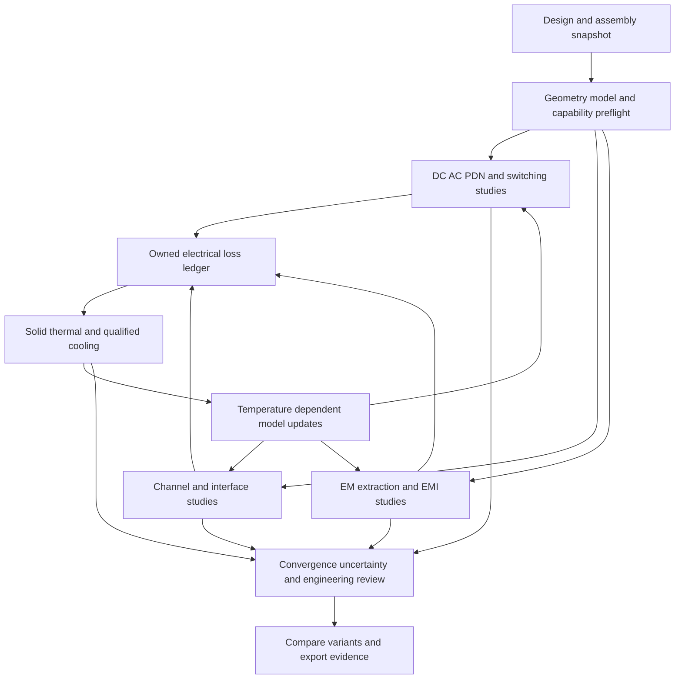

<!-- SPDX-License-Identifier: Apache-2.0 -->
# SPIKE HyperLynx parity and multiphysics development plan

Planning baseline: 12 October 2026.

SPIKE should provide a complete electronics-analysis workflow: import a design,
verify signal and power delivery, predict cooling and electromagnetic behavior,
couple those domains, and retain reproducible engineering evidence. The immediate
priority is to qualify and connect existing foundations, then close the major
SI, field-extraction and cooling gaps. Adding solver names or controls alone
does not achieve parity.

HyperLynx parity covers its SI, PI, schematic analysis, analog mixed-signal,
electrical DRC and Advanced Solvers modules.
Electronics cooling, general RF/antenna EM, magnetics and structural reliability
are additional goals, benchmarked against complementary products. They are not
all capabilities of HyperLynx itself. Siemens describes the module boundaries
in its [six-solution suite description](https://blogs.sw.siemens.com/electronic-systems-design/2026/03/12/hyperlynx-a-parallel-reality/).

This is a proposed development plan. Current executable and validation claims
remain governed by [Solver status](SOLVER_STATUS.md), its linked records and the
machine-readable capability ledger. The tables summarize the inspected working
tree; they do not assert that an installed release has every source capability.

## What parity means

Track three independent outcomes for every requirement:

| Outcome | Required evidence |
| --- | --- |
| Functional parity | Same declared task and input class; complete workflow, diagnostics, import/export and failure recovery. |
| Predictive parity | Same physical problem and observables; mesh/time/frequency convergence, independent comparison and measurement correlation within agreed uncertainty. |
| Workflow parity | Reproducible setup, batch execution, cross-probing, design-change comparison and usable reports within a measured resource and interaction budget. |

Before making an exhaustive parity claim, pin the comparator version, modules,
protocol editions, permitted model libraries, geometry classes and operating
envelope. Public product pages establish feature families; they do not establish
every licensed feature, numerical accuracy or complete rule inventory. Obtain
the detailed inventory through permitted customer documentation and turn every
item into a traceable requirement. Until then, this is a feature-family gap
assessment rather than an exhaustive HyperLynx release checklist.

Source access at this baseline: several Siemens product links returned an
unsupported-content response on direct retrieval; their official indexed text
supports the feature-family comparison. The Siemens six-solution article and
the Ansys, CST and COMSOL reference
pages were directly retrievable. Exact Siemens release entitlements and full
feature inventories require a further documentation check before M0 closes.

In the following tables, **partial** means executable bounded behavior exists
but the full target is unmet; **experimental** preserves the current model
status; **pending** means the inspected evidence does not establish that target.
Priority P0 removes foundational blockers, P1 closes core board-analysis gaps,
P2 extends system multiphysics and P3 adds broader specialist applications.
Milestones M0–M6 are defined below. Their order expresses dependencies, not
promised dates. Multiple increments within one row will be needed.

## Signal integrity and interface verification

The comparator is [HyperLynx SI](https://www.siemens.com/en-gb/products/pcb/hyperlynx/signal-integrity/):
pre/post-layout analysis, DDR interfaces and SerDes workflows, including
IBIS-AMI. Broader EM extraction is covered separately below.

| ID | Target capability | SPIKE baseline and evidence | Required improvement | Priority and milestone |
| --- | --- | --- | --- | --- |
| SI01 | Pre-layout topology exploration and constraints | Partial: configurable RLGC/Touchstone endpoints and passives in [SI workflow](SI_WORKFLOW.md). | Reusable topology editor, corners, termination sweeps and export of reviewed layout constraints. | P1 M2 |
| SI02 | General post-layout channel extraction | Experimental straight/pair and piecewise planar paths; bends omit discontinuity physics. [Geometry channel](GEOMETRY_DERIVED_SI_CHANNEL.md). | Branches, layer changes, return planes, arbitrary coupled conductors; geometry coverage report and converged extraction. | P0 M1, P1 M2 |
| SI03 | Vias, launches, connectors and package discontinuities | Bounded optional EM workflows; general board extraction is unqualified. [Solver status](SOLVER_STATUS.md). | Calibrated multiport submodels, explicit reference planes, de-embedding, package/board composition and stitched return paths. | P1 M4 |
| SI04 | Nonlinear IBIS driver and receiver behavior | Inventory and explicit DC-slope/ramp reduction; nonlinear switching and AMI absent. [SI guide](SI_USER_GUIDE.md). | Qualified IBIS parser/model execution, clamps, V/T behavior, package parasitics, corners and model diagnostics. | P1 M2 |
| SI05 | SerDes statistical analysis and IBIS-AMI | Deterministic loaded NRZ/PAM4 records and bounded clock recovery; no established AMI or rare-event BER capability. [Solver status](SOLVER_STATUS.md). | Bounded AMI execution, statistical/time-domain modes, CTLE/FFE/DFE, jitter/noise/CDR models and protocol-specific acceptance. | P1 M4 |
| SI06 | DDR full-interface SI and timing verification | No qualified DDR interface workflow established by the inspected ledger. | Controller/DRAM model binding, read/write timing, strobes, byte lanes, ODT, topology and corners; versioned JEDEC requirements. | P1 M4 |
| SI07 | Crosstalk, waveform, eye and TDR diagnostics | Partial experimental NEXT/FEXT, deterministic eyes, loaded transfer and TDR. [SI guide](SI_USER_GUIDE.md). | Multi-aggressor switching, timing/noise budgets, spatial cross-probing and independent two/four-port VNA/TDR correlation. | P1 M2 |
| SI08 | Network quality and interoperability | Operational Touchstone S/Z/Y, renormalization, bounded mixed mode, passivity/reciprocity; arbitrary causality checks unavailable. [Solver status](SOLVER_STATUS.md#network-data-workbench). | Reviewed causality/resampling/DC policy, calibrated fixture removal, general port pairing and passive causal broadband model fitting. | P0 M1, P1 M2 |

## Power integrity and electrical rule checking

[HyperLynx PI](https://www.siemens.com/en-us/products/pcb/hyperlynx/power-integrity/)
covers DC delivery, AC decoupling and PDN optimization.
[HyperLynx electrical DRC](https://www.siemens.com/en-us/products/pcb/hyperlynx/electrical-design-rule-check/)
provides configurable structural/electrical checks. Rule coverage and physical
simulation accuracy are separate acceptance questions.

| ID | Target capability | SPIKE baseline and evidence | Required improvement | Priority and milestone |
| --- | --- | --- | --- | --- |
| PI01 | Board DC drop, current density and via loading | Executable routed/hybrid DC with bounded analytical benchmarks. [Solver status](SOLVER_STATUS.md#copper-geometry-dc-spikerouted_dc). | Representative geometry qualification, full rail coverage, contacts, source/load regimes and measured-board correlation. | P0 M1, P1 M2 |
| PI02 | Broadband AC PDN extraction | Approximate PEEC driving-point networks and candidate review; C/G estimates and scaling limits remain. [AC PI](AC_POWER_INTEGRITY_EFFECTS.md). | Converged capacitance/dielectric loss, proximity redistribution, plane/via/package multiports and passivity-preserving reduction. | P1 M2 |
| PI03 | Physical decap selection and placement optimization | Supplied-network candidate/single-cap comparison exists. [PI tools](PI_ENGINEERING_TOOLS.md). | Location-dependent extraction, bias/temperature/tolerance models, BOM constraints and validated optimizer; retain rejected candidates. | P1 M2, P2 M5 |
| PI04 | Switching loads, SSN and circuit/field interaction | Native transient, staged ngspice and bounded field/circuit paths exist. [Solver status](SOLVER_STATUS.md). | Qualified switching/model subsets, package PDN, simultaneous-switching return currents, stable broadband N-port coupling and reference comparisons. | P1 M2, P2 M5 |
| PI05 | SI/PI/EMI/safety electrical DRC | Contextual checks, return-path tools and evidence export; no HyperLynx-class ruleset established. [Engineering review](ENGINEERING_REVIEW.md). | Versioned geometric rule engine, explicit coverage, waivers, cross-probing and original fixture library; separate native EDA DRC/ERC evidence. | P1 M2 |
| PI06 | Power-circuit and converter model completeness | Behavioral PWM electrothermal and sourced model checks are bounded. [Power qualification](SOURCED_POWER_QUALIFICATION.md). | Real controller/device models, deadtime, startup/protection, semiconductor temperature feedback and measured loss/thermal correlation. | P2 M5 |

## Schematic analysis and analog mixed signal

Siemens also includes schematic inspection and AMS circuit simulation in its
[HyperLynx suite description](https://blogs.sw.siemens.com/electronic-systems-design/2026/03/12/hyperlynx-a-parallel-reality/).
These need explicit requirements alongside board field analysis. The public
description does not settle complete simulator dialect or device coverage.

| ID | Target capability | SPIKE baseline and evidence | Required improvement | Priority and milestone |
| --- | --- | --- | --- | --- |
| SA01 | Schematic net and component electrical analysis | Connectivity/BoM/contextual checks exist; no qualified complete schematic-analysis workflow established. [Engineering review](ENGINEERING_REVIEW.md). | Reviewed schematic import and hierarchy, model/pin assignment, operating-condition compatibility and net-wide checks; actionable cross-probed findings and explicit coverage. | P1 M2 |
| AMS01 | Analog and mixed-signal circuit verification | Native circuit/transient kernels and optional circuit adapters execute bounded subsets. [Solver status](SOLVER_STATUS.md). | Pin comparator device/model/dialect coverage; OP/DC/AC/transient/noise and analog/digital event interaction as required by that inventory; schematic-to-netlist traceability and independent numerical verification. | P1 M2, P2 M5 |

## Electromagnetic extraction and system EM

[HyperLynx Advanced Solvers](https://eda.sw.siemens.com/en-US/pcb/hyperlynx/3d-em/)
is the PCB/package extraction comparator. General RF, antennas and EMC broaden
the target to [Ansys HFSS](https://www.ansys.com/de-DE/products/electronics/ansys-hfss)
and [CST Studio Suite](https://www.3ds.com/products/simulia/cst-studio-suite).
These suite-level scopes do not mean every application uses the same formulation.

| ID | Target capability | SPIKE baseline and evidence | Required improvement | Priority and milestone |
| --- | --- | --- | --- | --- |
| EM01 | Quasi-static R/L/C/G extraction | PEEC and bounded quasi-TEM cross sections; general convergent capacitance and proximity physics remain open. [Solver status](SOLVER_STATUS.md). | Independent electrostatic/magnetoquasistatic oracles, explicit material ranges, frequency validity and full conductor matrices. | P1 M2 |
| EM02 | Hybrid planar full-board/package extraction | No qualified general hybrid extraction path established. | Segment planar regions and 3D discontinuities without losing return currents; validate interface continuity and multiport composition. | P1 M4 |
| EM03 | Full-wave 3D multiport SI/PI/RF | Optional EMerge/openEMS execute bounded cases; native `spike.fullwave_3d` remains unavailable. [Solver status](SOLVER_STATUS.md). | Complete geometry/ports, dielectric dispersion and conductor loss, boundary convergence, multi-excitation calibration and qualified PCB/package fixtures. | P1 M4 |
| EM04 | Antennas, near/far fields and scattering | Experimental fields/NF2FF and one-way physical optics; public MoM unavailable. [Retained EM](RETAINED_ASSEMBLY_EM.md), [mesh roadmap](ANALYSIS_AND_MESH_ROADMAP.md). | Power calibration, fed antenna matching, antenna/enclosure/cable interaction; complete and qualify MoM only when its use cases justify it. | P2 M4, P3 M6 |
| EM05 | Conducted/radiated EMC and immunity | EMI screening and reference-profile metadata; regulatory pass/fail and signoff absent. [EMI workflow](EMI_WORKFLOW.md). | Cable/common-mode sources, LISN/receiver/fixture models, shielding/transfer paths, immunity excitation and licensed edition-specific limits with chamber correlation. | P2 M6 |
| EM06 | Nonlinear magnetics, machines and actuators | Experimental planar FEM, stationary eddy currents and reduced motion/thermal models. [Machine studies](MAGNETIC_MACHINE_STUDIES.md). | 3D material-qualified magnetics, moving interfaces, hysteresis/core loss, drive-circuit feedback and force/torque/loss measurement. | P3 M6 |

## Thermal and cooling

These targets extend beyond HyperLynx. Dedicated comparators are
[Simcenter Flotherm](https://www.siemens.com/en-gb/products/simcenter/fluids-thermal-simulation/flotherm/),
[Ansys Icepak](https://ansys.synopsys.com/products/electronics/ansys-icepak)
and the [COMSOL Heat Transfer Module](https://www.comsol.com/heat-transfer-module).
Module dependencies and permitted automation differ between products.

| ID | Target capability | SPIKE baseline and evidence | Required improvement | Priority and milestone |
| --- | --- | --- | --- | --- |
| TH01 | PCB/package/assembly solid heat transfer | Experimental layered and retained tetrahedral steady/transient conduction, contacts and ambient radiation; CalculiX comparisons exist. [Thermal roadmap](THERMAL_RESEARCH_ROADMAP.md). | Resolve existing refinement failures; qualify copper/package detail, thin layers, temperature-dependent materials and nonmatching contacts. | P0 M1, P1 M3 |
| TH02 | Junction and compact package models | Reviewed solids and explicit losses/resistances; decorative STEP does not reveal internal package physics. [Component solids](THERMAL_COMPONENT_SOLIDS.md). | Conditioned die/TIM/lead models, multi-node dynamic compact models, Zth import/fit and independent package measurements. | P1 M3 |
| TH03 | General enclosure airflow and CHT | Native/SU2 2D cavity, SU2 three-zone CHT and synthetic OpenFOAM fan/duct cases are experimental; arbitrary retained-assembly execution has blockers. [Solver status](SOLVER_STATUS.md), [fan evidence](FAN_CHT_QUALIFICATION.md). | Robust imported fluid domains, natural/forced convection, boundary layers, fan curves and pressure losses; independently refined CFD and measured cooling. | P1 M3 |
| TH04 | Enclosure radiation, vacuum and potting | Ambient radiation, geometric view-factor work and bounded coating/potting paths; coupled enclosure radiosity remains open. [Thermal roadmap](THERMAL_RESEARCH_ROADMAP.md). | Conservative surface-to-surface radiation, occlusion/closure, reviewed optical properties, vacuum boundaries and qualified thin/effective layers. | P2 M3 |
| TH05 | Bidirectional transient electrothermal | Steady DC/AC multiboard and bounded PWM retained-volume coupling exist. [Volume PWM](PWM_VOLUME_ELECTROTHERMAL.md), [multiboard](MULTIBOARD_VOLUME_ELECTROTHERMAL.md). | Device/PCB loss mapping, temperature-dependent semiconductor behavior, multiple time scales, rollback and coupled mesh/time/energy convergence. | P2 M5 |
| TH06 | Thermal stress and reliability | No qualified general thermomechanical/reliability route established by this baseline. | Conservative temperature-to-structure transfer, CTE/material/contact models, deformation/stress; fatigue/lifetime only with calibrated material and mission data. | P3 M6 |

## Shared data and engineering workflow

Automation and job distribution are part of the HyperLynx Advanced Solvers
comparison above. General multiphysics coupling also takes guidance from the
[COMSOL RF Module](https://www.comsol.com/rf-module), which supports RF and
thermal interaction with the appropriate additional modules. SPIKE should
extend its current neutral contracts rather than duplicate each domain's setup.

| ID | Target capability | SPIKE baseline and evidence | Required improvement | Priority and milestone |
| --- | --- | --- | --- | --- |
| WF01 | CAD-neutral board/package/assembly ingestion | SpiDeR/AssemblyIR and importer boundaries exist; schema coverage exceeds executable support. [Foundation](CAD_NEUTRAL_NATIVE_MULTIPHYSICS_FOUNDATION.md). | Tested format/version coverage, unit/object/topology audits, source-ID mapping and explicit omissions across licensed ECAD/MCAD inputs. | P0 M0–M1 |
| WF02 | Shared materials, models and operating conditions | Environment profiles and domain-specific models exist; readiness does not validate physics. [Solver status](SOLVER_STATUS.md). | One conditioned model catalog with property functions, frequency/temperature ranges, uncertainty, provenance and redistribution rights. | P0 M1 |
| WF03 | Adaptive meshing and error control | Manual/local refinement and bounded adaptive reference tools exist. [Mesh roadmap](ANALYSIS_AND_MESH_ROADMAP.md). | Quantity-of-interest error control, interfaces/ports/loss-preserving transfer, mesh/time studies and explicit uncertainty; physics-specific meshes. | P0 M1, P1 M3–M4 |
| WF04 | Unified study orchestration and cross-probing | Worker/CLI, saved studies, provenance and several domain viewers exist; unified ordered evidence pipeline pending. [Review](ENGINEERING_REVIEW.md). | Dependency graph, stale-result propagation, synchronized occurrence/time/frequency probes, replay and consolidated review report. | P0 M1, P2 M5 |
| WF05 | Batch, optimization and scalable execution | Bounded independent local/remote worker jobs exist; no general single-solve MPI or AMD/Intel GPU claim. [Worker manager](PARALLEL_WORKER_MANAGER.md). | Workload-specific scheduling, checkpoint/recovery, reuse caches; profile before adding distributed kernels/GPU; validate each backend. | P1 M2, P2 M5 |
| WF06 | Measurement correlation and release qualification | Analytical/reference records and recorded telemetry comparison exist; general physical parity is unqualified. [Co-simulation](COSIMULATION_DIGITAL_TWIN.md), [contributing](../CONTRIBUTING.md). | Version-bound qualification packs, calibrated measurements, separate calibration/validation sets, supported-envelope reports and human numerical release review. | P0 M0, all milestones |

## Development milestones and dependencies

Scope effort only after M0 establishes the detailed inventory and available
engineering capacity. Full feature, accuracy and workflow parity is a sustained
multi-release program. External adapters can accelerate usable coverage while
native methods mature; adapter completion and native solver parity must be
reported separately.

| Milestone | Deliverable and recommended owner | Dependencies | Exit evidence |
| --- | --- | --- | --- |
| M0 Baseline and acceptance | Product/validation owners: requirement inventory for all 34 rows; comparator versions/modules, model rights, supported envelopes and benchmark plans. Reconcile stale summaries with scoped validation records. | None; respect the existing [active queue](ACTIVE_ENGINEERING_QUEUE.md). | Every row has an accountable owner role, input/output contract, exact benchmark, proposed tolerance, reference availability and failure policy. Unknown comparator details remain open. |
| M1 Shared foundation and existing failures | Geometry, contracts and validation owners: canonical geometry/model coverage, job dependencies, loss ledger, conservative transfer contracts and reproducible convergence runner. | M0, existing SpiDeR/AssemblyIR/AnalysisSpec/AnalysisResult. | Geometry/unit/ownership checks and stale-result rejection pass; known thermal refinement and SI passivity failures are resolved or remain blocked with a bounded supported scope. |
| M2 Core board SI and PI | SI/PI and UI owners: nonlinear IBIS increment, stronger channel/PDN extraction, network quality, DRC/schematic-analysis subsets, bounded AMS verification and topology/corner/batch flows and first correlated board pack. | M1; qualified extractors required for physical decap placement. | R/L/C/G and loaded electrical observables pass declared analytical, independent and measurement gates; DRC coverage explicit. No DDR/AMI claim yet. |
| M3 Solid thermal and assembly cooling | Thermal/CFD and geometry owners: solid/package qualification, reliable fluid-domain compiler, contacts/radiosity, cooling workflow and measured assembly pack. | M1; explicit electrical loss inputs from M2 where needed. | Heat and mass balances, mesh/time refinement, independent solid/flow references and calibrated temperature/flow comparisons pass within the declared envelope. |
| M4 High-speed interfaces and 3D EM | EM/SI owners: qualified discontinuity extraction, multiport composition, AMI and DDR interface workflows. Develop these as separate bounded increments. | M1/M2; EM03 qualification precedes geometry-derived full-wave link claims. | Two/four/N-port calibration, passivity/reciprocity/causality as applicable, port/PML convergence, interface timing and permitted protocol-model benchmarks pass. |
| M5 Integrated cross-domain studies | Coupling/application owners: one study graph for electrical, EM, thermal and circuit feedback; sensitivity and constrained optimization. | Qualified subsets of M2/M3/M4, versioned transfer contracts. | Coupled fixed-point/time refinement, conservative transfers, event/rollback behavior, no duplicated losses, reproducible restart and end-to-end measured pack. |
| M6 Broader system capability and release | EMC/magnetics/structures/release owners: cables/shielding/immunity, selected machine/structural routes and scalable distribution. | Relevant qualified M3–M5 paths; reference hardware and model rights. | Domain-specific qualification; numerical human review, offline/upgrade/uninstall and clean-machine release gates. Each added application gets its own envelope. |

Parallel work is economical after M1: thermal M3 and board SI/PI M2 can use the
same geometry/provenance foundation with distinct physics owners. AMI and DDR
can develop against qualified supplied networks while EM extraction matures,
but full-board predictive claims must wait for the extraction gates. Do not
make M2 wait for an entire native Maxwell solver or restart existing work merely
to fit this milestone numbering.

## Cross domain workflow

Use one immutable design snapshot, explicit operating scenarios and a dependency
graph of studies. Reuse entity identity and materials across domains; use
separate qualified meshes and conservative transfer operators where needed.

| Workflow | Transfer and feedback | Acceptance and practical value |
| --- | --- | --- |
| PDN to thermal to PDN | Current/conductor/contact/device losses → owning volumes; temperature → R, ESR and qualified device properties. | No double-counted Joule/device loss; convergence of rail drop, hotspot and energy. Finds rails or capacitors that degrade when warm. |
| SI and EM to thermal to SI | Qualified conductor/dielectric losses → thermal; temperature-dependent materials/models → extracted channel and endpoints. | Passive network/field consistency and coupled eye/timing convergence. Enables temperature-aware link margins. Small-signal SI amplitude alone does not establish dissipated operating power. |
| Switching PI to EMI | Time-domain return currents and switching spectra → explicitly defined EM ports/cables; qualified impedances → circuit response. | Preserve reference planes, phase, RMS/peak and source loading. Locates common-mode paths and compares filters/shield changes. |
| Fan and enclosure to electrical limits | Solved flow → thermal interface; temperature → electrical derating and losses. | Verify actual interface flux and global heat/mass balance. Prescribed convection remains a separate reduced model. |
| Board package harness and enclosure | Occurrence-scoped ports/bonds/contact/source IDs connect domain submodels. | Continuous return paths and ownership; distinguish supplied lumped harness networks from geometry-resolved field coupling. |
| Thermal to structure and reliability | Temperature history → structural expansion/stress; reviewed deformation may update geometry/contact conductance. | Preserve transferred loads/work and material range; calibrated fatigue models before lifetime claims. Later M6 extension. |

The coupling contract must record source/target mesh and model digests, entity
and occurrence IDs, units, timestamps/frequencies, sign conventions, transferred
integrals, interpolation method and error. Distinguish stored electromagnetic
energy from dissipative heating. A changed model, port, boundary or mesh
invalidates dependent results. Interpolation cannot quietly erase events,
conservation defects or unsupported source ownership.

Use explicit one-way coupling first. Add steady bidirectional iteration with
both state-change and residual/energy gates. Add transient window coupling only
with event alignment, rollback, resource limits and independent communication-
step refinement. Reuse current specialized electrothermal paths; generalize
them only when their contracts and evidence support it. FMI integration is a
separate planned adapter, not a prerequisite for the existing couplings.

## Implementation strategy

Keep domain contracts/orchestration in Python, profiled numerical kernels in
C++, presentation in TypeScript and the Rust host thin, following the
[language policy](LANGUAGE_POLICY.md). Extend registries and the existing
AnalysisSpec/AnalysisResult boundaries. A study graph extension or new public
transfer boundary needs an accepted ADR before implementation.

| Approach | Use it for | Conditions |
| --- | --- | --- |
| Extend SPIKE native code | Shared identity, study orchestration, provenance, reviewed loss/model catalogs, bounded electrical/thermal kernels and UI integration. | Preserve existing evidence and architecture; do not duplicate domain logic across UI/host/services. |
| Qualify existing optional engines | openEMS/EMerge for overlapping EM, CalculiX for solids, OpenFOAM/SU2 for overlapping CFD, ngspice/Xyce for supported circuits. | Pin versions, admit actual translated geometry/models, verify results and platform packaging; discovery or native output inspection is insufficient. |
| Add commercial exchange where useful | Licensed HyperLynx/HFSS/SIwave/Icepak/Flotherm reference comparison and customer workflows. | Verify public/licensed APIs, supported exchange formats and automation rights. No adapter is assumed present; no implicit purchase or engine redistribution. |
| Develop new native formulations | General electrostatics, scalable PEEC, hybrid/full-wave/MoM, advanced CFD only where needed. | Independent derivation, bounded reference implementation, convergence and comparison before performance work; maintain fail-closed public capability flags. |

Native ownership can remain the long-term goal without blocking useful
cross-domain operation on validated external subsets. Reassess engine choices
against accuracy, memory, execution time, maintainability, installation and
license obligations for the exact task. Do not assume a second solver's output
is ground truth merely because it is commercial.

## Validation and parity reporting

Build an original, legally reproducible benchmark pack for each family:

| Family | Required cases and observables |
| --- | --- |
| DC and PDN | Trace/sheet/via/contact references, multi-source rails, plane/package resonances and switched loads; R, voltage, current density, complex Z and energy. |
| SI and interfaces | Uniform/coupled lines, via/connector discontinuities, nonlinear IBIS, AMI reference channels and complete DDR lanes; complex S, delay, TDR, loaded waveform, eye/BER and timing. |
| EM | Resonator/antenna references, calibrated multiports, PCB/enclosure/cable cases; complex S, field norms, power balance, gain/pattern and shielding response. |
| Thermal and CFD | Anisotropic slabs/contacts, transient sources, cavity/channel flow, heated solid-fluid interfaces, package and assembly tests; temperature rise, heat rate, pressure drop and mass/energy histories. |
| Coupling | Resistor R(T), mapped multi-device losses, switched power into solids, temperature-aware channel and restart/event cases; transferred energy, residuals and iteration/time-step error. |
| Workflow | Project reopen, changed inputs, unavailable runtime, cancellation, malformed/partial results and bounded batch recovery; correct evidence retention and measured interaction/resource costs. |

Approve observable-specific tolerances **before** runs. Preserve existing
stricter gates. Complex S near a zero needs an absolute error metric; phase
needs meaningful amplitude and declared reference planes; temperature metrics
use temperature rise and measurement uncertainty; BER needs statistical
confidence. Use separate mesh, timestep and sweep refinement, normally at least
three consistent mesh levels where feasible. Algebraic residual, conservation,
cross-engine agreement and hardware accuracy are different metrics.

Keep failed White Rabbit eye passivity, the real-board thermal refinement
failure, timed-out CFD cases and geometry exclusions visible until new evidence
resolves them. Compare the same geometry, materials, loads, boundaries and
model subset; keep calibration and validation hardware separate. Numerical
implementation still requires knowledgeable human review before release.

Report supported requirement counts separately for functional, predictive and
workflow parity, with denominators and exclusions. Do not invent a single
percentage from these 34 broad rows. A benchmark dashboard should link exact
engine/build/model/mesh identities, inputs, logs, results, uncertainty, reviewer
and known failures. New evidence updates Solver status and capability flags only
through the project's acceptance process.

## First implementation batch

Implementation tracking is now in [the versioned development backlog](parity-capability-backlog-v1.json).
It covers all 34 rows without changing runtime capability flags. WF01 has its
first bounded import-assurance increment: [an original KiCad coupon](../benchmarks/parity-import/README.md)
passed real CLI execution and 24 geometry/reference assertions. The other
benchmark definitions remain pending, so Start01 is not yet an acceptance-complete
benchmark inventory. Check backlog coverage with `python scripts/check_parity_backlog.py`.

Bounded implementation stages are tracked separately from the M0–M6 program
milestones and the 34 overall capabilities. A stage is marked **Done** only
after its declared checks pass; neither M0 nor WF01 as a whole is complete.

| Stage | Status | Acceptance evidence |
| --- | --- | --- |
| WF01-S01 | Done | Straight tracks/via: real CLI execution and [24 source-bound assertions](validation/parity/WF01-S01.json). |
| WF01-S02 | Done | Rotated pad/native origin, materials and bindings: real CLI execution and [12 assertions plus KiCad 10.0.6 checks](validation/parity/WF01-S02.json). Native DRC findings remain explicit. |
| WF01-S03 | Done | Bounded exact copper arcs and straight-outline cutouts: [18 import assertions and recomputed consumer observables](validation/parity/WF01-S03.json). Historical failure evidence remains retained. |
| WF01-S04 | In progress | Additional formats, source geometry and package-model coverage; split into bounded substages below. |
| WF01-S04A | Done | All KiCad model occurrences and declared placement vectors retained: [30 CLI assertions and independent native pcbnew facts](validation/parity/WF01-S04A.json). JSON/legacy round-trip and malformed-vector diagnostics verified. |
| WF01-S04B | Done | [Actual native ODB export](validation/parity/WF01-S04B.json): 14 CLI assertions, member/native geometry/topology/reference gates and 56 pad pose/shape cases. Initial failures and the original candidate remain historical evidence. |
| WF01-S04C | In progress | Explicit package-model placement, solid geometry and material qualification; native composed KiCad placement and material evidence remain open. |
| WF01-S04C1 | Done | [Explicit neutral STEP handoff](validation/parity/WF01-S04C1.json): three source-bound package occurrences, actual native solid counts/volumes/bounds and STEP round trips. Source KiCad transforms remain unapplied. |

The checker rejects a Done stage with stale fixture/manifest/runner bytes,
failed or incomplete import evidence, or unfinished dependencies. These are
development acceptance records, not solver-release or hardware qualification.

S04A preserves model source declarations, including repeated paths and every
offset/scale/rotation triple, and binds each occurrence to its component.
Native KiCad 10.0.6 agrees with the retained facts. Model paths in this original
fixture deliberately have no solid files: rendering validates board parsing,
not package shape accuracy. Placement composition, model-file loading, solid
geometry, thermal properties and EM qualification remain outside this substage.
The canonical transform stays empty and the retained source envelope explicitly
forbids projection. Malformed declarations remain diagnostic source evidence;
they do not erase the footprint or pad. S04 stays in progress until its remaining
format and model-geometry coverage is independently qualified.

S04A verification: 39 focused tests and all 30 CLI assertions pass; native
KiCad confirms three model occurrences and their source vectors. Architecture,
backlog and documentation checks pass. The full host suite ran 3706 tests with
69 skips and one debug-session start timeout. The unchanged eight-test debug
module passed on rerun; the timeout cause is not established and the original
failure remains in the receipt. No zero-failure full-suite or release claim is
made.

S04B admits explicitly declared, digest-pinned ODB archives through the existing
registered importer/package policy. The original candidate remains a runner
regression fixture. The completed stage uses an actual KiCad 10.0.6 native export
with an absolute output path and typed `str_utf8_Map`. Fourteen assertions and
independent member, geometry, cutout and connectivity gates pass. Generated
font data is excluded from the redistributed geometry-only archive. Missing
stackup/models stay diagnostic; all solver-readiness flags stay false.

Native comparison exposed an incorrect earlier pad-angle oracle: the pad angle
is zero, not its footprint's 90 degrees. Import now normalizes angle to neutral
mathematical XY once, without a second back-side reflection; normalized UI
projection converts back to display convention. Native gates strengthen
S02/S03/S04A, with failure history retained. See [the frame decision](adr/0077-native-pad-angle-and-reflection-boundary.md).
This is bounded source/display geometry, not full format, model or physics parity.

S04B verification: 58 focused tests, 81 downstream geometry/import regressions,
three frontend scripts and TypeScript compilation pass. The full host suite
ran 3761 tests with 69 skips, two failures and one error. Native KiCad independently
confirmed that the Marble pad previously expected to be isolated is connected
through its saved back-copper zone; the corrected eight-test PEEC module passes,
including no-zone separation controls. The original full-run failure is retained.
Debugger publication and native Gerber subprocess deadlines remain unresolved;
this is not a zero-failure full-suite or release claim. See the stage receipt
for source-bound native connectivity evidence and all verification logs.

S04C1 adds complete embedded STEP bodies with explicit board-local placement to
the mechanical projection API. Ownership and exact retained design digests bind
each body to its model/component/board occurrence. Partial coverage remains
diagnostic; material IDs retain properties without promoting physics readiness.
Original 2x3x4 mm solids have volume 24 mm3; three supplied placements are checked
against analytical bounds and actual native STEP round trips. This does not
apply the original KiCad model vectors or authenticate source URI contents.
Native composed-placement export still times out in standalone and host probes;
[the recorded attempts](validation/parity/WF01-S04C-progress.json) preserve the
missing reference. S04C remains in progress.

S03 verification: 48 focused geometry tests passed (one optional FreeCAD check
skipped in the sandbox), plus 20 backlog/corpus tests. The full host Python run
completed 3654 tests with 68 skips and one temporary-directory-context failure:
the non-repository fixture lived inside this Git repository. Its unchanged
five-test module passed with the normal host temporary directory. No test oracle
or acceptance tolerance was relaxed. Full source/solver release qualification
remains outside this bounded stage.

Complete or account for existing active integration before starting this batch.
These tickets make M0/M1 concrete without claiming to implement every solver.

| Ticket | Owned output | Dependency | Acceptance |
| --- | --- | --- | --- |
| Start01 | Versioned requirement/benchmark manifest expanding the 34 rows. | None. | Each requirement binds comparator scope, current evidence, owner, target, tolerance and blocked reason. |
| Start02 | Geometry/material/model coverage audit for one DC board, one coupled SI coupon and one heated assembly. | Start01. | All source IDs, stackup, ports, contacts and omitted objects accounted for; unknown data blocks dependent calculations. |
| Start03 | Replay and diagnose existing SI passivity and thermal refinement failures. | Exact retained inputs and admitted runtimes. | Independent cause evidence; fix passes old and discriminating cases, or the affected workflow remains blocked. |
| Start04 | Reusable convergence/evidence runner extending current harnesses. | Start01/02. | Real executions retain mesh/time/sweep settings, quantities of interest, failures, uncertainty and resource costs. |
| Start05 | Loss ledger and conservative transfer extension proposal. | Start02 plus existing PWM/assembly contracts. | Ownership and no-double-counting derivation, stale binding and energy oracle approved; ADR for any new boundary. |
| Start06 | One saved multiboard electrical-to-solid-thermal study and report. | Qualified current subset; Start02/04/05. | Reopen/replay and source-to-loss-to-temperature cross-probing work; reduced or experimental status remains explicit. |

The first demonstrable improvement is a reproducible, inspectable coupled
study with honest uncertainty and an executable gap backlog. Core SI/PI
qualification and cooling qualification then proceed as separate workstreams
before broader full-wave, interface and system multiphysics claims.

Research provenance: vendor product pages support the target feature families;
SPIKE records support the baseline. This plan contains original requirements
and sequencing, with no imported vendor code, example decks, models or meshes.
No solver execution or capability promotion is performed by this planning change.
