<!-- SPDX-License-Identifier: Apache-2.0 -->
# Picture walkthroughs

Use these numbered flows in the current development UI. Start with **Ctrl+K**
when a workspace or panel is hidden. Captions identify what a picture proves.
Opening a setup panel, importing geometry and completing a solver run are
separate outcomes. See [current solver status](SOLVER_STATUS.md) before choosing
an analysis; installed releases can have older controls.

## Find the next action

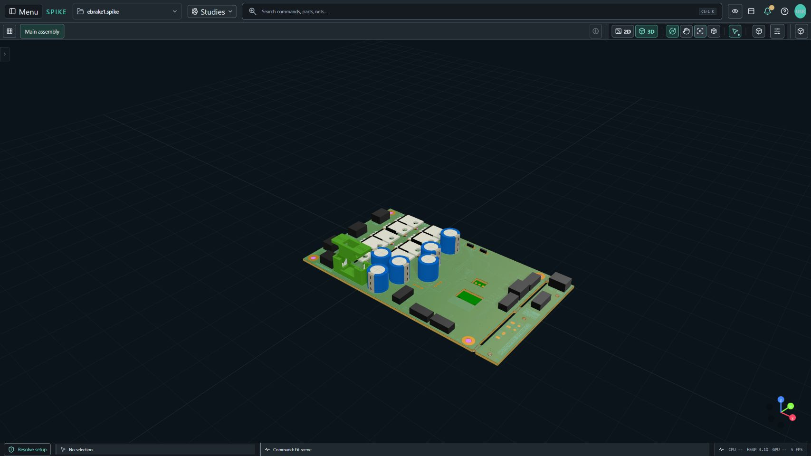

Actual full-workbench browser capture of the current SPIKE shell. It shows the
board viewport and command routes; no analysis was run for this walkthrough.
The [dated ESP32 picture and provenance](UI_QUICKSTART.md#capture-provenance)
remain available in the earlier quick start.

1. Press **Ctrl+K** and enter the action, workspace, part reference or net name.
2. Read the proposed target and board identity, then open it. Use the panel's
   expand/resize controls when its inputs need more room.
3. Open the section's **Help** control for its exact inputs. Return to setup and
   complete missing values before continuing. Save the project explicitly.

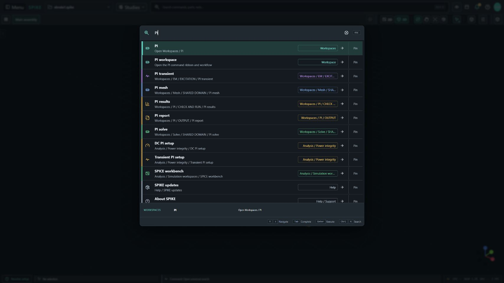

Actual full-workbench browser capture of command search; no analysis was
executed. If a tool is hidden, use **Show hidden tools**, search, or **Menu > All actions**. Search
routes to setup and does not supply missing voltage, current or return paths.

## Import a board and review readiness

1. Open **Project files > Import board / CAD...** or use supported file drop.
   Select the source file and wait for the import to finish.
2. Open the import-quality report in **Scene Navigator**. Check units, tracks,
   pads, vias, zones, components, unsupported objects and source identities.
3. Review physical layer order, copper/dielectric thickness and materials.
   Cross-check the net inventory, then use **Fit scene** and save the project.

**Outcome:** an imported design with reviewed diagnostics, ready for explicit
analysis setup. A displayed component model does not establish an electrical
model. If geometry is missing, inspect the named import/model diagnostic;
resolve the source or supported model assignment before relying on it.

Continue with [the workbench handbook](WORKBENCH_HANDBOOK.md) and
[UI quick start](UI_QUICKSTART.md).

## Load native Gerber: Source > Stack > Ports > Review

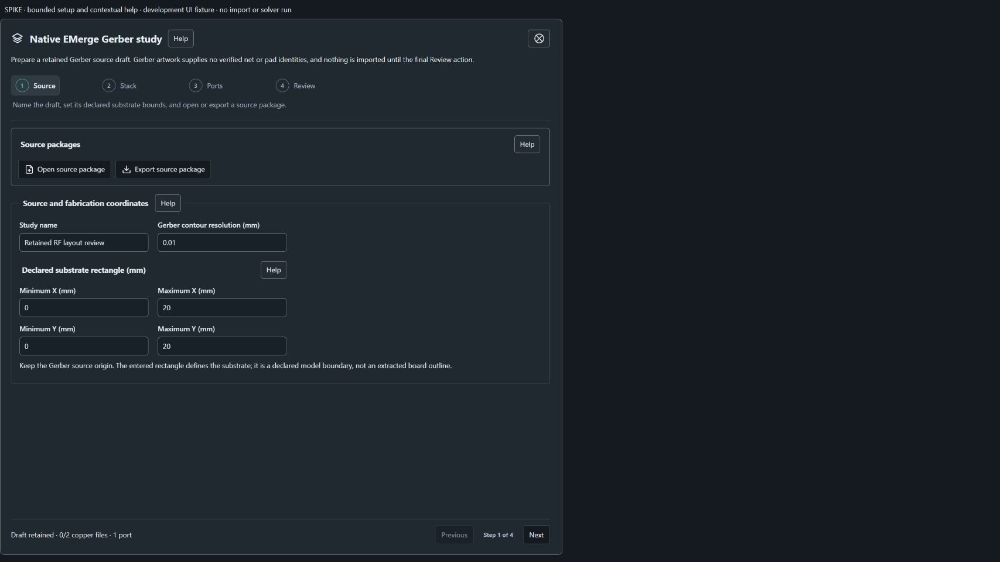

Actual browser capture of the native Gerber setup component. Source bounds and
package actions are editable draft inputs; the picture is not a native import
or an EMerge execution receipt.

1. Open EMerge setup and choose **Native Gerber study**. In **Source**, enter the
   study name, original-coordinate bounds in mm and contour resolution, or use
   **Open source package** to restore a retained draft. The rectangle declares
   substrate extent; it does not extract a board edge from artwork.
2. Choose **Stack**. Select original copper files from F.Cu to B.Cu and enter
   each intervening dielectric's thickness, relative permittivity and loss
   tangent. Then choose **Ports** and enter each manual plane's centre X, Y,
   width and signal/adjacent lower return layers. Use **Next**, **Previous** or
   the numbered steps to revisit inputs; navigating does not import the draft.
3. Choose **Review**, check the source/count/port summary, then select **Load
   Gerber study**. After import, use **Check EMerge runtime** and **Prepare
   native Gerber mesh**. Review actual conductor/port contact before a solve.

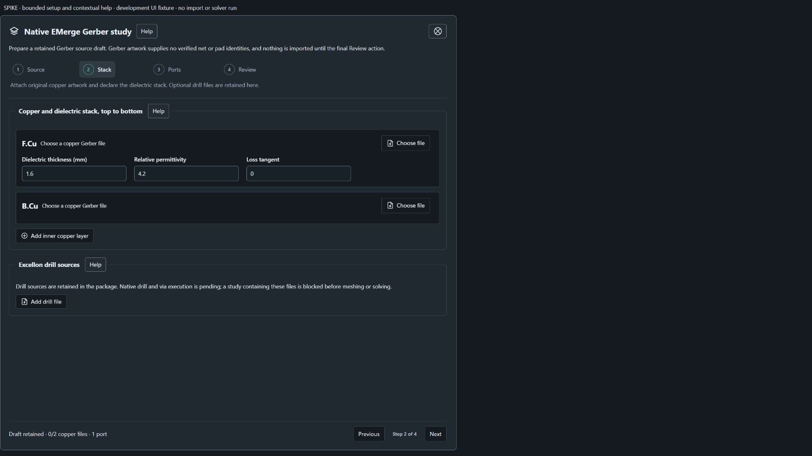

Actual browser capture of the Stack editor. Material values are supplied inputs;
Gerber does not provide verified pad/net identity or dielectric properties.

**Outcome:** retained artwork and explicit setup become the active design.
The initial viewport shows substrate bounds; copper review follows native mesh
preparation. Runtime support must be available in the selected interpreter.
Retained Excellon sources currently block native drill/via execution. Do not
remove them merely to make a run pass: first determine whether omitting drills
is valid for the study. Failed import retains the draft for correction.

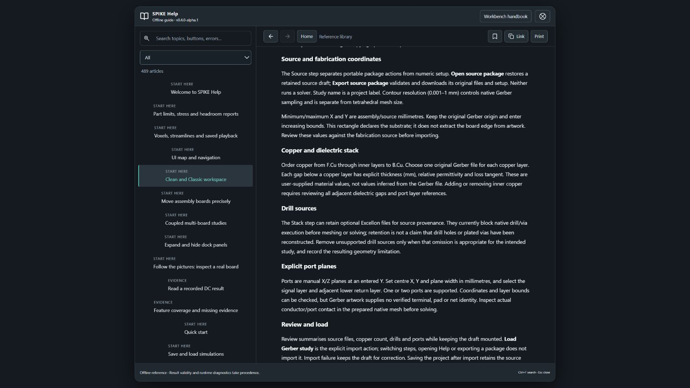

Actual browser component capture of contextual Help. Use the header Help control
for the matching section, then close Help and continue with the retained draft.
See [native Gerber workflow and limits](EMERGE_GERBER.md).

## See copper: layers, opacity and net names

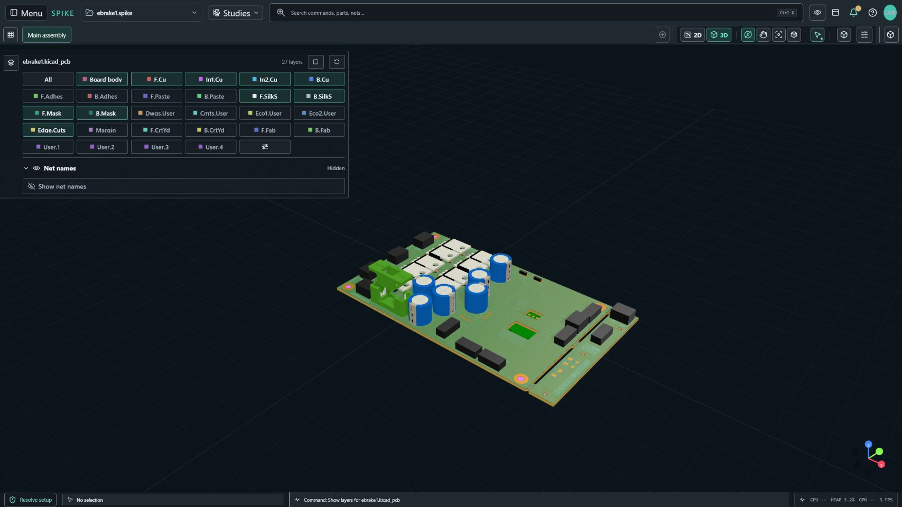

Actual full-workbench browser capture with the layer control expanded. Layers show
display state, not mesh coverage or electrical connectivity.

1. Focus one board occurrence, choose **2D** for trace/net inspection and use
   **Fit scene**. Hover or focus the layer pull near the upper-left viewport.
2. Toggle the desired layer in the expanded grid. Use **All** to restore layers
   and clear layer focus. Open the layer manager for per-layer visibility and
   opacity; reduce context opacity to expose internal copper.
3. Enable **Net names** in the layer manager, or search **Show net names**.
   Zoom in for fine traces, then inspect the selected net/part identity.

**Outcome:** a readable view of the intended board/layer. If the strip is
missing, focus one board; multi-board/all-board selection hides it. Restore
hidden layers before diagnosing missing geometry. Identical net names on two
boards require explicit connector pin mappings to establish a connection.
See [UI navigation](UI_NAVIGATION.md) and [workbench handbook](WORKBENCH_HANDBOOK.md).

## Inspect mechanics: Objects > Section > Measure

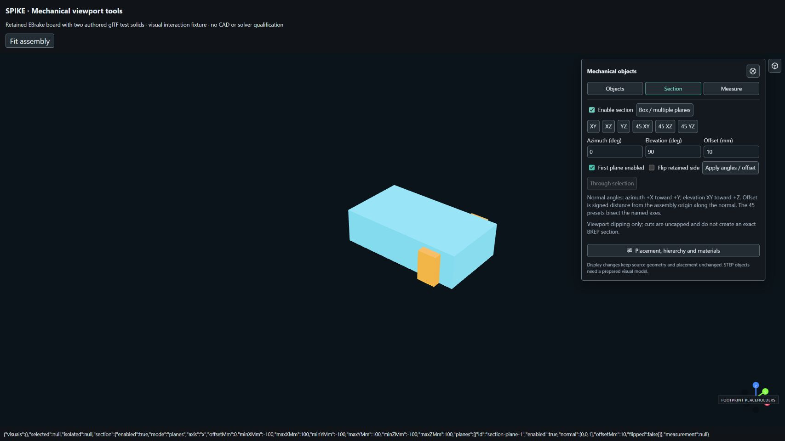

Actual browser capture of the mechanical-controls component with prepared
fixture display geometry. Fixture glTF bodies demonstrate controls; they are
not evidence that native STEP solids were imported or a native CAD operation ran.

1. With mechanical parts loaded, click **Mechanical objects, sections and
   dimensions** at the upper-right viewport to pin its panel. In **Objects**,
   find and select the occurrence; use its eye, opacity or isolate control.
   Choose **View mechanical geometry in 3D** if offered.
2. Choose **Section**, enable section and the first plane, then use XY/XZ/YZ or
   a bisector preset. For an arbitrary angle enter azimuth, elevation and
   offset, then **Apply angles / offset**. **Through selection** uses the
   selected occurrence origin. **Flip retained side** reverses the kept side.
3. Choose **Measure**. Enter both XYZ points in assembly mm, or select each
   occurrence and choose **Set A from selection** / **Set B from selection**.
   Read distance and signed B-minus-A deltas; export **JSON** or **CSV**.

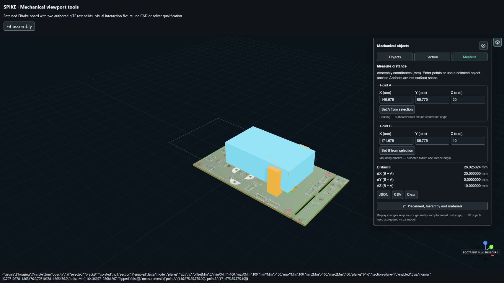

Actual browser capture of the measurement component. Coordinates and selected
origins are anchors, not native surface snaps or a minimum-clearance calculation.

**Outcome:** visual inspection plus an explicit coordinate measurement. Cuts
are uncapped viewport clipping; they do not create BREP sections or solver
meshes. If an object is listed but invisible, inspect visibility, isolation and
prepared visual-model diagnostics. **Restore complete assembly**, **Reset
display** and disabling section recover the context. Measurement is temporary;
export it to retain its numbers. See [mechanical viewport tools](MECHANICAL_VIEWPORT_TOOLS.md).

## Prepare PI: geometry > sources > review

These three checkpoints use actual full-workbench browser captures of PI setup.
The pictured setup has zero terminals and remains unsolved. No PI run was
performed to create these pictures; they demonstrate where inputs belong.

1. Open **PI analysis setup** and choose **Geometry and domain**. For **Direct
   net**, select the actual connected copper net. **Series path** instead needs
   a reviewed ordered Power Tree path; it does not silently cross components.

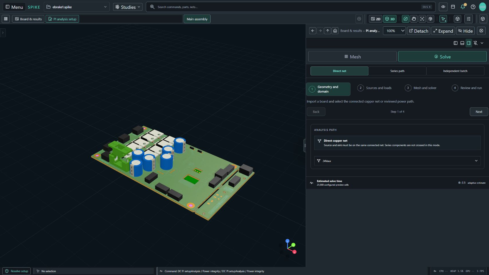

2. Choose **Sources and loads**. Add explicit source and load anchors on actual
   copper, enter reviewed voltage/current values and define the applicable
   return domain. The pictured empty terminal setup must be completed before
   a run. Continue through **Mesh and solver** to review the representation,
   mesh size, via model and analysis settings.

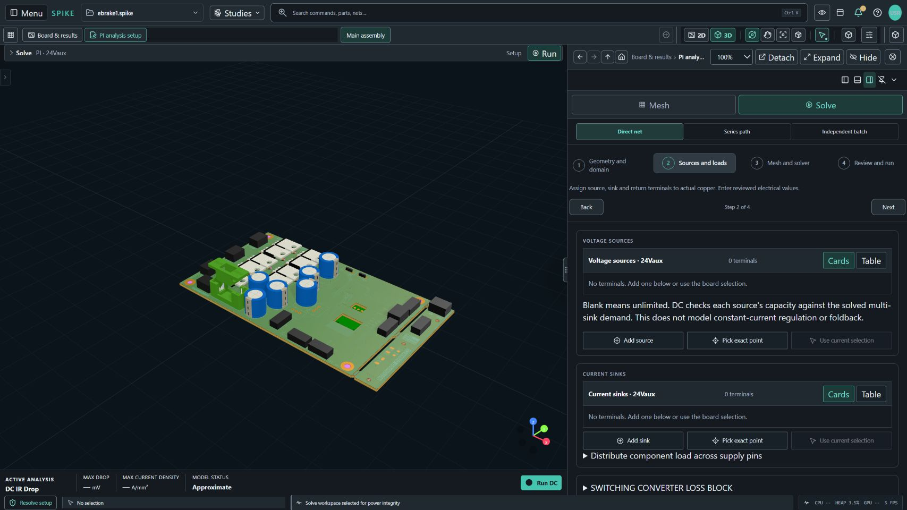

3. Choose **Review and run**. Preview the mesh and read the diagnostics.
   Correct missing terminals and any other blocking input before using Run;
   then evaluate convergence and returned status for your actual analysis.

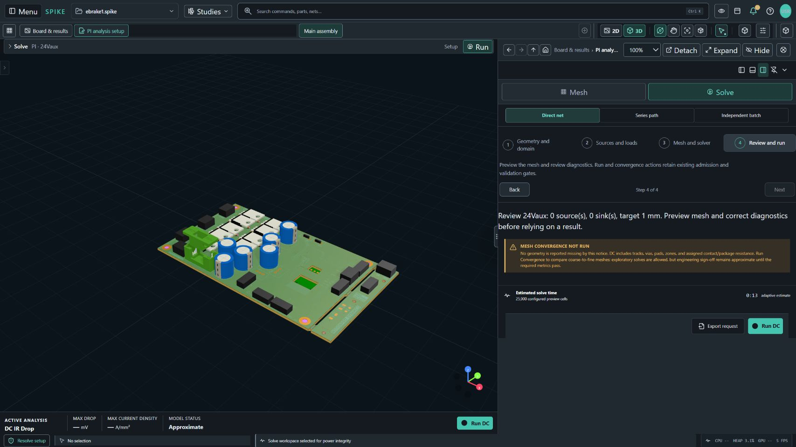

**Outcome pictured:** setup navigation, with no numerical result. If the net
list or terminal options are empty, review the imported design and selected
net. If **Series path** has no entry, create/review its Power Tree path first.
Moving between steps preserves editing position; it does not satisfy solver
admission. Current PI qualification gaps remain in [solver status](SOLVER_STATUS.md).

## Set up a solver: inputs > preparation > execution

These routes describe current controls. The component pictures above do not
show completed PI, SI, EM or thermal runs. Use the linked domain documentation
for model-specific admission and recorded numerical evidence.

| Question | Open | Review before execution |
| --- | --- | --- |
| DC drop, AC impedance or transient PI | Search **PI analysis setup**; use **Mesh** and **Solve** when directed | Physical stackup, selected power/return nets, exact source/load terminals and contact values |
| Channel or sampled network response | **HF / SI**, then **Source-to-receiver workflow**, **NEXT / FEXT**, or the S-parameter workbench | Explicit ports/returns, impedance, frequency coverage, timing and admitted geometry or supplied network/RLGC |
| EM risk or fields | **EM**; select the screening or supported extension route | Traceable excitation; for field runs also geometry, materials, ports, frequencies, mesh limits and trusted runtime |
| Object temperatures | **Thermal > Thermal setup** | Power W, thermal paths K/W, boundaries; transient heat capacity J/K, duration and time step |

1. Select the route and model resolution. Enter every required value with its
   displayed units. For thermal work, choose explicitly between object nodes,
   approximate board grids and admitted retained-solid volume models.
2. Run the relevant preflight/mesh preparation. Review diagnostics, ownership,
   material and return definitions, memory/time limits and runtime readiness.
   Fix the named problem before execution; a prepared case is not a result.
3. Run the chosen solver. Inspect returned status, warnings, residuals,
   conservation and spatial/time/frequency refinement before interpreting
   maxima. Retain the design revision, solver/version, assumptions and units.

**Recovery:** a disabled command or unsupported diagnostic identifies a missing
prerequisite or route limitation. Supply the input, choose an applicable model,
or resolve the runtime registration in **Solver manager**. Do not relabel an
approximate/screening result as full fields or protocol/hardware qualification.

PI convergence and board-specific extraction gaps remain explicit. SI sampled
network plots and eye/TDR outputs do not establish protocol compliance. EM risk
screening is not a field solve; arbitrary-board field qualification remains
route-specific. Lumped thermal nodes do not resolve package gradients. See
[solver status](SOLVER_STATUS.md), [analysis gallery](ANALYSIS_GALLERY.md),
[SI network workbench](SIGNAL_INTEGRITY_NETWORK_WORKBENCH.md),
[native Gerber](EMERGE_GERBER.md) and [thermal user guide](THERMAL_USER_GUIDE.md).

### Thermal inputs and SI request recovery

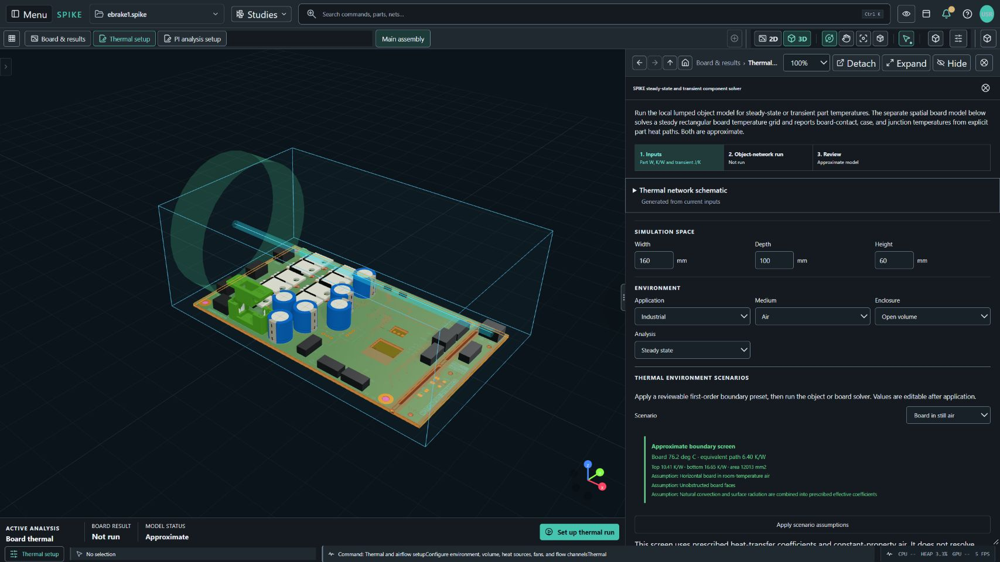

Actual full-workbench browser capture at the top of **Thermal setup**. The
pictured route is **Inputs > Object-network run > Review**, with space/environment
controls. It shows setup only; no thermal solve was performed.

1. In **Inputs**, review objects, power and thermal paths, then the applicable
   space/environment conditions.
2. Continue to **Object-network run** only after the required boundary and
   transient inputs are supplied; review its displayed model limits.
3. Use **Review** to inspect setup and diagnostics. A successful run and its
   returned temperature/heat-balance evidence are still needed for results.

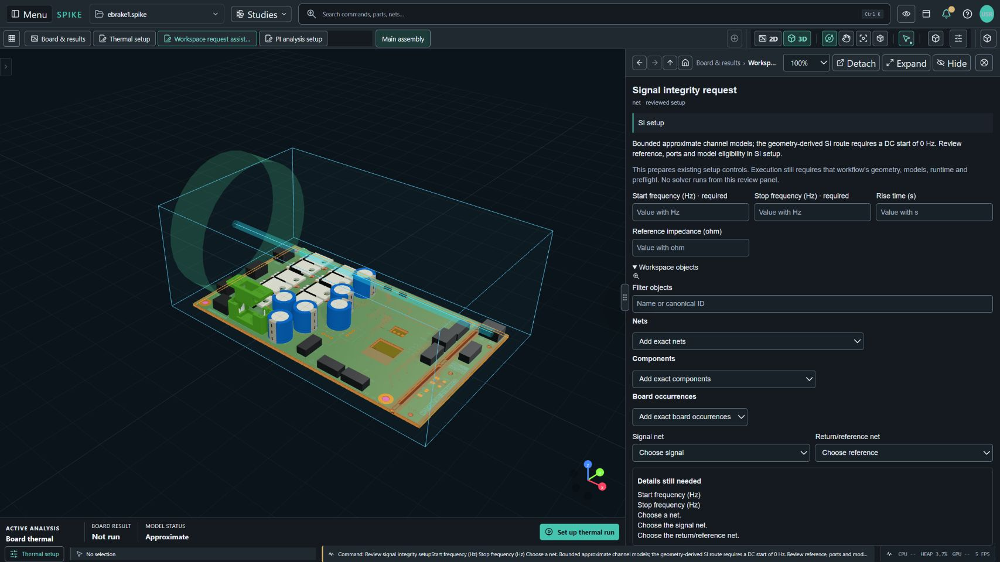

Actual full-workbench browser capture after searching **Review signal integrity
setup**. This is the **Workspace request assistant**, before the SI solver
editor. It shows **Details still needed** and the disabled **Apply reviewed
inputs and open setup** action. No worker or solver run was performed.

1. Review the requested SI action and the intended board/net scope.
2. Supply the required start/stop frequencies, reference impedance, signal net
   and reference net. Use actual design identities and reviewed units.
3. Resolve **Details still needed**, then apply the reviewed inputs to open
   setup when enabled. Review the SI editor's own prerequisites before running.

## Read results, fields and saved playback

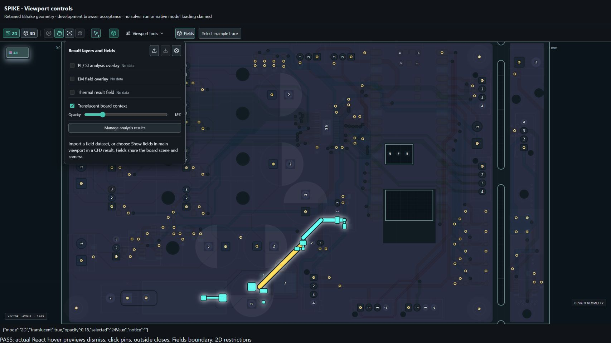

Actual browser capture of the field-control component. The control's presence
shows how to select/display a dataset; it is not evidence of a solver run.

1. Select the intended result and check its design/revision, model status and
   units. Open **Result layers and fields** in the viewport. Toggle an available
   result layer and adjust its own opacity. **No data** means that quantity was
   not supplied; the display does not manufacture it.
2. For an admitted field JSON, use **Import field**; supported CFD results can
   use **Show fields in main viewport**. Select quantity, Points/Voxels and
   cuts. Voxels require cell dimensions. Velocity arrows require vectors;
   streamline modes require admitted curves or the supported complete grid.
3. For saved histories, use play/pause, frame scrub, previous/next, speed and
   loop. Check the displayed saved timestamp. Export field JSON to retain an
   imported dataset; imported fields are session-only.

**Outcome:** inspection of returned or explicitly imported data in the shared
scene. Playback does not run a solver or interpolate new solved frames.
If import is rejected, read the error and correct the dataset; the previous
field stays retained. A static dataset cannot become a transient simulation.
See [field visualization](FIELD_VISUALIZATION.md) and
[thermal viewport history](THERMAL_VIEWPORT_HISTORY.md).

## Export an evidence-aware report

1. Open **Reports** for the intended project, discipline and result. Generate
   preview and check project/result identity, units, model status and warnings.
2. Inspect all result tabs and the provenance. **Not returned** and
   **ANALYSIS NOT RUN** are missing-evidence states, not numerical zeros.
3. Choose **Export HTML** for a self-contained report or **Print** for the
   operating-system print/PDF workflow. Reopen the export and check its contents.

**Outcome:** a report of the available setup/results. An unsolved report remains
a setup record. If expected results are absent, activate the matching retained
result before exporting. See [engineering reports](ENGINEERING_REPORTS.md).

## Picture coverage and remaining captures

The `guides-current` images include original full-workbench browser captures
and actual UI component captures with fixture-backed states. They show controls and layout;
they do not establish desktop import, native CAD execution, numerical convergence
or physical qualification. The older `ui-current` pictures retain their dated
board/source provenance above. No generated mockup is presented as a screenshot.

Still needed for complete run walkthroughs: native import/error recovery;
Gerber Ports/Review followed by actual prepared mesh and runtime diagnostics;
full-workbench mechanical source/model preparation; completed revision-bound
PI/SI/EM/thermal setup-to-result sequences; saved result playback; and report
export/reopen. Capture those with their source, version, inputs, status and
limitations before claiming end-to-end picture coverage. Current numerical
records remain in [solver status](SOLVER_STATUS.md) and its linked evidence.

