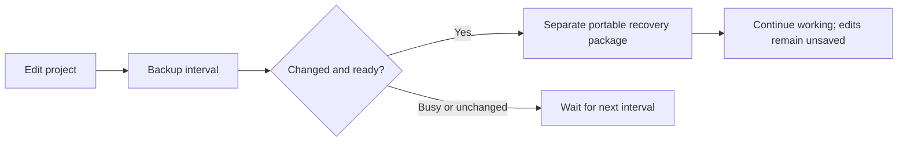

# Project backups

Automatic project recovery is available in the desktop development source.

## 1. Enable backups

Open **Settings → Backups**. Enable **Automatic backups**, choose **1, 5, 10, 15, 30, or 60 minutes**, then **Apply settings**. The default is enabled every five minutes. Existing installations with the old autosave preference set to Off remain disabled. Cancel leaves the running settings unchanged.

Only changed project revisions are backed up. The interval starts when enabled or changed; a backup is not immediately created on startup. Disabling stops future scheduled backups; an in-progress atomic write can finish. Existing recovery packages remain available.

## 2. Keep working

Backups capture the current project snapshot using the portable project writer, including saved project analysis state and available embedded model/result artifacts. They do not overwrite the primary project or mark edits saved. Python editor buffers and unapplied editor drafts require their own save/recovery flows.

Backups pause during imports, loading, project saving, active operations, or unapplied assembly drafts. Older projects must first be saved in the current package format. Work changed while preparing a snapshot is retried at the next interval. A failed write is reported and retried on a later interval.

Recovery packages are local to this desktop installation in its application-data `project-recovery-v1` directory. They are not cloud synchronization. Browser preview requires manual export instead.

## 3. Restore a copy

Open **Project manager → Project recovery backups**, or use **Open project recovery backups** in Settings. **Back up now** creates a manual snapshot, even if the revision is already backed up. **Refresh backups** updates the list.

Choose **Restore copy** beside the required project and timestamp. Resolve the current project's unsaved-work prompt first. SPIKE verifies the backup's integrity and opens its state as a recovered project. **Save requires a new filename**; the recovery package remains intact. Save that copy before running operations that modify package contents in place. Imported model artifacts remain available from the recovery base until saved into the new portable file.

## Storage and failure limits

| Limit | Behavior |
| --- | --- |
| Ten backups per editing session | Old verified backups are pruned after a new package succeeds |
| 512 MiB per package | Larger snapshots fail with a visible error |
| 2 GiB total recovery storage | Old verified backups may be pruned across sessions |
| Opened recovery base | Protected from pruning while it is the base for the new backup |
| Missing or malformed recovery metadata | Operation fails; unverified files are not deleted |

Backups complement normal Save and external file backups. Unsaved changes since the latest completed snapshot cannot be recovered by this feature. Package preparation needs temporary disk space, and a full disk can prevent a backup.
