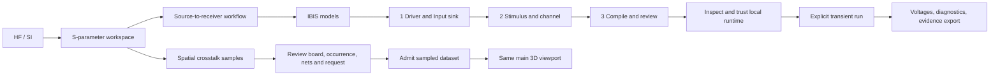

# IBIS endpoints and spatial SI visualization

Source workflow added on 25 October 2026. These additions are experimental and
are not evidence that an installed release contains them. They do not close
protocol, measured-accuracy or release qualification.

## Navigation and three-step workflow

1. **Driver and sink:** choose an IBIS file for each endpoint and enter the exact
   component, pin and model names. Select the process/I-V corner, die capacitance
   corner and package corner independently. A minimum capacitance is not an
   implicit weak-process selection.
2. **Stimulus and channel:** import a complete structured setup or review its
   JSON. Set explicit output states, edge times, two waveform fixture indices,
   series resistance or lossless line, time step and stop time. Use the original
   [driver/receiver fixture](../examples/si/ibis_driver_receiver/) as a starting
   point. Source files remain inert during editing and compilation.
3. **Compile and run:** compile first and read every diagnostic. Inspect the
   local ngspice path and SHA-256, explicitly trust that native executable, then
   run. Failed admission or OS resource enforcement stops execution. The result
   distinguishes die and package-pin voltage/current. Export complete evidence
   before closing or save the project. Reopening restores inputs and recorded
   evidence, but requires fresh compile/runtime review and never restores trust.

The older **Bind linearized model to endpoint** action remains a DC-slope/ramp
approximation in the loaded linear SI workflow. It does not acquire nonlinear
behavior merely because the behavioral workflow is also available.

## Supported behavioral subset

The initial compiler targets classic single-ended Output, I/O or 3-state drivers
used in driven low/high states, and an Input receiver. It retains selected
pullup/pulldown I/V, always-on clamp currents, die capacitance and declared
lumped package R/L/C. Two time-correlated resistive fixtures per edge are needed
to calibrate switching weights. Only admitted tables, ideal fixed rails and the
declared package topology are used.

Ramp-only or one-fixture switching, dynamic high-impedance transitions,
differential/bus execution, power-aware models, AMI binaries and unrecognized
electrical features are unsupported. An explicit unsupported result is useful:
it identifies what a model needs without silently simplifying it. There is no
claim of universal manufacturer-model coverage.

The independent [IBIS method derivation](validation/IBIS_DRIVER_RECEIVER_DERIVATION_20261025.md)
records current signs, calibration, conditioning, source-domain checks and open
convergence/model-validation gates. The engine is trusted native code, not a
security sandbox. Execution is supervised with a maximum 30 seconds, 512 MiB
and bounded output; no unsupervised fallback is permitted.
The [executed source verification](validation/IBIS_SPATIAL_IMPLEMENTATION_20261025.md)
records successful engine launches and the still-unmet voltage refinement gate.

## What the spatial colors mean

| Display | Source and units | What it does not establish |
| --- | --- | --- |
| Induced victim voltage | Returned complex voltage samples, V RMS phasor, on explicit victim segments/fractions | Surrounding E-field, radiation or arbitrary-board extraction |
| Electric field | Supplied returned complex Ex/Ey/Ez samples at explicit XYZ, V/m | A new field solve, source authenticity or measurement qualification |
| Existing aggressor/victim route colors | Categorical route roles and port NEXT/FEXT metrics | Local field or local crosstalk strength |

Use **Spatial crosstalk samples and main viewport** in the S-parameter workspace.
Import a `spike/si-spatial-noise/v1` file, review independent current net and
request identities, and admit it against the worker-computed digest of the
current canonical DesignIR. Imported provenance is supplied evidence, not
independently authenticated solver output. The selector offers only quantities
the dataset actually contains. Change frequency, complex projection, component,
scale and opacity; select a sample to inspect its exact value and position.

The [original straight-pair example](../examples/si/spatial_crosstalk/README.md)
also runs the existing symmetric coupled-line engine with supplied RLGC and
maps its actual victim probes into the main viewport. Both victim incident waves
must be zero to label the voltage induced. This is a finite uniform-line model,
not geometry extraction. No artificial distance falloff, continuous unsampled
trace gradient or port-metric heat map is generated.

Current rendering supports the main **3D single-board** viewport. Transformed
multi-board spatial overlays remain open. Project saves retain setup and sample
candidates; reopening requires explicit current-context rebinding. Exporting
without results removes captured samples and IBIS outputs while preserving
setup inputs. Changing the design, occurrence or source request
invalidates the display. A mismatched old file must be rerun or explicitly
re-associated using a reviewed evidence workflow; changing its filename is not
sufficient.

## Worker/API boundary

| Method | Parameters | Behavior |
| --- | --- | --- |
| `compile_ibis_behavioral` | `{request}` | Inert admission/calibration and generated deck; no execution |
| `inspect_ibis_behavioral_runtime` | `{}` or `{executable}` | Read-only path/hash discovery, no version command |
| `run_ibis_behavioral` | `{request,executable,executable_sha256,execution_requested:true}` | Recompile, recheck identity and supervise a single launch |
| `inspect_si_spatial_context` | `{design,occurrence_id,aggressor_net_id,victim_net_id,request_id}` | Current canonical digest and authoritative straight victim strokes in mm |
| `run_si_spatial_pair` | Context fields plus `{pair_request,aggressor_segment_id,victim_segment_id}` | Existing supplied-RLGC engine, actual probe mapping, complete source result |

The display contract retains source scope (`provided_rlgc`, `extracted_rlgc` or
`solved_em_field`), extraction status and limitations. Scope metadata never turns
an imported model into validated extraction. Malformed, nonfinite, oversized or
revision-mismatched data is rejected.
