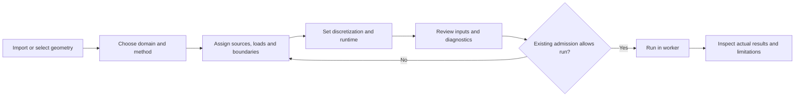

# Guided solver setup and searchable choices

SPIKE's basic solver forms use numbered steps with **Back**, **Next**, and direct
step selection. Navigation changes the editor section; it does not validate a
study or run a solver. Inputs remain mounted when hidden so partially entered
values and local drafts survive step changes. Save supported project settings
before closing the application.

## Common task sequence

Numbered steps indicate editing position, not completion or engineering approval.
You may return directly to an earlier step. Existing unavailable capabilities,
experimental status, preflight checks and prepared-case requirements still apply.
Busy state, failures and supported cancellation remain accessible while moving
between sections.

## Individual solver flows

| Workflow | Steps | Review action and limits |
| --- | --- | --- |
| PI: one copper net or reviewed series path | Geometry and domain → Sources and loads → Mesh and solver → Review and run | Preview mesh and review diagnostics; run and convergence retain their existing checks. Independent batch remains its separate multi-job editor. |
| Geometry SI | Geometry and channel → Reference and ports → Sweep and conditions → Review and run | Select actual canonical nets and explicit references. This bounded extraction route does not expose a separate full-wave mesh. |
| Loaded SI | Channel and conditions → Sources / receivers → Passives → IBIS models → Network edits → Review and run | Assign actual source/receiver models and inspect returned blocked or partial stages. Existing model and port validation remains authoritative. |
| Board thermal | Board and materials → Heat and contacts → Grid and time → Review and run | Enter justified material, convection and contact data. Plate and layered approximations retain their declared scope. |
| PCB EM | Geometry and domain → Electrical pre-pass → Sources and ports → Mesh and solver → Review and run | Validate, prepare, then run only when the admitted engine and prepared-case gates permit it. |
| Native CFD cavity | Domain → Conditions → Grid and runtime → Review and run | Check runtime before execution. This is the existing experimental 2D cavity benchmark, with no imported CAD or thermal coupling. |
| Internal channel airflow | Geometry → Fluid and heat → Mesh → Review and run | Prescribed laminar fluid energy transport; this screen does not solve a solid domain or general enclosure CFD. |
| Assembly airflow / CHT | Source → Geometry and air → Materials and power → Boundaries → Mesh and runtime → Review and run | Load actual assembly sources, review materials, boundaries and the experimental acknowledgment; existing mesh/request admission and save gates remain. |

Specialized extension workbenches, independent batches and machine-specific
editors retain their existing workflow controls. The shared step component is
available for subsequent migrations; its presence does not imply those editors
already use the new sequence. See [solver status](SOLVER_STATUS.md) for actual
capability and qualification evidence.

## Search inside dropdowns

Open an ordinary single-choice dropdown by clicking it or pressing Enter,
Space, Up/Down or F4 while it is focused. Typing opens its search with that
character. Search checks labels, stored option values and option groups.

| Query | Meaning |
| --- | --- |
| `ground` | Case-insensitive substring search |
| `power ground` | Both terms must match the option's label, value or group |
| `VCC*` | `*` matches any length of text |
| `C?0` | `?` matches one Unicode character, such as C10 or C20 |
| `In?.Cu` | Find inner copper-layer names such as In1.Cu |

Wildcards filter choices; they never select several items or change an engineering
value. Other punctuation is literal, with no regular-expression execution.
Unavailable options remain disabled. Hidden options stay hidden. A changed or
removed option is checked again before its original change handler is called.

Use Up/Down to move through enabled choices, Home/End for the first/last displayed
choice, and Enter to select. Escape closes and returns focus to the field. Tab
closes and moves to the adjacent form control. Clicking outside or resizing the
window dismisses the popup. Searching without selecting leaves the value intact.

The picker displays up to 200 matching choices at once; its count tells you when
to refine a query. Wheel and keyboard navigation remain available without native
scrollbar chrome. Native multiple-choice/listbox controls keep their existing
interaction. A field with `data-native-select` explicitly retains the platform
picker. Operating-system file dialogs are unaffected.

The custom PI net picker and shared action menus also accept these wildcard
queries. Net hover previews and exact net identities remain intact.

## Implementation and checks

`SelectSearchLayer.tsx` adapts existing native single-choice fields in the main
entrypoint and detached panel documents. `optionSearch.ts` owns literal/wildcard
matching and rechecks choices before dispatching the original native change
event. `SolverSetupSteps.tsx` owns navigation and retained hidden editor panels.

Run `npm run test:setup-navigation` from `app`, plus the affected solver-panel
checks. Browser fixtures verify the actual shared controls; they contain
illustrative inputs and do not establish numerical validation or installed native
rendering. No governing mathematics or solver method is changed by this UI work.
