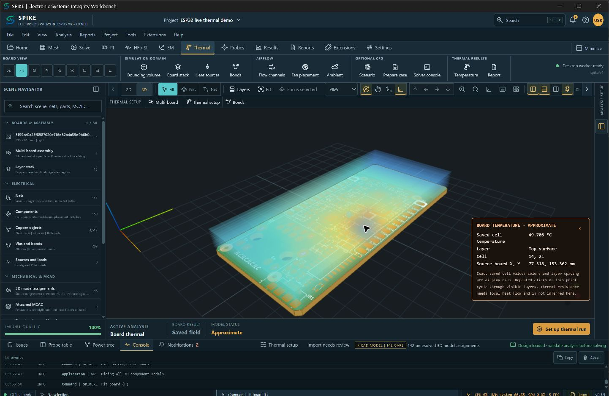
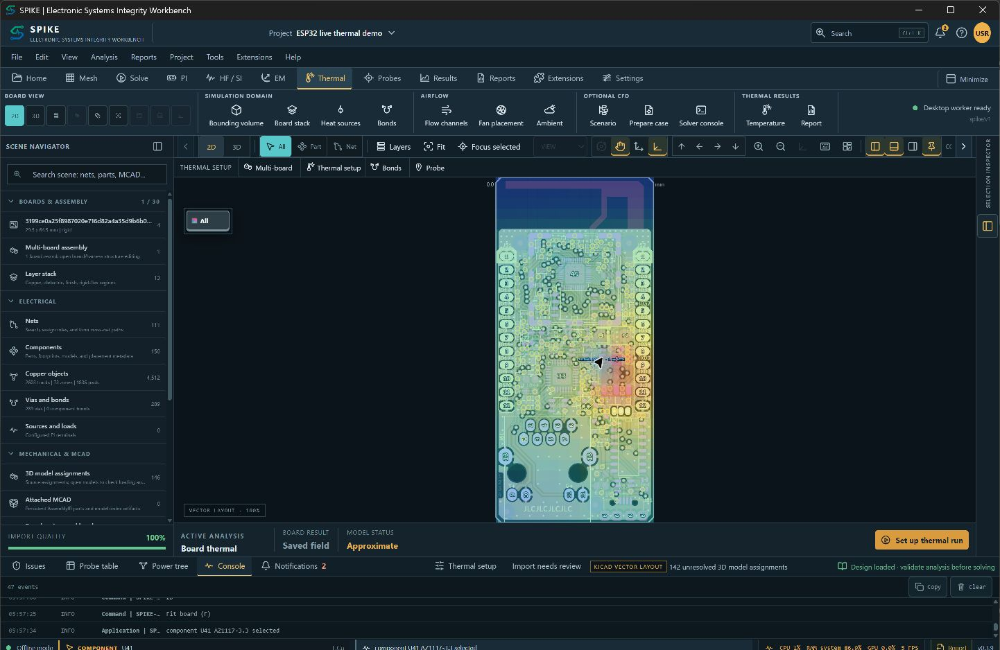

<!-- SPDX-License-Identifier: Apache-2.0 -->
# SPIKE viewport demonstration

**SI, PI, Thermal, EM**

These are actual native SPIKE screenshots of the ESP32 example board with
a completed layered thermal result displayed directly in the main viewport.
The colored cells come from the solver; the board geometry comes from the
imported KiCad source.

## 3D temperature overlay and probe

The probe reports the saved top-surface cell value and source-board coordinates.
The displayed layer spacing is enlarged for inspection.

## 2D temperature overlay

The model assumes U41 dissipates 0.5 W, with 25 °C ambient and a 2 mm grid.
Board temperatures span 27.52–54.76 °C. Materials and cooling are assumed,
some pad contacts are underresolved, and results are approximate. Component
models with unresolved references use footprint placeholders.

See [the demo evidence record](validation/SPIKE_DEMO_VIDEO_20261010.md) for
inputs, source digest, rendering verification and remaining model limits.
