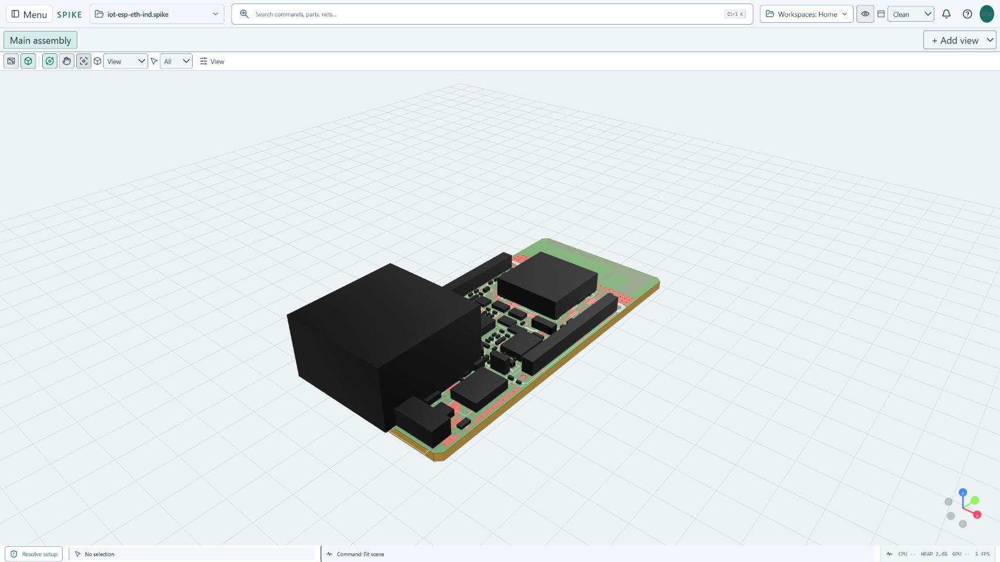
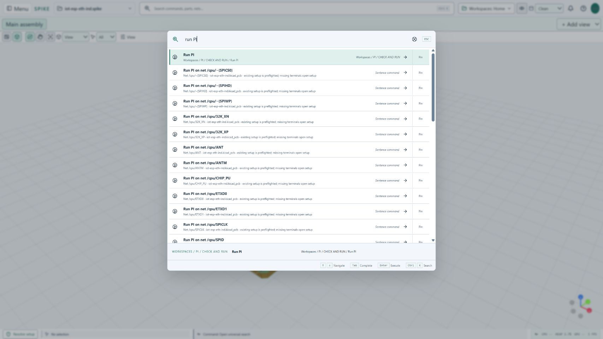

<!-- SPDX-License-Identifier: Apache-2.0 -->

# Current UI quick start

This guide describes the current development UI. Installed releases can have
older labels and layouts; check the application version before following a
workflow. Numerical availability is independent of the selected layout.

Start with the [visual UI map and navigation guide](UI_NAVIGATION.md) to learn
the two command rows, Menu sections, actual depth examples and panel recovery.

Actual local browser preview captured on 19 October 2026. The board was imported
from `examples/esp32/source/iot-esp-eth-ind.kicad_pcb`, then **Fit scene** was
selected. Black component bodies include stand-ins. This is geometry inspection,
not a solved field or a native desktop packaging test. Board source/license:
[ESP32 example](../examples/esp32/README.md) and
[third-party notices](../THIRD_PARTY_NOTICES.md).

## Find a workspace or command

- **Workspaces** in the top bar changes the active workflow. Search also finds
  workspace names such as Mesh, PI, HF / SI, Thermal, EM and Results.
- **Menu > All actions** browses flat command paths. Menu search finds commands
  inside nested groups without requiring every submenu to be opened.
- **Ctrl+K** opens universal search. Type an action, solver name, part reference,
  net name, or a supported sentence. Read the proposed target before executing.
- **Solver manager** lists named solver blocks, dependencies, scope, runtime
  readiness and setup routes. A detected engine is not a validated analysis.

Actual browser preview on the same board. Only `run PI` was typed; no solve was
executed. Suggestions refer to the imported board's real net catalog.

Try `run PI on net <actual-net> from <source-ref> to <load-ref>` using names
from your board. Confirm the chosen board, net and pads. Supply missing voltage,
load current, return path and model settings in setup; search must not invent
engineering inputs. Other domains route to their supported setup and preflight.
Ambiguous references need resolution. Conditional fields appear in live search
once their editor is rendered; external engine windows are outside this index.
See [command and panel access](COMMAND_ACCESS.md).

## Keep the canvas clear

Clean uses two persistent command rows: the main header and a shared row for
document/assembly tabs and compact viewport controls. Camera presets, selection
filters, adding an assembly view and assembly actions open from icons rather
than native dropdowns. Extra options are contextual popovers, not new toolbars.
Inspectors use a common inset, section spacing and wrapping metadata.

| Control | Purpose |
| --- | --- |
| Clean / Classic | Choose compact contextual access or persistent workspace/menu/ribbon access. Both use the same project and solver inputs. |
| Orbit / Pan icons | Choose camera interaction while a 3D viewport is visible. Hover for tooltips. |
| Camera view | Select Top, Bottom, Front, Back, Left, Right or Isometric. |
| Fit scene | Frame the current scene after import or a large placement change. |
| Selection filter | Choose All, Parts or Nets before picking geometry. |
| View | Open contextual navigation/display options without replacing the viewport. |
| Show hidden tools | Restore hidden controls and panels. Search can also find the relevant opening command. |

The legacy command ribbon is restricted to Classic layout. Clean keeps compact
viewport navigation icons; its separate floating quick-tools bar is optional. Search **Show optional quick-tools bar** only when you want it.
Hiding controls is a presentation preference; restore them through **Show hidden
tools** rather than rebuilding the project. See [interface layouts](INTERFACE_LAYOUTS.md).

## Editors, panels and themes

Power tree and other document-style editors use workspace tabs; assembly views
have their own tabs. Preserve the board view while editing the study. Supported
docks have hide/show, expand/restore and detach actions, plus a resize grip.
Detached native windows require the desktop shell; the browser preview is not
proof of multi-window desktop operation. Draft retention is not a saved project:
save `.spike` explicitly before closing or reloading.

Workspace appearance and viewport background are separate preferences. Search
**Use graphite workspace theme** or **Use light workspace theme**, then choose
**Use graphite viewport background**, **Use light viewport background**, or
**Use AMOLED black viewport**. **Show orientation grid** restores a faint world
reference. A black background does not change a result's physical color scale.

## Run and inspect an analysis

1. Import through **Project files > Import board / CAD…**, or use supported file
   drag/drop. Review import diagnostics, units, stackup, vias and material mapping.
2. Select a model and supported solver. Assign terminals, returns, powers,
   boundaries, connectivity and material properties explicitly.
3. Review geometry and mesh, then run preflight. A blocked or unsupported request
   is not a result. External engines need separate compatible installations.
4. Run through the relevant workspace. Inspect status, diagnostics, convergence,
   conservation and model limits before reading a field maximum.
5. Open results, choose the physical quantity and units, inspect probes and
   compare cases. A port/network response is not a spatial field.
6. Save the project with the required results. Export a report and a screenshot
   through the supported [result screenshot workflow](RESULT_SCREENSHOTS.md).

Continue with the [analysis gallery](ANALYSIS_GALLERY.md): PI, SI, EM, Thermal,
hybrid multi-solve, CFD, CHT and multiboard inputs, actual plots and limits.
The [solver status](SOLVER_STATUS.md) and [mathematics reference](SOLVER_MATHEMATICS.md)
provide capability and method details. UI access alone does not establish
numerical qualification.

## Capture provenance

The [capture manifest](../app/public/help/ui-current/manifest.json) records image
and source-board hashes and capture steps. Both JPEGs above are unmodified browser captures of the current development
frontend at localhost. They were captured in an isolated tab with a public
example; no user board was uploaded and no solver was run in that tab. The light
appearance was already selected. Historical screenshots elsewhere retain their
original versions and evidence scope. Computed gallery plots are generated from
example outputs, not screenshots of these UI panels.
