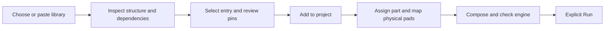

# User models and analysis backends

## Current increment

The circuit workbench can inspect a user-supplied SPICE library, select a
subcircuit entry, retain its local dependencies and add it to the project.
The source and provenance travel with the existing circuit workspace. Import
does not assign a board component, run an engine, download a model or install
an executable. This is an application/import change, with no new solver method.

### Three steps in the workbench

1. **Inspect:** select Import model, then choose a `.lib`, `.mod`, `.cir`, `.sp`,
   `.spice`, `.net` or text file, or paste source. File size is checked before
   reading; UTF-8 content is limited to 2 MiB. Errors include their source line.
2. **Choose:** search the entry points, using `*` and `?` when useful. Review
   declared pin order, parameter defaults and required subcircuits. Optionally
   record a vendor/source locator and license/private-use note. These notes do
   not establish redistribution rights. Add the chosen entry explicitly.
3. **Bind and run:** assign the added model to a component and inspect every
   pad/node mapping. Compose first. The importer conservatively identifies
   external ngspice as the required review route; it does not expand native
   MNA or SPIKES device coverage. Missing runtimes and rejected models remain
   errors. Execution still requires the existing explicit Run action.

The [original library example](../examples/user_model_library/README.md)
demonstrates multiple entries, header continuations, defaults and shared local
dependencies. It is an import fixture, not a qualified hardware model.

## Supported library subset and recovery

| Accepted | Rejected or still requiring separate support |
| --- | --- |
| Explicit `.subckt` / matching `.ends`, declared pin order and `params:` defaults | Nested subcircuit definitions, encrypted/binary model source |
| `+` continuation lines, full-line `*` and inline `$` comments | Quoted dialect syntax, backslashes, semicolons and non-ASCII source |
| Supporting `.param` and `.model` declarations with bounded expressions | `.model`-only entry points, `.func`, conditional or unknown dot directives |
| Declared local X-call dependencies, pin counts and named parameter checks | External `.include`/`.lib` files, control commands, analysis directives and XSPICE code models |
| Bounded structural expressions retained without evaluation | Semantic/device-model or numerical compatibility certification |

Flatten required includes into a reviewed self-contained library before import;
SPIKE does not follow paths. Nested device-model name reuse is conservatively
rejected even when another simulator permits it. Conflicting definitions are
not renamed or overridden automatically. Remove/replace the intended old model
or resolve the library namespace explicitly, then compose again.

The importer retains only the selected subcircuit dependency closure plus all
top-level parameters/device models. Shared identical definitions are emitted
once; conflicting normalized definitions block composition. Current imported
source is reparsed and its pin order checked on composition. Editing source
invalidates its numerical review; original import hashes remain descriptive.
Inventory limits also bound definitions, dependency depth, inspection metadata
and combined source. Nothing is silently truncated into a runnable model.

Saving and reopening the existing circuit workspace preserves inline source
and `import_provenance`, including original and normalized source hashes.
Exports containing third-party source require the appropriate sharing rights.

## Extension routes for the other capability gaps

| Requested capability | What a user can add today | Remaining implementation and acceptance work |
| --- | --- | --- |
| Additional circuit devices | Self-contained reviewed subcircuits for the external ngspice path; explicit native models supported by the owning backend | Broader dialect/model-card import and independently verified native device implementations. A catalog entry cannot add an equation to a solver. |
| Full-board 3D copper/contact extraction | An external process analysis/mesher adapter using the existing normalized design and bound geometry/mesh contracts | Source-authenticated copper, vias, pads, finite contacts and material ownership; conservation and mesh-convergence evidence on real boards. Existing board-volume gates stay active. |
| Improved SI extraction | Explicit RLGC/Touchstone models or an admitted external analysis adapter | Geometry/reference-plane coverage, material/frequency applicability, ports and independent extracted-channel comparisons. Imported network data does not supply spatial fields. |
| Vendor IBIS-AMI | The existing inert AMI parameter/package inspection API; separately admitted trusted development execution | Vendor package rights, correct platform/ABI, dependencies, IBIS association and executable trust before execution. Import/inventory never loads a DLL. |
| Protocol-specific analysis | Explicit channel data and supported existing eye/mask or sampled-channel requests | Versioned encoding, training, transmitter/receiver behavior, clock recovery and authoritative compliance criteria. Generic PAM3 must not become a USB4 compliance claim. |

For an external extractor or solver, follow the existing
[analysis extension contract](EXTENSION_ANALYSIS_API.md) and
[extension SDK](../extension_sdk/README.md). Declare the analysis contribution,
permissions and budgets. Consume the supplied design identity and, when
requested, the exact bound complete mesh. Return the supported analysis result
with units, source identity, diagnostics and truthful model status. A display
preview is not the complete solve mesh. Adapter admission does not establish
physical validity, executable isolation or standards compliance.

AMI users can call `inspect_si_ami_parameters` or `inspect_si_ami_package`
through the existing worker to inventory supplied data. These deliberately
return `execution_admitted: false`; the trusted native development host has
separate execution admission. See [SI execution scope](validation/SI_EXECUTION_20261023.md).

## Backend contracts

- `inspect_spice_model_library`: exactly `{text, name}`; returns
  `spike/spice-model-library-inspection/v1`, candidate metadata and diagnostics.
- `import_spice_model`: `{text, name, subcircuit_name}` and optional
  `source_locator` / `license_note`; returns `spike/spice-model-import/v1`
  with a workspace model and `execution_admitted: false`.
- No path, executable, execution flag or include resolver is accepted.
- Direct Python owners are `spice_model_import.py` and
  `service_model_library.py`; the existing workspace owns pin and netlist
  validation. Inspection, selection and composition each recheck their inputs.

Syntax semantics were checked against the official ngspice manual's
[subcircuit definitions](https://nmg.gitlab.io/ngspice-manual/circuitdescription/subcktsubcircuits.html),
[parameters](https://nmg.gitlab.io/ngspice-manual/circuitdescription/paramparametricnetlists/subcircuitparameters.html)
and [symbol scope](https://nmg.gitlab.io/ngspice-manual/circuitdescription/paramparametricnetlists/symbolscope.html).
Parser, fixtures and prose are independently authored; no external model,
implementation or example was copied. Expressions are not evaluated here.

## Next milestones

1. Close and verify this end-to-end model-library increment.
2. Add explicit multi-file dependency packaging and broader model-card import
   without implicit file/network access.
3. Add SI model-package review/persistence and connect independently admitted
   runtimes without treating inventory as execution permission.
4. Extend extraction/protocol providers through the existing registries, each
   with source-bound mathematical, numerical and real-case acceptance evidence.

These stages improve extensibility progressively. This increment does not
complete arbitrary board extraction, full IBIS-AMI coverage or protocol
compliance, and does not qualify those capabilities for release.
