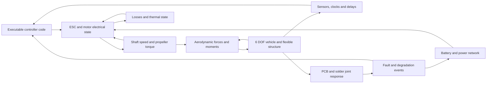

<!-- SPDX-License-Identifier: Apache-2.0 -->
# Vibration, aerospace vehicles, drones and precision mechanisms

Requested on 18 October 2026 as part of the active
[coupled suite track](COUPLED_MECHANICS_MAGNETICS_DEVICES_PLAN.md). These are
implementation targets, **not delivered simulation capabilities**. The current
verified mechanics stage is static linear tetra thermoelasticity GP07-S01;
it does not simulate vibration, joint fatigue, flight or moving gear contact.
PI/SI remains primary. This request authorizes the listed dynamics/application
families and vehicle aerodynamics within GP05 alongside existing work; it does
not open unrelated building CFD, general acoustics, optics or the full parity gate.

## Capability and evidence matrix

| Family | Requested simulation coverage | Required evidence and outputs |
| --- | --- | --- |
| GP12: vibration and shock | Modal response, base acceleration, swept sine, harmonic and transient excitation, random vibration PSD/cross spectra, multi-support motion, shocks and shock response spectra (SRS). | Eigenfrequencies/modes, damping definition, transmissibility, acceleration/displacement/stress spectra and RMS; independent oscillator references, effective modal mass, modal/mesh/time/frequency convergence and measured fixture correlation. |
| GP13: electronics and solder joints | PCB bending, component mass/inertia, mounting/fastener constraints, package/lead/BGA solder geometry, underfill, CTE mismatch, cyclic plasticity/creep, vibration and thermal-cycle fatigue. | Revision-bound global-to-local transfer, strain/stress and inelastic energy histories, alloy/temperature/rate-specific laws, joint-level mesh convergence and calibrated failure statistics; contact/intermittent/open fault effects in electrical simulation. |
| GP14: constrained and precision mechanisms | Rigid/flexible bodies, gears/gear trains, bearings, shafts, springs, cams, backlash, friction, compliance, contact/impact, motors and actuator loads. Watch winding/train/escapement/balance/hairspring. | Constraint residuals, torque/speed/work balance, tooth and bearing loads, elastic deformation, backlash reversals and friction heating; event/contact convergence and independent mechanism/timing references. |
| GP15: integrated drone simulation | Controller code, timing, sensors, battery/power electronics, ESC and BLDC/PMSM motor response/back-EMF, propeller thrust and torque loading, drag, 6-DOF flight, structure, thermal behavior and faults. | Synchronized raw electrical/mechanical/aero/control histories; thrust-stand/motor tests, flight and sensor replay, timing fidelity, step refinement and uncertainty. Vehicle performance is conditional on admitted models and operating ranges. |
| GP16: spacecraft and launch systems | Launch fixtures/loads, satellites, deployable structures, reaction wheels/actuators, on-orbit thermal deformation and jitter; launch-vehicle ascent/GNC, staging and flexible structure. | Mission/revision-bound loads, explicit frame/clock conventions, quasi-static/dynamic stress and stability, coupled-load references, thermal/vacuum applicability and measured subsystem evidence. Mission acceptance is separate from solver execution. |

All families depend on conditioned material laws LB01, physical assembly assets
LB02, mechanics GP07, conservative/time-aware coupling GP09 and result views
VF01/VF02. Magnetic machines GP04 and Hall/other sensor models GP10 are shared
with drone and actuator cases. AX01 owns profiled scalable sparse/multibody
algebra and CPU/GPU equivalence; increasing the current 192-free-DOF reference
limit alone is not a scalability result. Reduced models must retain construction
revision, valid frequency/amplitude envelope and full-order correlation.

Large thin structures and PCBs also need GP07-S05: verified beam/shell and
layered/orthotropic formulations, prestressed response and buckling, with
patch/locking checks, laminate stiffness/thermal references, mass/mode checks,
boundary-condition sensitivity and independently converged buckling loads.
The current solid tetra reference cannot imply this coverage. Nonlinear
post-buckling or instability needs GP07-S04 and its own imperfection/path checks.

## Vibration, solder joints and failure

| Stage | Deliverable | Acceptance before Done |
| --- | --- | --- |
| GP12-S01 | Modes and deterministic base/harmonic excitation using admitted mass and damping. | Independent damped SDOF resonance/phase and base transmissibility; rigid/free/support modes, consistent/lumped mass distinction, mode normalization/effective mass, support reaction and energy; mode-count and frequency refinement. |
| GP12-S02 | Random vibration and correlated multi-axis/multi-support inputs. | Declare one/two-sided PSD, Hz/rad/s and acceleration units; validate Hermitian positive-semidefinite cross-spectral matrices, correlation and finite-band integration. Independent response-PSD/RMS references, frequency/modal truncation checks; seeded time histories are separate finite realizations. Peak factors/fatigue are explicit assumptions, not inferred from RMS. |
| GP12-S03 | Shock/transient response and SRS. | Defined pulse/input sample interpolation, absolute versus relative response, damping/Q and SRS convention; analytic pulse/oscillator references, time-step/sample/filter refinement and fixture conditions. Contact/nonlinear impacts require their own mechanical model. |
| GP13-S01 | PCB/package/solder local stress submodels. | Admit anisotropic board/laminate and mounting models, package/lead/ball/underfill dimensions and assembly conditions. Conservatively transfer global motion/traction without overconstraining local boundaries; thermal mismatch, package bending and joint references with local mesh convergence. Perfectly shared nodes do not represent debonding/contact. |
| GP13-S02 | Calibrated thermal/vibration solder degradation with electrical fault feedback. | Applicable alloy microstructure/aging, temperature/rate-dependent creep/plasticity and fatigue law; cycle/mission/dwell history and combined-environment assumptions. Validate against independent coupons/assemblies with uncertainty and failure definition. Map degraded resistance/intermittent/open events into actual circuit stepping and retain failure time/history. |

Stress alone is a screening result. A static von Mises contour is insufficient
to predict solder life under cyclic thermal mismatch and vibration. NASA's
[spacecraft solder-fatigue systems study](https://ntrs.nasa.gov/citations/19930058665)
ties reliability work to the experienced environment, packaging and testing;
the [combined thermal/vibration test report](https://ntrs.nasa.gov/api/citations/20100042600/downloads/20100042600.pdf)
is a potential reference to review for applicable models and redistribution
rights. Neither supplies a universal life law for arbitrary SPIKE assemblies.

## Drone: executable code through physical flight

The initial integrated reference vehicle will be an explicitly parameterized
electric multirotor. Fixed-wing and tiltrotor/hybrid cases follow their own
airframe/rotor/control admission and references. An entire-drone claim requires
all relevant participants to execute in a common study:

| Stage | Deliverable | Acceptance before Done |
| --- | --- | --- |
| GP15-S01 | Battery/wiring/ESC/motor/shaft/propeller load bench. | Real current, voltage, shaft speed, back-EMF, torque, losses and supply sag; no-load, loaded spin-up/down and stall operating limits. Distinguish averaged DC-equivalent motor/drive from phase-resolved BLDC/PMSM/PWM. Include rotor inertia, opposing aero torque and thermal laws; electrical-to-shaft/aero power accounting and measured motor/propeller references. |
| GP15-S02 | Rigid 6-DOF multirotor plant and sensors. | Explicit inertial/body/rotor frames, attitude conventions, mass/CG/inertia and gravity; thrust/drag/torque, angular momentum, wind/gusts, sensor orientation/noise/bias/delay/filtering. Free fall, torque-free rotation, hover/trim, maneuvers and frame/step convergence with supplied reference parameters; no firmware execution claim yet. |
| GP15-S03 | Actual controller executable in software-in-the-loop (SITL). | Execute a pinned build/source/toolchain/configuration; controller/estimator scheduling, sample-and-hold, clocks, latency/jitter, actuator protocol, reset/checkpoint and deterministic replay. Prove actual code changes alter control response; nominal and sensor/motor/power faults, deadline/step refinement and held-out trajectories. Do not substitute a hand-written PID for user firmware. |
| GP15-S04 | Detailed vehicle aero/propeller and flexible-load feedback. | Qualified blade-element/momentum or CFD operating envelopes, inflow/wake/body interference, propeller advance/angle, ground effect and windmilling only when modeled; rotating mesh/sliding interfaces where needed. Return integrated pressure/traction to structures and deformation to aerodynamics with conservative transfer, mesh/time/interface convergence and measurements. |
| GP15-S05 | Integrated mission/performance and fault campaign. | Actual S01-S04 results in one study: thrust/torque/current/RPM, attitude/path/tracking error, speed/climb/endurance, energy/thermal margins, vibration/joint response and fault propagation. Supply admissible mission/wind/payload/controller variants; retain uncertainty and measured vehicle correlation. HIL is a distinct later stage with measured real-time deadlines and separately authorized hardware connection. |

For the first measured-map propeller model, declare rotation direction, RPM
versus revolutions per second, diameter, density and the coefficient conventions.
For the common convention, `n` is rev/s, axial advance ratio is `J = V/(n D)`,
`T = C_T rho n² D⁴`, `Q = C_Q rho n² D⁵` and `P = 2 pi n Q`.
Datasets supplying power coefficient `C_P` require the corresponding conversion
`C_Q = C_P/(2 pi)` only when their coefficient definitions match these conventions.
The positive absorbed propeller torque opposes shaft drive. Zero speed,
reverse rotation, oblique inflow and windmilling need explicit branches or
rejection rather than extrapolating an unavailable map. The
[UIUC propeller database](https://m-selig.web.engr.illinois.edu/props/propDB.html)
offers experimental propeller data to assess for declared test conditions and
rights. A calibrated thrust curve is a bounded model, not a full aerodynamic solve.

The existing [co-simulation service](COSIMULATION_DIGITAL_TWIN.md) has fixed-grid
scalar replay/gain participants. It currently has no built-in motor, vehicle,
firmware or live HIL adapter. Vehicle simulation needs vector/tensor ports,
energy/effort-flow semantics, event/time synchronization and actual stateful
solver adapters before that service can support the loop above. Pin executable
dependencies, isolate processes and bound messages/state, timeout and cancellation.
SITL runs actual code on a host; full MCU/peripheral emulation and cycle timing
are separate fidelity levels. The official [PX4 simulation documentation](https://docs.px4.io/main/en/simulation/)
distinguishes SITL and hardware-in-the-loop; it is an integration reference,
not a claim that a PX4 adapter is already installed or implemented in SPIKE.

## Satellites and launch vehicles

| Stage | Deliverable | Acceptance before Done |
| --- | --- | --- |
| GP16-S01 | Mission environmental-load study for mounted spacecraft/launch structures. | Import reviewed quasi-static acceleration, sine/random vibration, multi-point base motion, acoustic pressure loads and shock/SRS with duration, axes, units, damping, source revision and fixture. Correlate modes/support behavior and coupled loads; separate acoustic-load import from solving sound propagation. Include prestress and buckling only with validated formulations. |
| GP16-S02 | On-orbit coupled satellite assemblies. | Orbital attitude/illumination inputs and eclipse/thermal-vacuum boundary conditions, thermoelastic gradients, flexible solar arrays/deployment, reaction-wheel/motor jitter, joints/bearings and instrument pointing. Independently verify rigid-body attitude, thermal energy and structural/multibody coupling; mission and measured references bind each supported model. |
| GP16-S03 | Launch-vehicle trajectory, staging and flexible control-load studies. | Admitted propulsion/thrust/gimbal/mass-depletion models, atmosphere/aero tables and gravity frames, 6-DOF ascent/staging events, flexibility and GNC feedback, loads and stability. Conserve mass/momentum/work across defined events; verify independently refined trajectories and modes. Slosh, flutter, POGO, combustion or detailed propulsion CFD require separate applicable models/evidence. |

Environmental profiles must bind their applicable mission/test specification;
there is no universal satellite/drone/launcher vibration level. NASA's official
[GEVS record](https://standards.nasa.gov/standard/gsfc/gsfc-std-7000)
is a reference for environmental verification planning. A future profile importer
must pin the actual selected revision and requirements. Loading a specification
does not certify a design, and simulation does not replace required testing.

## Gear trains, actuators and watch movements

| Stage | Deliverable | Acceptance before Done |
| --- | --- | --- |
| GP14-S01 | Multibody shafts, joints and ideal gear constraints with motor/actuator ports. | Independent pendulum/shaft/gear-ratio and reaction-torque references; inertia/frames/DOFs, constraint residual/drift, energy/work balance, rigid/flexible reduced-body applicability and reversible motion. An ideal gear ratio does not establish tooth/contact stresses. |
| GP14-S02 | Compliant gears, backlash, friction and tooth/bearing contact. | Declared tooth geometry, preload, bearing stiffness, lubrication/friction/temperature and event/contact laws; load reversals, contact force/penetration, frictional heating, stress mapping and convergence. Calibrated wear/fatigue and efficiency stay conditional on applicable laws. |
| GP14-S03 | Mechanical watch movement and regulated timing. | Supplied mainspring torque/angle, barrel/gear train, escapement contact and impulse events, balance inertia/hairspring behavior, pivots/jewels/friction. Compare rate, amplitude, beat error and power reserve against independent references; resolve impacts/time steps, winding/run-down and temperature/orientation/shock sensitivity. Magnetic disturbance requires an actual admitted magnetic/material coupling, not an arbitrary frequency offset. |

These stages should share constraint/contact and loss/temperature models with
servo gearboxes, solenoids, robotics joints and deployment actuators. The
[Project Chrono gear example](https://api.chrono.projectchrono.org/tutorial_demo_gears.html)
illustrates a separate gear-constraint fidelity level; an ideal constraint and
resolved tooth-contact mechanics remain different SPIKE acceptance targets.
No new external engine or dependency is selected by this plan.

## Delivery order and completion policy

1. Continue PI/SI and GP07-S02/S03 mechanics load/results/mass/modal foundations.
2. GP12-S01 deterministic vibration, then PSD and shock; GP13 local joint stress
   after the required materials and global/local mapping are available.
3. In parallel where dependencies permit, GP14-S01 mechanisms and GP15-S01/S02
   motor/propeller/flight plant foundations. Reference models precede firmware coupling.
4. GP15-S03 executable-code coupling, higher-fidelity GP05 vehicle aerodynamics,
   contact/nonlinear mechanics and GP13 calibrated degradation.
5. Integrated drone, spacecraft/launch and watch/actuator cases pass their own
   end-to-end evidence gates; one example never closes an entire broad family.

Each stage remains Planned until its declared executable tests and applicable
reference evidence pass. Retain partial/unsupported states, original raw results,
mesh/model/code/material revisions, parameter ranges and uncertainty. Visualizations
must show mode/deformation scale, PSD/RMS versus deterministic time history,
frames, missing regions and sample association. GPU/parallel acceleration and
reduced models must match unchanged reference observables before performance claims.
