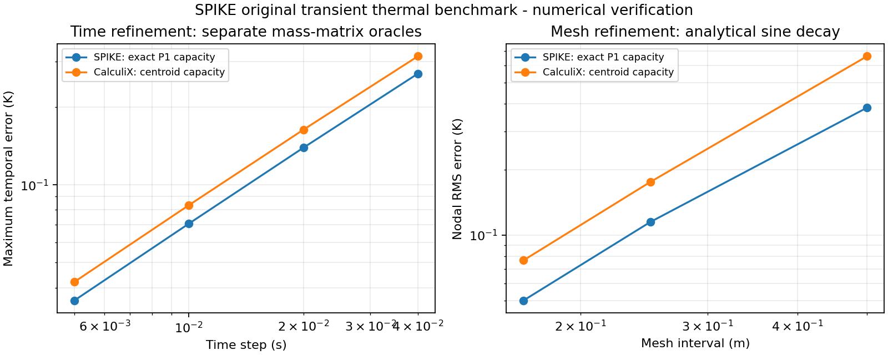

# Original transient thermal benchmark, 2026-10-08

This is numerical verification of an original, fully specified benchmark.
It is not measured hardware correlation, production qualification, or a
reproduction of Fang's MC34063A result. The public demonstration does not
provide enough material, loss, mesh, and boundary data for that comparison.
All meshes, STEP geometry, loads, and analytical oracles here were independently
authored. No third-party implementation, example deck, or mesh was consulted.

Machine-readable results: [JSON](ASSEMBLY_THERMAL_TRANSIENT_20261008.json).
Reproduction: `scripts/validate_transient_thermal.py`.



## Engines and comparisons

Actual local CalculiX 2.23 was executed at every reported external solve.
Executable SHA-256:
`913abf828a2d706f3e8c9da89d7a0eddd68ce817f8dabf1098cb013dfe3f94f6`.
Each record retains executable, input deck, temperature output, and log hashes.
The mixed assembly uses the admitted Gmsh 4.15.2 OCC installation to create and
import an original STEP box, mesh its retained volume, and mesh both boards.
Neither runtime is included in SPIKE.

The external adapter reuses SPIKE's established SI mesh, anisotropic material,
face, heat-source, radiation, and explicit thermal-contact compiler. It adds
positive density and specific heat, scalar or per-node initial temperature,
and one fixed transient increment per admitted time-grid interval. A requested
power schedule scales volumetric sources at each backward-Euler endpoint;
prescribed boundary heat flux is constant. Full NT coverage is required at
every increment, even when the UI retains fewer output frames. Missing final
or intermediate output, duplicate nodes, wrong times, and nonphysical values
are rejected. Existing process cancellation, timeout, and artifact limits apply.
Before expansion, decks are limited to an estimated 8 MiB and full external
history to 500,000 increment-node values. This can be stricter than the internal
solver, which only retains requested output frames.

The authoritative method reference is the
[CalculiX manual](https://www.dhondt.de/ccx_2.20.pdf), sections 6.9.8 and 7.71:
heat transfer with capacity and fixed increments. It guided deck semantics;
all implementation and test data are original.

An independently assembled element-matrix check establishes a relevant
discretization difference in this installed runtime:

- SPIKE integrates P1 capacity exactly:
  `M_e = rho*cp*V*(I + 11^T)/20` J/K.
- Actual CalculiX DC3D4 results match centroid capacity:
  `M_e = rho*cp*V*11^T/16` J/K. At the centroid all four shape functions are 1/4.
  The independent matrix solve reproduces the external decay result within
  `0.00006 K`, the allowance for printed NT precision.

Both conserve the capacity of a spatially constant state. The centroid
element matrix has rank one; it is not interchangeable with the positive
definite exact element integral for arbitrary initial fields. SPIKE retains
the exact integral. Coarse-mesh disagreement is recorded explicitly.

The public comparison API verifies each result against the same retained
assembly and problem, requires identical transient settings and node/time
coverage, and checks every node at every retained time using
`abs(T_SPIKE - T_CCX) <= atol + rtol*abs(T_CCX(t)-T_CCX(0))`.
Relative tolerance is on the local temperature change, not absolute Kelvin.
Agreement does not establish physical accuracy.

## Analytical and refinement cases

All quantities are SI; temperatures are Kelvin.

Uniform heating uses a unit cube split into six tetrahedra, `k=2 W/(m K)`,
`rho=2 kg/m^3`, `cp=3 J/(kg K)`, initial `300 K`, all faces insulated,
and uniform `q=12 W/m^3`. The solution is `T(t)=300+2t K`.
With `dt=0.1 s`, duration `1 s`, and output every `0.25 s`, the largest
analytical error and inter-engine discrepancy were both `0 K` at printed
precision. The gate is `0.00006 K`. Tests also check a nonuniform event grid
and an explicitly varying volumetric power schedule.

The decay case is a unit cube with `T=300 K` at `x=0` and `x=1`, insulated
other faces, no source, the same material, and initial
`T(x,0)=300+10*sin(pi*x) K`. Its continuous solution is
`T(x,t)=300+10*sin(pi*x)*exp(-(2/6)*pi^2*t) K`.

For temporal refinement, the mesh has two subdivisions per axis. Each engine
is compared at `t=0.2 s` with the exact-in-time solution of its own independently
assembled semidiscrete matrix system. A generalized symmetric eigensolve
evaluates the matrix exponential; it does not reuse either time integrator.
This separates temporal error from the capacity-integration difference.

| Step (s) | SPIKE max temporal error (K) | CalculiX max temporal error (K) |
| --- | ---: | ---: |
| 0.04 | 0.269156 | 0.314110 |
| 0.02 | 0.139130 | 0.163310 |
| 0.01 | 0.070765 | 0.083410 |
| 0.005 | 0.035699 | 0.042110 |

Each halving must reduce error by a factor better than 0.65. All passed,
consistent with first-order time convergence. Eigenvalues and capacity units
follow `K` in W/K and `M` in J/K; the decay eigenvalues are in 1/s.

Spatial refinement uses the continuous analytical solution at `t=0.2 s`,
`dt=0.002 s`, and identical tetrahedra and boundary mappings in both engines.

| Axis subdivisions | Nodes / tetrahedra | SPIKE nodal RMS error (K) | CalculiX nodal RMS error (K) | Max difference (K) |
| --- | --- | ---: | ---: | ---: |
| 2 | 27 / 48 | 0.384917 | 0.662695 | 0.494931 |
| 4 | 125 / 384 | 0.114970 | 0.175509 | 0.106908 |
| 6 | 343 / 1296 | 0.050180 | 0.076696 | 0.052075 |

Both analytical errors must decrease at each refinement. The finest mesh
must pass `0.05 K + 5%` of local change. All gates passed. The coarsest mesh
fails that cross-engine tolerance; this failure is retained in the JSON.
These are finite mesh/time checks, not a universal error bound.

## Two boards and retained STEP package

The original assembly contains two 2 x 2 x 1 mm homogeneous board occurrences
and a separately imported 2 x 2 x 1 mm STEP package above board A. Board B is
translated 4 mm in X. All three use `k=2 W/(m K)`, `rho=2000 kg/m^3`, and
`cp=1000 J/(kg K)`. Initial temperature is `300 K`; both board bottom faces
are fixed at `300 K`. Other exterior faces are insulated. Package power is
`q=1e7 W/m^3`, totaling `0.04 W`. The explicitly retained package-to-board
contact is `4 mm^2`, `50 K/W`, hence `h_contact=5000 W/(m^2 K)`.

The joint mesh uses 0.5 mm sizing and contains 288 separately owned nodes.
Each body's CAD and tetrahedral volume is 4 mm^3 within floating-point
roundoff. Interface coincidence alone does not create a contact: the retained
contact identity and reviewed conductance are both required.

At `dt=0.05 s`, duration `1 s`, output every `0.25 s`, all 1,440 nodal samples
pass the `0.05 K + 5%` change tolerance. Maximum difference is `0.011426 K`,
and RMS difference is `0.004095 K`.

| Final maximum | SPIKE (K) | CalculiX (K) |
| --- | ---: | ---: |
| Board A | 301.827705 | 301.834500 |
| Board B | 300.000000 | 300.000000 |
| STEP package | 303.914174 | 303.925600 |

The generated STEP, complete request/problem/settings, both results, a native
field-study JSON, and a portable `.spike` project are retained under
`.local/transient-thermal-validation/`. The project is reopened through the
normal persistence service and its saved study must be admitted as current.
Those local artifacts are reproducible outputs; the checked-in script and
metric JSON are the durable benchmark record.
The portable project includes zero-thickness named top/bottom display layers
for its component visualization. These introduce no copper volume or thermal
conduction; this benchmark deliberately uses homogeneous boards.

## Reproduction and scope

On the recorded Windows installation:

```powershell
$env:TEMP = Join-Path (Get-Location) '.local'
$env:TMP = $env:TEMP
& 'C:/Users/yawar/AppData/Local/Programs/Python/Python311/python.exe' scripts/validate_transient_thermal.py
.venv/Scripts/python.exe scripts/validate_transient_thermal.py --plot-only
& 'C:/Users/yawar/AppData/Local/Programs/Python/Python311/python.exe' -m unittest tests.python.test_calculix_transient -v
```

The pinned Gmsh adapter currently requires Windows CPython 3.11. The separate
plot command requires Matplotlib but executes no solvers. CalculiX-only unit
tests skip when the external executable is unavailable; the benchmark script
fails instead of substituting mock execution.

Additional real-runtime regression coverage exercises prescribed convection,
ambient radiation, explicit contact heat flow, per-node initial conditions,
saved-history corruption, and stale material/contact binding. This benchmark
does not validate temperature-dependent properties, phase change, airflow,
cavity radiosity, nonconforming contacts, switching loss prediction, or
measured PCB behavior. Material and loss inputs remain engineering assumptions.
Knowledgeable human numerical review is required before release.

## Native UI acceptance, 2026-10-09

The rebuilt Windows development app opened `original-transient.spike` and
displayed its saved five-frame CalculiX history directly. Playback reached
1.0000 s and stopped; the retained temperature scale stayed 26.850–30.776 deg C.
The internal solver was also run through the desktop and completed with an
admitted five-frame result. Live computed frames were observed separately from
saved results. Cancellation withheld late completion and offered draft reset.
Wide (1322 px) and narrow (750 px) windows were inspected; narrow assembly
commands were repaired to wrap without overlap. Screenshots are retained under
`.local/transient-thermal-validation/gui/`.

This check exposed a native JSON precision defect: default Rust decoding changed
one shortest-decimal coordinate by one ULP, breaking exact mesh/request digest
bindings. Exact float-roundtrip decoding now preserves the coordinate and has
a native regression. No binding tolerance was relaxed. Internal transient
wrappers also normalize physical assembly defaults before solving, so original
authored input and native save/open bind to the same physical assembly.

Checks performed: full Python suite (2845 tests, 22 skipped), followed by 23
focused transient/CalculiX/persistence tests after the identity repair; full
Rust suite (41 passed, one ignored); TypeScript, production build, parser,
architecture, control-standard, focused field/editor/playback and documentation
checks. The cold study-read chain remains slow (about 26 s in the measured
worker chain plus startup queue wait); no transport deadlock was found.
