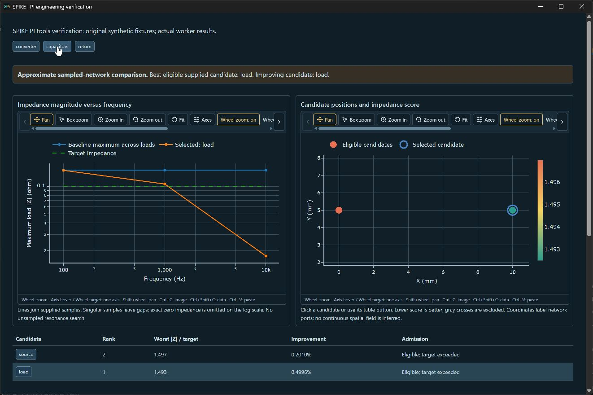
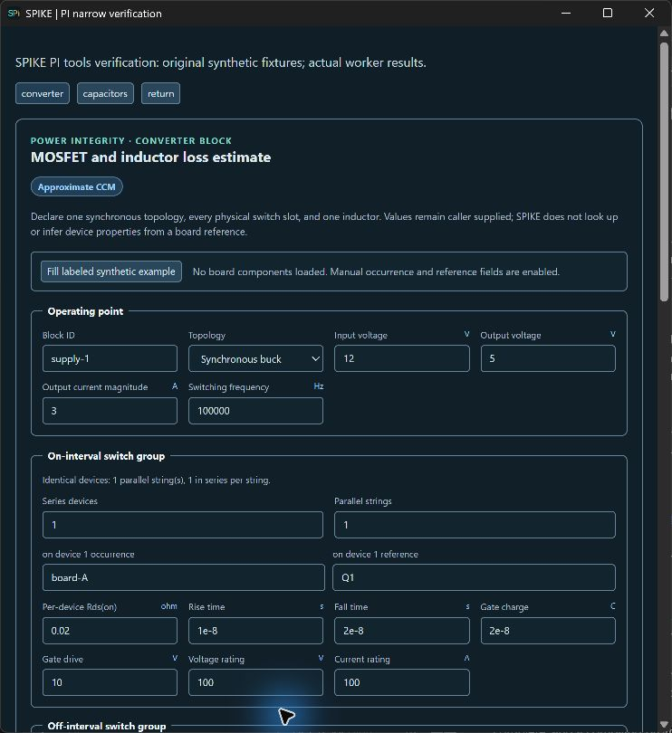

<!-- SPDX-License-Identifier: Apache-2.0 -->
# PI engineering tools verification, 2026-10-09

This is software verification of bounded approximate models using original
synthetic fixtures. It is not measured converter validation or knowledgeable
human approval for release.

## Numerical and integration evidence

- 37 focused Python tests passed for converter, capacitor comparison, copper
  return routes and actual worker/MCP dispatch. Converter tests include ideal
  analytical topology values, periodic RL integration against independent RK4
  refinement, conduction/transition/gate loss accounting, CCM/rating rejection,
  and snapshot isolation. Capacitor tests include direct complex nodal oracles,
  nonreciprocal transfer orientation, passivity, conditioning, frequency
  refinement, and 800 V/4000 A ripple rating exclusions. Return-route tests
  include analytical copper resistance across four mesh targets, disconnected
  copper and identity/geometry rejection.
- Focused React tests consume actual Python results for admission. They cover
  stale inputs, late responses, failure retention/recovery, exact snapshot
  matching, route application gates, curves and candidate selection. Existing
  project snapshot/persistence and PI terminal checks passed during integration.
  Converter and capacitor comparisons restore from PI setup snapshots; tests
  reject mismatched saved results, retain editable inputs and verify successful
  result callbacks. Large capacitor requests are admitted once at mount rather
  than re-parsed on every edit or candidate selection.
- Independent software review found no further concrete numerical defects in
  the tested envelope. A separate 60-digit exponential RL oracle agreed within
  5.8e-14 A for tested unequal phase-resistance cases. Incorrect advice to reduce
  load for low-load DCM was corrected. This review does not replace human review.
- Rust checks: 41 passed, one ignored. TypeScript, parser, button-standard,
  architecture and documentation checks passed. Production frontend build
  passed with existing large-chunk/mixed-import warnings.

## Full Python regression outcome

The full discovery run executed 2920 tests in 2032.679 seconds with 22 skips,
two failures and three errors. Two release-readiness cases exposed the missing
`$id` on the new return-path request schema; that identifier was added. The
other cases were a CalculiX execution timeout, a worker-protocol timeout and a
debug session still running at the test's completion deadline.

All five failing cases passed in an isolated targeted rerun (25.601 seconds)
after the schema correction. No solver timeout, test assertion or admission
gate was weakened. The full suite was not repeated after this correction; the
initial failing run and the successful targeted rerun are distinct evidence.
Local logs are `.local/pi-engineering-full-tests.log` and
`.local/pi-engineering-failure-recheck.log`.

## Native observations

The dedicated Tauri preview rendered actual worker-generated results from
the original fixtures. It does not substitute for a full retained real-board
study or hardware comparison.

At 1320 logical pixels, converter input controls and both capacitor Plotly
plots were inspected. The plots rendered the computed baseline/candidate
impedance curves, target, supplied XY locations and returned color scores.
At 740 logical pixels, converter fields and switch groups wrapped without
overlap. Other desktop activity interrupted the narrow capacitor click; that
specific narrow view was not accepted as observed.

Reproduce the preview by regenerating the fixture with
`scripts/prepare_pi_engineering_preview.py`, starting the frontend, and using
`app/scripts/fixtures/pi-engineering-native.config.json`. Numerical fixtures
are defined in the checked-in focused test modules. The preview is developer
verification tooling rather than an installed runtime dependency.

## Applicability

Converter output is steady CCM only, with declared operating resistances and
overhead. Copper routes are minimum series-resistance routes, not equivalent
terminal resistance or distributed current. Capacitor scores cover supplied
candidate ports/frequencies with one added capacitor and separate RMS ripple
scenarios. No continuous field, closed-loop switching, automatic thermal
deposition, general assembly EM or hardware qualification is claimed.
